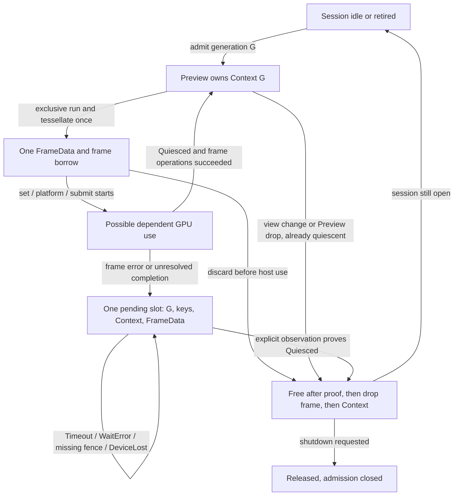

# DGUI-4C7B2C4B2A: fallible retirement and persistent host ownership

C4B1 PR #32 was verified at `9c76a020deb599fab6172b25260c695e090a136b`,
made Ready and merged normally as `2e516f718fa1cfd3e3d38fae56fe8a6e2afa3641`.
The approved HEAD is its second parent. Main was synchronized and clean before
creating `feature/dgui-4c7b2c4b2a-fallible-retirement`.

This implements the internal ownership change accepted from
[GLOW_DRAIN_PROPOSAL.md](GLOW_DRAIN_PROPOSAL.md). The infallible `drain()` and
`complete()` methods are removed. There is no Glow backend, native window, GPU
smoke, Runtime worker or device access. `ACTIVATION_QUALIFIED = false`.

**GPU lifecycle remains BLOCKED.** The state machine is checked with deterministic
ambiguous-work mocks and native CPU allocation measurements. These are not GPU
completion or VRAM evidence. The native root owner, GL adapter and terminal
device/context destruction remain separate review duties.

## API and ownership

`Preview::with_session(document, epoch, &mut HostSession<B>)` replaces the
backend-owning constructor. Only the explicit `CpuOnly` Preview may own an
inline session. Host Previews exclusively borrow one external session.
`PreviewFrame` still exclusively borrows Preview, keeps FullOutput private,
permits one tessellation attempt and consumes itself on finish/discard.

```rust,ignore
let mut session = HostSession::new(backend);
{
    let mut preview = Preview::with_session(&admitted, epoch, &mut session);
    let mut frame = preview.run(&observations, bounded_input)?;
    frame.tessellate()?;
    let frame_result = frame.finish(); // original result, never cleanup success
    let cleanup = preview.cleanup_outcome(); // separate pending/retired state
    // Handle these separately. No automatic render retry.
} // Preview transfers unresolved payload; it never waits in Drop.
let shutdown = session.shutdown(WaitPolicy::default());
// Released: dependent ownership discharged. Unresolved: retain this session
// AND its native current-context owner; do not leave the native root scope.
```

The final comment is a trusted native-runner requirement, not an event loop.
Rust borrowing prevents dropping or mutably reborrowing HostSession while its
Preview remains usable. It cannot enforce linear destruction of the final root
owner. **Dropping an unresolved HostSession destroys its CPU record and payload;
it is not supported shutdown or a recovery mechanism.** Its Drop does not wait,
invent quiescence or call `free` for unresolved work. A backend destructor must
not delete in-use resources. The future runner must keep the root and OS/GL
context alive on `Unresolved`, destroying them only under a separately established
terminal-release protocol. No leak, forgotten owner, panic/abort or indefinitely
blocking destructor implements that protocol here.

This final-root limitation is an explicit integration blocker. The crate-internal,
inactive API does not claim that arbitrary callers or backend destructors satisfy
GPU lifecycle safety.



An error after an operation starts is treated as possible physical GPU work.
The ledger registers a key **before** attempting its set and arms dependent use
before every set, platform operation and submit, including frames without new
uploads. Unattempted keys need no cleanup. Whole and partial updates retain their
per-ID order; eight fixed key slots and fixed sorted-ID scratch preserve bounded
processing. There are at most sixteen updates.

Backend CPU inputs are borrowed only for each synchronous call. Asynchronous
staging is host-owned and separately budgeted. Conservatively, the generating
Context, FullOutput, deltas and CPU meshes move into the one pending slot on
error. There are no clones, output queues, generation lists or second frames.

| Owner | Resource and bound | Lifetime and release |
|---|---|---|
| Preview | One Context generation and one CPU FrameData | Active presentation; moved to session on unresolved retirement |
| PreviewFrame | Exclusive borrow; no owned heap payload | One preparation/one tessellation attempt; finish, discard or Drop |
| HostSession | One backend, namespace and fixed pending record | Outlives Preview; retained through timeout/error |
| TextureOwner inside session | Eight keys, one possible dependent submission | Registers before attempted set; blocks namespace replacement |
| Pending slot | Original reason/frame error/initial wait, latest wait, moved payload | No new frame; released only after quiescence proof |
| Future native root/backend | Current OS/GL context, staging, textures, buffers, fence | Not implemented or GPU-qualified; outlives unresolved session |

`CleanupOutcome::Active` is not a draw acknowledgement. `HostCompleted` requires
all frame operations to succeed and backend `Quiesced`. CPU-only completion
remains distinct. A failed frame stays failed even if cleanup succeeds. Initial
completion failure is retained in `RetirementStatus::initial_wait`; later polls
update only `wait`. The first retirement reason and frame outcome never change.

| Frame result | Wait result | Ownership / cleanup result |
|---|---|---|
| Success | Quiesced | Frame acknowledged; namespace remains active |
| Set/platform/submit error | Quiesced | Original error; registered keys freed; Retired |
| Any frame error | Timeout, Failed or DeviceLost | Original error; same generation, keys and CPU payload Pending |
| Completion error | Later Quiesced | Original error and initial wait preserved; Retired, no render success |
| Preparation/tessellation failure or discard before host use | Structurally quiescent | No dependent operation; retire without backend waits |
| Shutdown with unresolved work | Timeout, Failed or DeviceLost | Unresolved; admission closed, same owner retained |
| Shutdown after retirement | Quiesced or no work | Released; repeated shutdown performs no wait/free |

`run` rejects pending/closed sessions before projection or Context allocation.
Document/owner/revision replacement and navigation return false while pending.
Repeated retirement preserves the first record. A new Preview borrowing the same
pending session cannot replace its payload. After proven retirement, an open
session may admit a fresh process-unique ContextGeneration. Shutdown permanently
closes admission even if later cleanup succeeds. Managed(0) in another generation
is a different key. No counter recycling or wrap is introduced.

## Fallible waits and finite work

`FrameBackend::wait(WaitRequest) -> Completion` distinguishes `Quiesced`,
`Unobserved`, `Timeout`, `Failed(WaitError | MissingFence | InvalidFence)` and
`DeviceLost`. Only Quiesced clears dependent use. Structural quiescence also
exists when no backend operation began. Timeout/errors never imply quiescence.
Only after proof does retirement free keys, drop FrameData, then its Context.

WaitPolicy caps these independently:

- At most 20 wait calls per explicit observation.
- At most 5 ms requested timeout per call.
- A monotonic application deadline of at most 100 ms, checked between calls.

Only Timeout permits another call within that observation. Wait errors, invalid
or missing fences, device loss and unobserved status return immediately. Zero
call/deadline budgets make no backend calls. WaitObservation reports attempts,
sum of requested waits, actual monotonic elapsed time and reached limits.
A driver operation can overrun its request and the application deadline:
**there is no absolute 100 ms wall-clock guarantee**. A deterministic test returns
after one simulated 250 ms call requested for 5 ms and preserves Timeout. Other
tests separate 20 immediate timeouts from 20 simulated 5 ms waits.

A non-completion frame error receives one bounded cleanup observation after
payload transfer. Unsuccessful frame completion already spent its budget and
gets no implicit second wait. Further observation requires an explicit
`poll_retirement` or `shutdown`. These never repeat upload, platform action or
draw. There is no scheduler/retry worker. Repeated polls replace one observation
without growing history.

A future Glow adapter must establish/flush a valid fence in its creating current
context, cover work that started before an error (including platform with no
sets), distinguish signaled/condition-satisfied from timeout/wait-failed, and
retain ownership with a missing/invalid fence. Genuine device loss cannot be
converted into a fabricated later Quiesced. Explicit mock proofs test a state
transition; they do not establish physical device-loss recovery.

## CPU qualification and reproducibility

Scope remains Windows x86_64 MSVC, pinned eframe/egui/epaint/egui_glow 0.36.2,
egui_plot 0.37.0, existing dev/release profiles, 1280x960 at pixels-per-point 1,
admitted events, bounded Unicode, one Plot/Context and serial CPU output.
Dependencies, features, profiles, B1 and finite geometry policy are unchanged.
Bounds remain 32 traces, 16,384 prepared points, 65,536 curve vertices and 98,304
curve indices. GUI tessellation totals can exceed curve-only counts.

```text
accounted = realloc_overlap_peak + 127 * peak_blocks + 65_536
allowance = 8_388_608 bytes, including B1's 512 KiB projection allowance
```

Pending FrameData/Context heap remains inside this allowance after moving to
HostSession. No active frame overlaps it. Session/ledger records add no heap
buffers. The fixed-storage regression conservatively charges the inline Preview
layout AND an external session plus Page/text/preflight scratch against 65,536.
Native mock host metadata is also separately reported as `host_fixed_bytes`;
real staging, driver memory and VRAM are not measured or declared free.

The measured Windows/MSVC fixed sizes are Preview 16,112 bytes,
HostSession with the unit mock 1,232, TextureOwner with CpuOnly 320,
FrameData 640 and Page 13,800. The conservatively checked combined subtotal
is **44,672 bytes**, below the unchanged 65,536-byte fixed charge. Both possible
frame headers are counted; only one heap payload may actually be populated.

The nine-case CPU/mock probe covers normal completion, timeout, wait-error,
missing-fence, invalid-fence, device-loss, upload-error, no-upload platform-error
and no-upload submit-error using production modules and the original meter.
Faults retain CPU payload, one key and zero frees after Preview Drop and during
25 unresolved polls. Polls assert unchanged live bytes/blocks, generation,
original error and operation counts. Only a separate injected Quiesced proof
allows final cleanup. `post_drop=0` describes **subsequent proven release**, not
the unresolved snapshot; `pending_retained`, `pending_keys` and
`frees_before_proof` record that snapshot.

See [gate record](FALLIBLE_RETIREMENT_GATES.txt) and its CSV/hash evidence for
final dev/release counts, measurements and commands. Historical C3/C4A/C4B1 CSVs
are preserved. Numerical qualification is allocator/configuration-specific,
alongside structural ownership bounds, not a universal guarantee for other
operating systems, fonts, DPI, allocators or dependency versions.

Both native profiles passed with the following maxima:

| Suite | Cases/phases per profile | Maximum accounted bytes |
|---|---:|---:|
| Geometry | 119 | 4,610,337 |
| C3 combined memory | 125 | 4,458,653 |
| Plot widget | 113 | 4,483,157 |
| Page traversal and lifetimes | 5,120 pages plus stress | 3,013,664 |
| C4A frame owner | 12 | 4,355,499 |
| C4B1 no-upload | 4 | 4,367,945 |
| C4B2A pending retirement | 9 | 4,367,945 |

The combined maximum remains **4,610,337 / 8,388,608 bytes**, with B1 included.
The new pending suite peaks at 3,590,538 requested bytes, 4,170,202 with realloc
overlap and 1,041 live blocks. Unresolved snapshots retain up to 2,992,214 bytes
(834 blocks), or 2,747,498 (835 blocks) for no-upload errors; all retain one key
and perform zero frees before proof. Native mock host storage is 1,496 fixed
bytes: the session's 1,232 already conservatively charged above, plus 264 bytes
of host-only control/counters. Actual GPU resources are absent.

All 308 targeted regressions pass in dev/release (301 previous plus seven new),
including v1 and architecture guards. Five compile-fail gates preserve exclusive
frame and session borrowing. Admission/conversion/export allocation probes,
formatting, warning-denied Clippy and diff checks pass. The preserved source
and numerical limits remain CPU MEMORY QUALIFIED in this fixed scope.

## Remaining blockers for C4B2B

- Public-API Glow upload/draw/error reporting in both profiles. The pinned
  painter's void/error-consuming calls cannot just be wrapped in successful
  Results; the existing preflight source audit remains relevant.
- A reviewed native root keeping the OS/GL context current and alive until
  release, including shutdown with pending work. Eframe's void on_exit is not
  that protocol; dropping the unresolved root is unsupported.
- Fence creation/flush/wait coverage, measured waiting policy and truthful key
  release. Backend `free` remains a trusted non-panicking post-quiescence release
  contract; the real adapter must establish it before Retired is GPU evidence.
- Terminal release after real wait failure/device loss. If bounded final
  context/device teardown cannot be established, GPU lifecycle stays blocked
  even after healthy-device smoke. No automatic abandonment API exists.
- Native dev/release smoke, GPU object counters and separate host staging,
  buffer/texture payload and driver/VRAM accounting: unmeasured in C4B2A.

No active v2 integration or next stage is authorized by mock results. This is one
implementation Draft PR for independent review, without merge or release.
