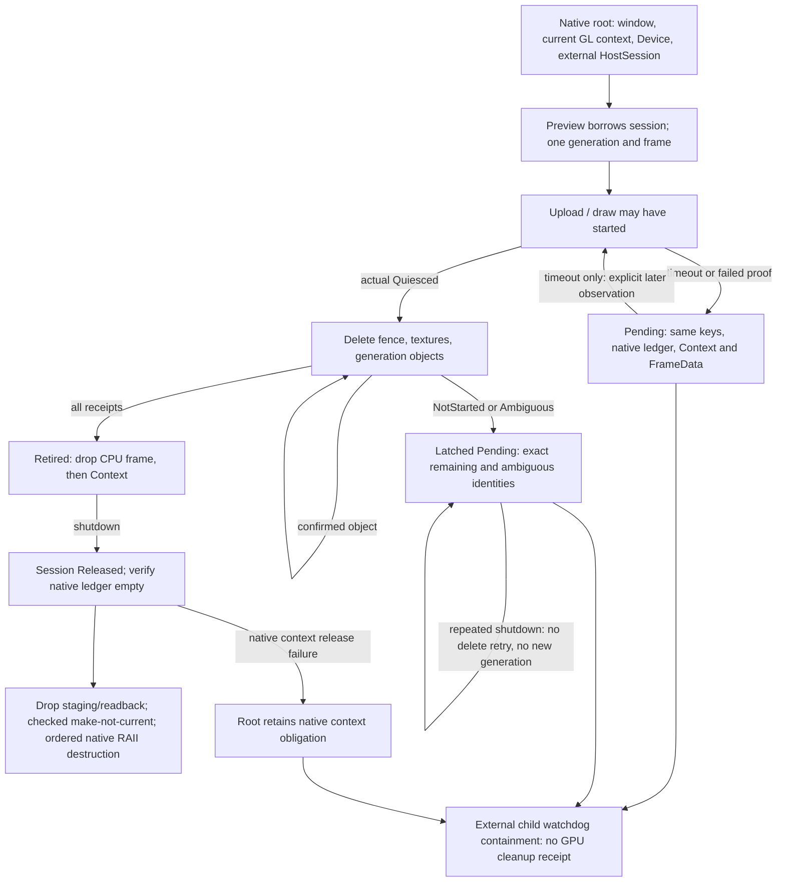

# DGUI-4C7B2B2: fallible deletion, terminal ownership and host budget

PR #34 was verified unchanged at
`f75c885cbbb9b14966fa28f51dd3b835910688cd`, made Ready and merged normally as
`76ec5620ff9feed0b536df3d7140f8d0a2f87635`. The reviewed commit is its second
parent. Main was synchronized and clean before creating
`feature/dgui-4c7b2b2-terminal-gpu-ownership`.

This is an internal, inactive ownership change and standalone Windows/MSVC
qualification. Runtime/Workbench APIs, DTOs, B1, FiniteTraceItem, the active v1
GUI, dependency declarations, Cargo.lock and profiles are unchanged. No physical
instruments, Runtime connection, activation or release are involved.
`ACTIVATION_QUALIFIED = false`.

| Independent qualification | Verdict and exact scope |
|---|---|
| GPU RENDER SMOKE | PASS: actual Windows GL pixels in dev/release, fixed 1280x960, scale 1 |
| HEALTHY GPU LIFECYCLE | PASS: real completion, confirmed own-object deletion, zero obligations before native context release |
| TERMINAL GPU LIFECYCLE | BLOCKED overall; normal release and timeout followed by real proof PASS; unresolved wait/loss/deletion/context teardown remain BLOCKED |
| HOST BUDGET QUALIFICATION | BLOCKED for the complete native root; controlled storage bounds below are qualified independently |
| HOST OWNED RUST BUDGET | BLOCKED for the whole host, including native libraries/fixture/inspection work; Device storage and fixed session metadata have a bounded contract |
| GPU RESOURCE PAYLOAD BOUNDS | PASS for owned textures/buffers/object counts and bounded command payload; excludes driver allocations |
| DRIVER/VRAM ALLOCATION UNCERTAINTY | Explicitly excluded from exact-byte qualification; calculated payload is not measured VRAM |

These verdicts do not transfer between categories. The existing isolated CPU
Preview allowance remains **8,388,608 accounted bytes**.

## Deletion and retirement contract

The old void `FrameBackend::free` let TextureOwner remove a key before learning
whether the native delete succeeded. It also could not account for remaining
pipeline objects after the last texture. The seam now requires three fallible
operations, with no successful default implementation for GPU hosts:

```rust,ignore
fn release_frame(&mut self, generation: ContextGeneration) -> DeletionResult;
fn free(&mut self, key: TextureKey) -> DeletionResult;
fn release_generation(&mut self, generation: ContextGeneration) -> DeletionResult;
// DeletionResult = Result<(), DeletionFailure>
```

`Ok(())` explicitly confirms the requested obligation's release. The backend must
establish its proof. `Err` carries an ObjectIdentity: creating generation, object
kind, original native name, and original TextureKey for a texture. Its disposition
is `NotStarted` or `Ambiguous`. These diagnostics use fixed storage.

TextureOwner removes a texture slot only after `free` confirms it. It keeps the
generation until completion objects, every registered key, and all generation
objects have been confirmed released. A pipeline deletion failure can therefore
leave zero texture keys and still retain Pending, Context and FrameData.

The first deletion failure latches the owner. Both dispositions prohibit any
automatic deletion retry, new frame or replacement generation. Repeated shutdown,
retirement polling and Drop cannot repeat that delete. Even NotStarted requires a
separately designed resolution protocol before retry; this stage adds no such
protocol. Completion polling cannot clear the deletion latch.

HostSession retains one pending generation and moves, rather than clones, its
Context and single CPU frame payload. It releases those only after every backend
obligation is discharged, in order: backend objects, FrameData, Context. Initial
wait evidence and the original frame outcome remain unchanged when cleanup later
succeeds or fails. Shutdown closes admission permanently.

| Error domain | Representation and effect |
|---|---|
| Frame execution | Existing TextureUpdate/PlatformOutput/Submission etc.; original FrameOutcome retained |
| GPU completion | FrameError::Completion plus Completion/WaitFailure and initial/latest WaitObservation |
| GPU deletion | FrameError::Deletion for frame cleanup, separately retained RetirementStatus::deletion for any cleanup failure |
| Native context teardown | Separate native-root failure after session/object receipts; root remains owned, no context destruction receipt inferred |

A frame with actual completion but failed fence deletion returns Deletion, not
HostCompleted. A failed submission remains Submission even when later completion
succeeds and shader deletion becomes ambiguous. A retirement receipt never follows
from zero keys alone.



Unresolved native roots keep running the event loop and ignore ordinary window
close. No mem::forget, artificial leak, glFinish, unbounded wait, replayed upload
or replayed draw implements cleanup. Arbitrary Drop of the final unresolved root
remains outside the trusted contract; Rust borrowing does not make it linear.
An unexpected event-loop error/exit with a retained root exits the child with
failure without Rust owner Drop; it is process containment, never cleanup or PASS.

## Native proof and bounded ledger

The seam remains public winit 0.30.13 / glutin-winit 0.5.0 / glutin 0.32.3 lifetime
control with a direct checked Glow 0.17.0 adapter. It does not use egui_glow
Painter's void upload/draw calls or the v1 painter. All raw GL stays in the
standalone device module; production Workbench still forbids unsafe code.

Native completion now stops at a signaled valid fence and returns Quiesced.
Fence deletion is a separate fallible operation. The native adapter checks the
creating current context/thread, calls delete once, observes its immediate GL
error, queries absence, and checks the query's GL error before clearing a handle.
Texture, buffer, shader, program and sync use their corresponding is-object query.
Because pinned Glow omits is_vertex_array, a checked GL 3.3 glIsVertexArray symbol
with its documented Windows ABI supplies the VAO proof. It has no library error
consumer. Failed proof preserves the exact handle as an ambiguous obligation.

The fixed ledger has at most 15 objects: eight textures, two buffers, two shaders,
one program, one VAO and one fence. Actual remaining handles are stored in their
fixed slots; one first-failure identity classifies the ambiguous/not-started slot.
No history, retry queue or generation list grows. Ledger snapshots are fixed
arrays. A name recorded ambiguous is not bound, drawn with, recreated or deleted
again.

One unshared context and owned bindings are part of the proof: texture binding is
removed, program/VAO/array-buffer bindings are removed, the VAO is deleted before
its buffers, and program deletion removes shader attachments before shaders are
deleted. Object-name absence alone would not discharge references held by another
context/container. See OpenGL 3.3 core specification sections 2.10, 2.11 and 5.1
([Khronos specification](https://registry.khronos.org/OpenGL/specs/gl/glspec33.core.pdf)).
The receipts establish our GL object obligations, not exact driver heap/VRAM reuse.

WaitPolicy still caps 20 calls, 5 ms requested per call and a 100 ms application
deadline checked between calls. Real fence creation/validation and flush precede
the dependent wait. Only ALREADY_SIGNALED/CONDITION_SATISFIED prove Quiesced.
Timeout/error/invalid proof/loss retain resources. Driver calls can overrun the
application deadline; there is no absolute 100 ms driver-time guarantee.
Native non-timeout completion failures latch permanently at this seam. Repeated
polls do not call GL with a quarantined sync handle. The fault tests remove the
simulated status after the first failure and check that the native latch still
blocks actual waiting, draw and presentation. Timeout alone permits a later proof.

## Healthy and terminal evidence

Both profiles use Windows x86_64 MSVC, Rust 1.95.0, AMD Radeon(TM) Graphics,
ATI driver OpenGL 3.3.0 Core Profile Context 25.10.30.02.250923. The RGB8/alpha8
drawable is 1280x960, scale 1, depth/stencil/samples zero.

The healthy sequence retains Page/Unicode, Plot, 32 traces and 16,384 prepared
points, coincident points, widths through 32, measurements, hover, zoom,
Plot -> Details -> Plot, retirement, next-generation full atlas upload and normal
shutdown. Controlled readback gives **32/32** matched trace positions and **85,972**
cyan pixels, versus **zero** in the no-data control. Repeat-frame hashes match;
measurement/zoom hashes change. Full -> partial green -> partial blue -> draw
reads blue at the center and background outside scissor.

Each profile records 21 submitted/completed frames, 76 draws, 596,028 vertices,
931,788 indices, six full and six partial uploads, 124 buffer reuses, 21 fences
and flushes, and **63 confirmed deletion calls**. Created/deleted totals are
textures 6/6, buffers 12/12, programs 6/6, shaders 12/12, VAOs 6/6, fences 21/21.
Final unresolved frames, keys, owned obligations and GL errors are zero.
Wait/timeouts vary with scheduling and are recorded in the profile transcripts.

Six new deterministic Rust regression groups cover both deletion dispositions,
each distinct buffer/shader identity, partial textures, frame-delta free, fence
deletion, original execution errors, repeat shutdown, Drop without a second
delete, admission blocking and later proof. Previous completion/missing/invalid
fence/device-loss mock tests remain. These are simulated failures.

The separate native fault matrix has **20 scenarios per profile**:

- Texture, buffer, shader, program, VAO and fence deletion before GL call and
  after the real delete may have started: 12 scenarios.
- Partial two-texture deletion; original draw error plus later shader deletion
  error; timeout then actual proof; wait failed; missing proof; invalid proof;
  simulated device loss; native context release failure: eight scenarios.

The wait injections occur after a real valid fence/flush, at the completion
observation boundary. Missing/invalid/device-loss statuses are simulations;
the probe never passes an invalid pointer to GL or claims an actual driver reset.
After-delete injections execute the real delete but withhold its confirming
observation and receipt. They preserve ambiguity rather than infer success.

The timeout-proof child retains all resources before proof, then removes the
injection and obtains actual native Quiesced, confirms all deletions and exits
normally. Draw/upload/frame counts remain unchanged. Its original failed frame
does not become a successful render. This qualifies category B in this scope.

The other 19 children retain the root. The GPU fault children check 25 repeated
shutdown/deletion attempts with unchanged exact obligations and deletion-call
counts; regular session faults also reject new Preview admission. Current context
and zero GL errors are checked. The partial native conformance test confirms texture
one, keeps texture two ambiguous and leaves six pipeline objects untouched. Its
root owns the raw native conformance ledger; the independent Rust regression also
checks the corresponding HostSession keys and moved CPU payload. Native teardown
and an idle-session shutdown receipt are not attempted for that unresolved native
ledger. A native context release injection instead retains the context after all
GPU objects were confirmed gone.

These children are terminated only by the external watchdog. This is containment,
**not a GPU cleanup receipt**. Native fault behavior is PASS as a regression
expectation, while terminal cleanup for category C remains BLOCKED.

## Windows teardown limitation and next choice

Pinned glutin WGL ContextInner::drop calls wglDeleteContext and discards its BOOL
result (`src/api/wgl/context.rs`). Its make_not_current_in_place path does check
wglMakeCurrent; the healthy root verifies it before dropping native owners in
context -> surface -> window order. No checked wglDeleteContext receipt is exposed
by this public seam, and no driver-time bound is established.
Thus A/B PASS refers to own-object release and the checked currentness/order gate.
The final native context-destruction outcome itself is still unobservable even
on that healthy path; no full terminal/context-destruction PASS is claimed.

[Microsoft wglDeleteContext documentation](https://learn.microsoft.com/en-us/windows/win32/api/wingdi/nf-wingdi-wgldeletecontext)
specifies success/failure and prohibits deleting another thread's current context.
[Microsoft wglMakeCurrent documentation](https://learn.microsoft.com/en-us/windows/win32/api/wingdi/nf-wingdi-wglmakecurrent)
describes currentness changes. Neither supplies a bounded teardown guarantee after
device loss or unresolved operations. Successful unbinding/RAII field order does
not substitute for those missing guarantees. Healthy own-resource cleanup remains
proven before native destruction; terminal destruction success is not inferred.

Minimal next architecture choice: keep v2 inactive, or explicitly choose an
isolated GUI child with a parent watchdog and bounded process memory/input policy.
Child termination would be containment, never Released. In-process terminal
qualification instead needs a reviewed supported context-destruction seam with
observable outcomes, exact unresolved-object resolution and an agreed driver/OS
scope. Directly deleting a glutin-owned raw context would risk double destruction;
this branch does not bypass its ownership. No further teardown work is started.

## Host and GPU resource accounting

Controlled Device storage now uses exact-length boxed byte slices. Staging grows
only to validated requested length; replacement has explicit old+new overlap.
Readback is one reusable exact framebuffer buffer, with no per-frame clone or
readback queue. All packing/draw work is bounded before pipeline allocation:
at most MAX_SHAPES native primitives and at most 2 MiB each of total vertex/index
packing per frame. Existing texture admission caps eight keys/sixteen updates.
Shader failure diagnostics no longer request an unbounded driver info log.

| Controlled storage/payload | Structural bound | Measured maximum |
|---|---:|---:|
| Staging bytes | 4,194,304 | 1,312,400 |
| Staging old+new replacement overlap | 8,388,608 | 2,624,400 |
| One readback buffer | 4,915,200 | 4,915,200 |
| Combined staging overlap + readback | 13,303,808 | Individual measured maxima are conservative, not a synchronized sum |
| Device / Root fixed layout | Fixed, no growing ledger | 6,824 / 1,424 |
| Native HostSession (included in Root) | Fixed | 1,408 |
| CPU Preview / CpuOnly TextureOwner | Existing fixed charge | 16,280 / 376 |
| Context generations / CPU frame payload slots | 1 / 1, including Pending | 1 / 1 |
| VBO / EBO logical store | 2,097,152 each | 1,312,400 / 395,592 |
| Simultaneous VBO+EBO store | 4,194,304 | 1,707,992 |
| Texture logical level-zero RGBA8 payload | 4,194,304 per key; 33,554,432 for eight keys | 262,144 total |
| Own GL object obligations | 15 | Healthy peak 8; partial two-texture generation peak 9 |

Font texture: 2048x32 RGBA8 = 262,144 bytes. Conformance texture: 4x4 RGBA8 =
64 bytes. Source CPU ImageDelta/meshes coexist with packed staging during upload;
backend does not retain mesh clones. One update can replace a previous texture or
buffer store; possible internal old/new driver copies are not measured VRAM.
At most sixteen bounded texture updates and bounded vertex/index payload are
issued in one frame. A nominal RGBA drawable image is 4,915,200 bytes; drawable,
compositor, shader executable, alignment and internal driver storage are outside
the owned texture/buffer payload contract.

Pending does not create another Preview Context, frame, staging queue or readback
buffer. The same fixed handles, staging/readback and at most the one moved Preview
payload remain owned. Deletion failure does not allocate a diagnostic history.
Healthy shutdown releases GL objects, CPU frame/Context, staging/readback, then
native currentness. Pending allocation readings are recorded separately from
successful shutdown; a watchdog exit is never a post-cleanup zero measurement.

The native global Rust meter includes fixture/inspection/native library heaps,
and excludes OS/driver heaps and VRAM. Both profiles measured pre-Preview live
1,778,483 bytes / 1,557 blocks and peak 3,987,706; rendering/shutdown peak
**12,420,002 bytes**, 3,246 peak blocks; after window/root destruction
**342,780 bytes / 31 blocks**. Reusing readback retains it during subsequent CPU
frames, so the process peak rises from B2B1's 9,066,176. This is a lifetime change,
not an increased Preview allowance or a raised pass threshold. The staging cap
remains the previous 4 MiB.

The native-only attribution meter has 8,192 fixed stack records (983,040 static
instrumentation bytes), bounded stack depth and nonblocking try_lock. It performs
no symbolization/allocation in allocator callbacks. All 31 outstanding requests
match the meter's byte total with incomplete=false. The launcher records an exact
MSVC link map; the offline resolver maps stack RVAs to preceding symbols. Release
inlining/external PCs reduce attribution detail; the dev stacks provide:

| Allocation-site attribution | Blocks | Bytes | Interpretation limit |
|---|---:|---:|---|
| winit Windows LayoutCache | 20 | 341,316 | Includes sixteen 21,008-byte modifier-map tables; pinned source has a static cache keyed by keyboard layout |
| Numpad/theme and ahash singleton sites | 4 | 112 | Identified allocation sites, not a complete lifetime proof |
| winit window/event-loop/queue/drop-handler sites | 6 | 1,288 | Retained ownership graph not proven; not classified harmless or as a leak |
| Deeper Vec allocation caller beyond captured depth | 1 | 64 | Attribution remains unknown |
| Total | 31 | 342,780 | No unknown block is declared harmless or a proven leak |

The scoped Device storage contract and fixed session metadata are bounded by our
code. A complete host Rust budget remains BLOCKED: winit's static LayoutCache can
add layouts, its event buffering/native metadata lack application-controlled
capacities at this seam, six retained owner-site blocks need a lifetime audit,
and 64 bytes remain unattributed. Fixture/inspection/loader and SDK heaps are
included in measurements but not falsely covered by the Device buffer ceiling.
This blocker is about native Rust ownership/work bounds, not a demand to know
universal exact driver VRAM. Controlled GPU payload qualification stays PASS.

## Regression evidence and reproduction

Both profiles pass **314 targeted regressions** (308 preserved + six new groups),
five borrowing compile-fail gates, 119 geometry, 125 C3 memory, 12 C4A frame,
four C4B1 no-upload and nine C4B2A pending cases. The unchanged geometry/memory/
frame/no-upload CSV rows match historical evidence exactly. Pending CSVs differ
only in host_fixed_bytes: 1,496 -> 1,664. Fixed owner/page subtotal remains below
65,536 (45,008 bytes, including external mock session). Widget/Page/Unicode/navigation, admission/conversion/export, v1
GUI/Plot/Confirm, architecture guards, formatting, Workbench and standalone
Clippy -D warnings, and diff checks pass.

CPU maximum is unchanged: **4,610,337 / 8,388,608 accounted bytes**. No quota or
FiniteTraceItem numerical policy changed. Native GPU/allocation runs are separate
processes from the CPU allocation qualification.

```powershell
./scripts/test-native-glow.ps1 -BuildProfile dev
./scripts/test-native-glow.ps1 -BuildProfile release
./scripts/test-native-glow.ps1 -BuildProfile dev -Faults
./scripts/test-native-glow.ps1 -BuildProfile release -Faults
./scripts/test-v2-renderer-allocation.ps1 -BuildProfile dev
./scripts/test-v2-renderer-allocation.ps1 -BuildProfile release
./scripts/test-v2-allocation.ps1
cargo test -p lab-workbench --locked -- gui::readonly_v2:: presentation:: gui::controls:: gui::app:: external::tests:: dispatcher::tests:: operator_boundary_tests:: model::read_binding:: --test-threads=1
# Repeat targeted tests with --release before --locked.
cargo fmt --all -- --check
rustfmt --check --edition 2024 scripts/support/native-glow-device.rs scripts/support/native-glow-smoke.rs scripts/support/native-allocation-meter.rs scripts/support/frame-owner-probe.rs scripts/support/retirement-probe.rs
cargo clippy -p lab-workbench --all-targets --locked -- -D warnings
git diff --check
```

See TERMINAL_GPU_{DEV,RELEASE}.txt, TERMINAL_GPU_FAULTS_{DEV,RELEASE}.txt,
TERMINAL_GPU_FAULTS_{DEV,RELEASE}.csv, TERMINAL_GPU_ATTRIBUTION_{DEV,RELEASE}.txt,
TERMINAL_GPU_PENDING_{DEV,RELEASE}.csv, TERMINAL_GPU_GATES.txt and
TERMINAL_GPU_SHA256.txt. Evidence transcripts omit raw ASLR addresses from the
healthy summary; complete child logs, map and PDB are reproducible under target.
Exact pinned dependency license evidence from B2B1 remains unchanged. Kernel32
stack capture and the installed MSVC link-map option add no package/toolchain.

Remaining integration blockers: category-C terminal/context destruction,
complete native host Rust work/storage contract, unresolved-object resolution,
unqualified GPUs/drivers/configurations, and separate activation approval.
One Draft PR is required for independent review; no merge or release is requested
for this stage, and no next milestone is started.
