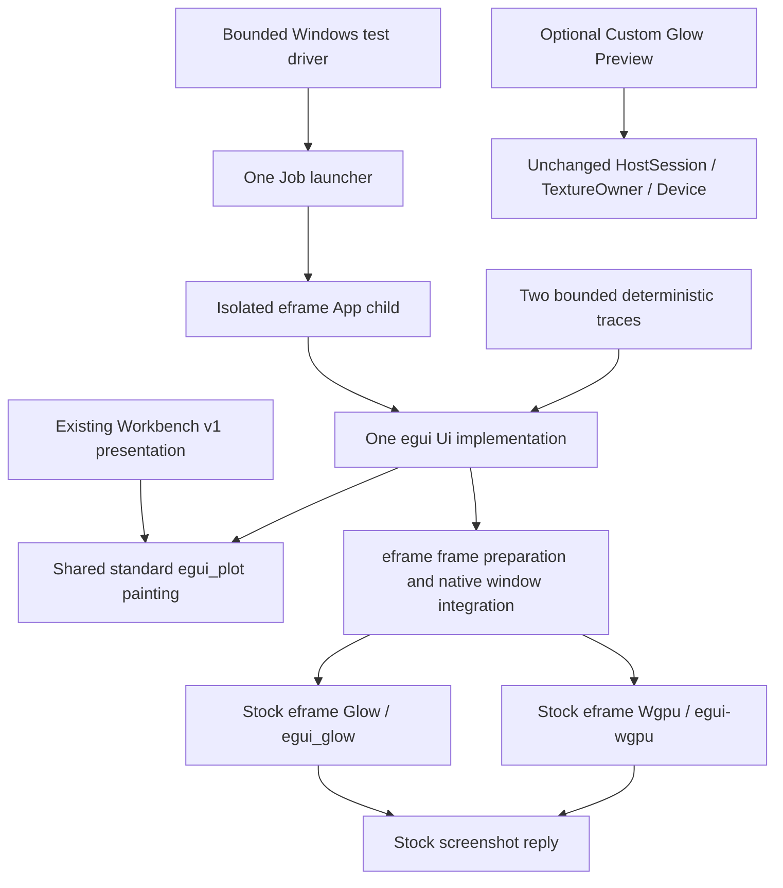

# EFRAME-1: Standard isolated GUI host

EFRAME-1 implements a **test-only native eframe application** in an isolated
Windows process. The primary GUI direction is standard egui/eframe: stock WGPU
is preferred, stock Glow is the alternative. This stage explicitly selects one
renderer per child; it implements no automatic fallback. Ordinary Workbench v1
startup remains unchanged. `ACTIVATION_QUALIFIED=false`.

The [implementation](../../scripts/support/eframe-host/src/app.rs) implements
`eframe::App::ui` and `on_exit`, and starts through `eframe::run_native` with
`NativeOptions.renderer = Renderer::Wgpu` or `Renderer::Glow`. It creates no
Device, Queue, RenderPass, swapchain, shader, texture manager, custom tessellation,
GPU completion or deletion framework. Screenshot requests and replies are stock
`ViewportCommand::Screenshot` and `Event::Screenshot`. PNG serialization only
reads the returned CPU `ColorImage`.

## Architecture and small shared boundary

The two graphics arrows are alternatives selected before startup, not two live
renderers. The independent test workspace does not link lab-core, a Runtime
client, Workbench dispatcher, recovery journal or private IPC endpoint. It has no
experiment authority or apparatus actions. A local display button and bounded
text field demonstrate display input only. No second Presentation model exists.

The existing v1 `show_observed_plot` already uses stock `egui_plot::Plot` and
`Line`. Its small painting loop and unique legend-name resolution now live in
[gui/plot_ui.rs](../../apps/lab-workbench/src/gui/plot_ui.rs). The caller passes
borrowed points, IDs, labels, color and width and retains its tooltip policy. The
existing v1 wrapper still derives values, source identity, freshness and units
from the same observations and document. There is no independent Plot renderer.
The helper allocates temporary curve/name views only; it retains no model or GPU
state, changes no admission or geometry quota, and does not affect CPU Preview.

The inspected readonly_v2 page, plot_widget, finite_trace and plot_projection
modules are coupled to bounded v2 navigation/projection and Preview frame
custody. They remain unchanged. Moving HostSession/TextureOwner or extracting
legacy GPU custody is unnecessary for a standard eframe App. Custom Glow's
source, ownership tests, native supervisor/private IPC and historical
B3B4C/PORT-1/RENDER-2A evidence remain available as an optional experimental and
educational implementation. Their later organization belongs to M-CLEAN.

## Explicit selection and isolation

The test launcher accepts `--launch wgpu|glow NEW_ABSOLUTE_DIRECTORY` and starts
the same executable with `--renderer wgpu|glow --receipts DIRECTORY`. There is no
environment-variable or hardware-fingerprint admission, no renderer retry and
no background Workbench v1 pump. Upstream eframe chooses its supported adapter
inside the explicitly selected standard renderer. Enumerating adapters within
stock WGPU is distinct from launching a second renderer incarnation.

The unchanged Windows Job capsule creates one suspended process, verifies
membership and configured limits before resume, observes exit on its original
process handle and retires original Job/process/thread handles. The raw HWND
reported to the fixture driver is diagnostic/input targeting only; a PID check
precedes each window operation. It is never used as an exit or containment proof.
Mouse/Unicode SendInput requires the original child to own foreground focus.
The driver briefly attaches Windows input queues to request real focus and
detaches them before sending input; it never fabricates egui focus events. No
graphics API is called by this automation.

The fixture driver owns a bounded one-byte stage file and finite receipt files.
These are not a proposed GUI protocol or changes to private IPC. The child has
at most two 128-point traces, a 64-character editor and six requested captures.
The driver tests three physical client sizes, zoom 1/1.5, input and close. Abort
and intentional UI stall follow a rendered first frame. There is no replacement
child within a launch. Parent integration and live Runtime observations are
reserved for EFRAME-2.

## Memory, dependencies and shutdown

The preselected test ceiling is **1,073,741,824 bytes** for both process and Job.
It is finite experimental containment for the standard window/swapchain/font/
screenshot path at several sizes. It is not a production memory policy and does
not inherit Custom Glow's 224 MiB or RENDER-2A's 768 MiB qualification. No cap is
increased on failure. A 90-second launcher deadline requests Job termination;
exit must be confirmed by 95 seconds. Failure retains original diagnostics.

Measurements report OS commit, not Rust allocator lifetime, GPU payload or VRAM.
The standard framework owns its own buffers, caches, staging and native objects;
EFRAME-1 does not claim separate bounds or deletion receipts for them. Normal
`on_exit`, return from `run_native`, process exit and handle retirement are
distinct receipts. Abort/stall do not promise `on_exit`. Process exit is not proof
of individual native GPU resource destruction.

The independent lock uses egui/epaint/eframe/egui-wgpu 0.36.2, egui_plot 0.37.0,
wgpu 30.0.1 and existing winit 0.30.13. Root manifests, lock and product features
are unchanged. Stock `eframe/wgpu` enables upstream backend features, including
Vulkan/DX12/GL on Windows; it is not restricted to RENDER-2A's offscreen DX12
feature graph. See the [dependency review](eframe-1-dependencies.md) and
[validation report](eframe-1-validation.md) for exact graph/license evidence.

## EFRAME-2 proposal, requiring independent approval

1. Review a small read-only adapter from the existing Parent-approved canonical
   document and selected snapshots into ordinary egui UI state. Preserve one
   Parent, one Application worker/client, one document/recovery authority and the
   existing external presentation API. Do not transplant Custom Glow GPU custody.
2. Connect the stock eframe child to the existing bounded private IPC and Job
   supervisor. Preserve original process-exit and IPC-retirement prerequisites
   before any replacement, and make shutdown/stall evidence explicit.
3. Test virtual Runtime continuity, scalar/Plot freshness and document replacement
   through the same Parent and external API. Display faults must cause no extra
   Runtime mutations, status or Exact Retry. Default v1 remains unchanged until a
   separate activation decision.
4. Qualify representative adapters, actual OS DPI/monitor transitions and finite
   memory policy separately. Linux/macOS need their own process adapters and
   integration tests. No automatic fallback or product activation is authorized.

MP-1 (16 MiB Job peak discrepancy) remains unresolved. SUP-1 has a separate small
test correction, with its original failure preserved; see validation. Historical
hello-only remains UNQUALIFIED; M17.4 Recorder overlap, general terminal GPU
lifecycle and whole-host Rust budget remain BLOCKED; final WGL destruction remains
LIMITED. Those historical Custom Glow limits are not replaced by stock eframe
smoke results. Other devices/drivers/DPI/platforms are untested rather than
blocked by a hardware whitelist. No EFRAME-2, release or activation follows
automatically from this proof.
