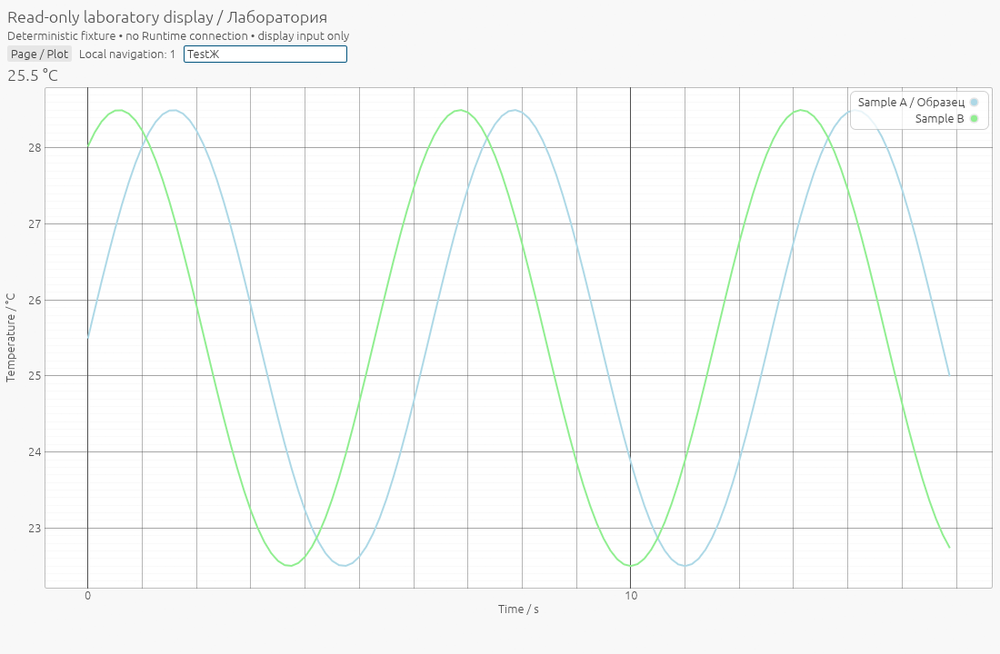
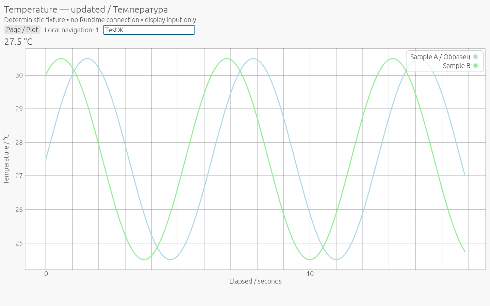

# EFRAME-1 validation and receipts

Scope: isolated **test-only** stock eframe WGPU and Glow on Windows/MSVC, with
one shared read-only egui UI. No live Runtime/Parent integration or production
activation. `ACTIVATION_QUALIFIED=false`. The [design](eframe-1-standard-host.md)
and [dependency review](eframe-1-dependencies.md) describe the implementation and
EFRAME-2 proposal.

**READY FOR INDEPENDENT REVIEW — EFRAME-1**, limited to this experimental host.

## Reviewed RENDER-2A merge

PR #46 remote HEAD `6912629e50cb458826723b403ff8c6913c9b6834` and base
`072bd36b32bdb6d5f9f9c13ff7880094d8073719` matched the reviewed identities. The
delta from qualified source `b05007fc64efdfc2e675fd485d5f5a9ef2a13b11` contained
documentation/evidence only; all 422 canonical SHA256 records were verified.
The PR was made Ready and merged with the ordinary merge strategy:

- Merge: `d8314efd32435b7b95891216c8a1d2a4753e9ec2`.
- First parent: `072bd36b32bdb6d5f9f9c13ff7880094d8073719`.
- Second parent: `6912629e50cb458826723b403ff8c6913c9b6834`.

Local main was fast-forwarded, the merge tree equalled the reviewed tree, and the
working tree was clean before `feature/eframe-1-standard-host` was created.
[Pre-merge](eframe-1-evidence/pre-merge.json) and [merge](eframe-1-evidence/merge.json)
receipts retain the checks. PR #43 remains open Draft/BLOCKED at
`04c0e5180a4bc45ae12c7b62fdb3b86ad8f10e7c`. No release was created.

## Source and tested hardware

Host qualification source: `eb36ff1e7d79e448af6e8a3b194480f55f203033`.
Final executable-source commit: `8cede781cf5e920bf2d64c7d466b5cb356494f56`.
The intervening change adds one module import to the existing allocation-test
wrapper; the host and all product Rust/Cargo inputs are identical. The earlier
root dev gates at `4da9da508b1c20d8b09c2895ff8b56924c1be3b2` likewise have the same
product Rust/Cargo inputs. Every command records its actual source, binary hash
and original result; no passing run overwrites a failed one.

Environment: Rust 1.95.0 x86_64-pc-windows-msvc, Windows 10 Pro build 19045,
Ryzen 5 9600X, actual selected NVIDIA GeForce RTX 3060 Ti. Stock WGPU selected
**Vulkan**, NVIDIA driver 616.92. Stock Glow reported **OpenGL 3.3.0 NVIDIA
616.92**, renderer `NVIDIA GeForce RTX 3060 Ti/PCIe/SSE2`, vendor NVIDIA
Corporation. WGPU adapter information is read from eframe's creation context;
Glow diagnostics come from upstream egui_glow logging, without application GL
calls. Vulkan's original layer-manifest registry warning is retained in logs.
The installed AMD iGPU was enumerated but not exercised as the selected adapter.
Hardware names are diagnostics, never admission conditions.

## Actual standard eframe frames and window behavior

Both dev and release execute the same UI with each stock renderer. The final
series contains 12 original child processes: normal, deliberate abort and UI
owner stall for each renderer/profile. Normal runs produce six stock screenshots
each; fault runs produce one before injection, for 32 successful-series captures.

| Behavior | WGPU dev/release | Glow dev/release |
|---|---|---|
| Native window, panels, Cyrillic/Unicode text | PASS | PASS |
| No-data display without fabricated scalar/curve | PASS | PASS |
| Scalar with °C; one curve, then two curves | PASS | PASS |
| Changed data, heading and axis text | PASS | PASS |
| Mouse movement/click; display counter; keyboard/Unicode text | PASS | PASS |
| Physical client areas 1100×720, 800×600, 1440×900 | PASS | PASS |
| egui zoom 1 → 1.5 → 1 | PASS | PASS |
| Windows minimize/restore | PASS | PASS |
| WM_CLOSE → CloseRequested → on_exit → run_native return → exit 0 | PASS | PASS |

The runner verifies the original HWND/PID and real foreground focus before
SendInput, with finite input-queue attachment/detachment to acquire focus. Mouse
position uses native client-to-screen coordinates. Unicode input becomes five
text events and `TestЖ` in the bounded local editor; the arrow key produces two
key events. These are injected OS integration events, not direct egui injection,
physical keyboard or IME composition qualification. The actual native scale is
1.0 / 96 DPI. Zoom testing does **not** prove OS DPI or monitor-change behavior.

Stock screenshot receipts include image dimensions, scale, input counts and
actual pixel counts. Offline PNG verification checks real colored plot pixels
in the plot area: none for no-data, blue only for one curve, blue and green for
two curves. Scalar/title/Unicode screenshots were also visually inspected.
Raster identity across backends is not required. All 24 normal PNGs and their
receipts are in [framebuffers](eframe-1-evidence/framebuffers.json); for example:

| Standard WGPU, dev, two curves | Standard Glow, dev, zoom 1.5 |
|---|---|
|  |  |

## Process and memory receipts

Each child is created suspended under the unchanged Job capsule. Membership,
active-process restriction and **1,073,741,824-byte** process/Job limits are
verified before resume. The cap was selected before trials and never increased.
The following maxima cover normal/abort/stall in the final series:

| Profile / stock renderer | Process commit peak | Job commit peak |
|---|---:|---:|
| Dev WGPU | 623,493,120 | 630,067,200 |
| Release WGPU | 606,613,504 | 613,187,584 |
| Dev Glow | 183,386,112 | 189,960,192 |
| Release Glow | 184,438,784 | 191,016,960 |

These are observations, not portable worst-case bounds. Earlier attempts are
also retained: the first failed WGPU dev run reached Job peak 640,081,920 and an
earlier successful Glow dev run reached 245,915,648. Neither exceeded the unchanged
1 GiB experimental cap. No Rust allocator, GPU payload or VRAM equivalence is
claimed; stock eframe allocation growth needs future memory-policy qualification.

| Fault / lifecycle | Observed result |
|---|---|
| Normal close | on_exit and run_native-return receipts, original exit 0 |
| Deliberate process abort after a frame | Original exit 3221226505; no normal cleanup receipt required |
| Deliberate UI owner stall after a frame | Launcher terminates original Job; original exit 92 |
| Original process/Job/thread retirement | All 12 cases confirmed; remaining capsule-owned handles `[0,0,0]` |
| Automatic graphics fallback/restart | Absent |

The handle result concerns the original handles owned by the capsule, with its
checked OS close path; it is not a system-wide handle-leak audit. Neither callback,
Rust drop nor process exit proves individual native GPU deallocation. These are
test abort/stall controls, not a comprehensive real device-loss qualification.
No Runtime process was started by this fixture, and no Runtime continuity/E2E
claim is made. See [processes](eframe-1-evidence/processes.json),
[memory](eframe-1-evidence/memory.json) and raw admission/exit diagnostics.

## Regression and development failures

The small shared Plot extraction is covered by 42 existing presentation tests
and the full Workbench suite. The original native supervisor and IPC controls
run in their unchanged scope. The CPU allocation/geometry/frame probes retain
all original scenarios and ten borrowing compile-fail controls. Custom Glow's
original frames, GPU Pending and 17-scenario fault matrix run in both profiles.
All requested final gates passed. The original failed allocation-wrapper compile
is retained as a separate failed receipt, followed by the corrected gate.

| Gate | Dev | Release |
|---|---|---|
| Standard host compilation and Clippy `-D warnings` | PASS | PASS |
| Stock WGPU / Glow normal, abort, UI stall | 6 cases PASS | 6 cases PASS |
| Full Workbench suite | 537 passed, 58 ignored | 537 passed, 58 ignored |
| Native Supervisor | 7 passed | 7 passed |
| Native private IPC | 22 passed | 22 passed |
| Original Job OS controls | 5 expectations PASS | 5 expectations PASS |
| Original Custom Glow frames / Pending / fault matrix | PASS / PASS / 17 scenarios PASS | PASS / PASS / 17 scenarios PASS |
| Full CPU Preview allocation/geometry/frame/retirement probe | PASS | PASS |
| Existing borrowing compile-fail controls | 10 PASS | 10 PASS |
| Product Workbench/native child/Job Clippy, all targets/features | PASS | PASS |
| Workspace and independent-host fmt / diff checks | PASS | PASS |

The v1 CPU smoke remains in the full allocation probe; the existing presentation
suite retains its unit/freshness/legend/zoom tests. Historical full B3B4C fixed-C
lifecycle/maximal gates and PORT-1 qualification retain their original scope and
evidence; these new runs do not shorten or replace those qualifications.

SUP-1 has a real, separate test-only correction at
`ff047c69ec5af96a2bc9414ae66a60d57406521b`: `Ready` is a snapshot, not a
reservation of the request mutex. The retirement test now tolerates `Busy` for
at most three seconds while arranging its stop; Busy admits no request. Production
Supervisor remains a single nonblocking try_lock. The separate test holding the
mutex still asserts immediate Busy. RENDER-2A's original failed release result
remains in its untouched archive; subsequent successes did not retroactively fix
that earlier run. This change does not add retries to Runtime operations.

Retained EFRAME-1 development failures:

1. Initial dev at `7c8e0a21016bf2a8b02413a2e69c28f721005a53`: a real WGPU
   screenshot was saved, then nested Context access in the receipt collector
   caused epaint's 10-second debug lock panic; exit 101 and original retirement
   were recorded. `9d69d0c` moves Context accessors outside `ctx.input`.
2. Corrected-dev input fixture: bare WM_CHAR did not produce text events through
   winit; all six frames existed, but the text assertion failed. The driver
   contained the original child and preserved the results. Complete native
   Unicode input replaced the incomplete message sequence.
3. First release input attempt: foreground verification failed before SendInput;
   the driver sent no characters to another window and contained its child.
   Final automation requests real OS focus and sends actual pointer input,
   rechecking ownership/focus before each operation. Diagnostic probes and their
   unqualified outcomes remain in raw evidence.
4. First CPU Preview regression failed compilation because its standalone wrapper
   did not import the newly shared plot module. Commit `8cede781` adds that one
   import; the original compile failure is retained alongside the corrected gate.

The early deprecated-method warning and Clippy is_multiple_of diagnostic are
also retained. Final warnings-denied builds use the corrected source.
The first offline PNG classifier also rejected LIGHT_BLUE because its B−G
threshold exceeded egui's actual 14-channel difference. The classifier was
corrected to tolerate antialiasing while rejecting gray grid/text; the original
collector diagnostic is retained. No renderer or framebuffer was changed.

MP-1 remains **OPEN**: RENDER-2A's 16 MiB run recorded Job peaks 21,614,592
(dev) and 21,524,480 (release), above 16,777,216. EFRAME-1 neither explains nor
reclassifies this discrepancy; successful 1 GiB trials and the unchanged native
32 MiB Job preflight are not an MP-1 fix.

## Artifact identities and remaining limits

| Standard host executable | SHA256 |
|---|---|
| Dev | `ddde4ac9fda522395c8165250126d4265212cab724e8b902fef2965164b6dbfb` |
| Release | `2e9922258565b8cc260fb37903097124872f2361f7f97a2d8cbf9568ca105982` |

[Source inputs](eframe-1-evidence/source-inputs.json),
[binary identities](eframe-1-evidence/binary-identities.json),
[host gates](eframe-1-evidence/host-gates.json),
[regressions](eframe-1-evidence/regressions.json),
[raw archive](eframe-1-evidence/raw-evidence.zip) and its
[per-member hashes](eframe-1-evidence/raw-manifest.json) preserve the actual source,
commands, initial failures, process receipts, upstream diagnostics and images.
The archive does not bundle executables. Historical B3B4C/PORT-1 and RENDER-2A
qualification records remain unchanged; fresh EFRAME smokes do not replace them.
The new archive contains **1,429 members / 9,635,388 bytes**, SHA256
`338fd7d9b5baa37d711d6fa19a404994f51d0355c6e6bcdb7afeca03450b9994`.
Every member was decompressed and checked against its length/hash. It includes
153 fresh Custom Glow raw framebuffer captures and 74 context records, including
intentional failures; those are not 74 healthy cleanup receipts. The source
inventory covers 446 versioned inputs. [Canonical SHA256](eframe-1-sha256.txt)
seals source inputs, report and evidence.

Remaining limits: MP-1; representative memory policy; actual monitor/OS DPI
transitions; hardware IME; other selected GPUs/drivers; Linux/macOS process hosts;
full graphics-device-loss coverage; real Workbench Parent/private IPC/virtual
Runtime integration. Historical hello-only remains UNQUALIFIED; M17.4 Recorder
overlap, general terminal GPU lifecycle and whole-host Rust budget remain BLOCKED;
final WGL destruction remains LIMITED. No public API, Runtime, OutputAuthority,
Recorder, Clojure client, GUI control or hardware command changes occurred.
EFRAME-2, merging EFRAME-1, release and production activation require independent
review and separate authorization.
