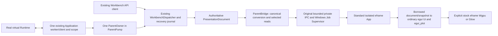

# EFRAME-2: real Runtime to standard isolated Workbench GUI

Experimental Windows/MSVC integration. `ACTIVATION_QUALIFIED=false`.
The default startup still runs Workbench v1. No release or production activation
is selected, and this branch must remain Draft until independent review.

## Ownership and launch



The parent composition is in `apps/lab-workbench/src/gui/isolated.rs`. It uses the
existing ParentOwner, ParentPump, dispatcher, ClientHandle, workspace ownership,
journal, endpoint and Supervisor. `parent.rs`, Runtime, Recorder, OutputAuthority
and the public Application/Workbench API contracts are unchanged. There is no
second client, presentation dispatcher, parser pipeline or mutable document model.

Build the independent EFRAME-1 host and the ordinary workspace executables:

```powershell
cargo build -p lab-runtime -p lab-workbench -p lab-native-child --locked
cargo build --manifest-path scripts/support/eframe-host/Cargo.toml --locked
```

Select the experimental host and its memory limit explicitly (absolute paths):

```powershell
./target/debug/lab-workbench.exe --connect 127.0.0.1:7420 `
  --workspace D:/lab/experimental-workspace --workbench-listen 127.0.0.1:7421 `
  --experimental-eframe wgpu `
  --experimental-eframe-child D:/rust_projects/lab-runtime/scripts/support/eframe-host/target/debug/lab-eframe-host.exe `
  --experimental-eframe-commit-limit 1073741824
```

`glow` selects stock `eframe::Renderer::Glow`; `wgpu` selects stock
`eframe::Renderer::Wgpu`. There is no automatic renderer fallback. The required
positive commit limit configures the process and single-child Job explicitly;
**1 GiB is only the qualification fixture choice**, never a deployment default.
The launch still verifies Job containment and limits before resuming the original
suspended child, and uses the original process/Job handles for exit and retirement.

An optional `--experimental-eframe-restart-limit 1` permits one controlled
same-renderer relaunch after containment. The default is zero, maximum three.
An explicit window close never consumes a restart. A new incarnation is admitted
only after the original process and both original IPC operations/handles retire.
Parent, client, scope, API endpoint and recovery journal remain the same.
The experimental observation deadline is eight seconds to include stock renderer
startup; other Supervisor policy remains unchanged. This is a finite experimental
liveness setting, not a thread-priority or device-loss qualification.

## Read-only document and drawing adapter

The host shares the original canonical v2 admission, Replica, selected LRD1 decoder,
SelectedSnapshot and Framed transport sources. The small `UiDocument` pairing
retains one immutable admitted CPU document. Replacement releases it before
calling the same canonical parser; malformed/superseded/stopped candidates cannot
produce Applied. Borrowing prevents replacement while drawing uses the document.
Existing four encoded credits, exact epochs, source/generation validation,
canonical bytes, transfer deadlines and receiver freshness latch remain intact.

The legacy renderer pairing methods were mechanically moved from neutral Replica
to `renderer_replica.rs`; Custom Glow still pairs its original DocumentOwner with
its exact HostSession. Stock host compilation does not import Preview, HostSession,
FrameBackend, TextureOwner, Device, Queue, fences or custom GPU textures. The pure
canonical target conversion is shared with the original read-only text adapter.
The only independent-manifest change is a direct serde dependency already present
at the same version in its qualified graph. Root Cargo manifests/lock are unchanged.
See [EFRAME-1 exact-version review](eframe-1-dependencies.md) and the EFRAME-2
validation inventory for the rechecked package/license/archive evidence.

ParentBridge can optionally follow display references from its authoritative v1
document. It selects at most 32 distinct supported references, preserving existing
source witnesses; a newly selected reference cannot gain provenance from a cache
alone. A selection/conversion failure fences the old child projection rather than
publishing a partial canonical document. Legacy explicit reference selection is
unchanged. Ordinary dispatcher admission and presentation revisions remain the
existing API contract.

`ui.rs` paints borrowed canonical windows, tabs, Status/Indicator and Plot roots.
It retains only window/tab/page positions, and calls the existing shared standard
Plot painting helper. It shows two panels and four roots per panel; additional
roots are explicitly outside this minimal adapter. Converted control groups and
all actions are inert. Local navigation is display-only. Replacing a document
clears the stock temporary widget/plot map, so obsolete revision IDs do not grow
without bound. Exact read epochs/incarnations, expected scalar kind, original
unit and freshness accompany the values. A requested incompatible display unit
suppresses the curve; no unit conversion or physical observations are invented.

The eframe logic callback services bounded IPC even while the window is hidden.
A current owner challenge takes precedence over a continuous stream of Applied
read receipts. Neither a heartbeat nor a GUI restart promotes stale observations.
Runtime loss may clear the source-fenced trace while retaining a stale scalar;
the empty Plot then honestly reports Stale instead of drawing invented history.

## Close, faults and diagnostics

Window close sends the small private `WindowClose` control variant, identifying
only a presentation lifecycle request. Parent requests the original Supervisor
Close, child stops new admission and completes its Closed write, then eframe
returns normally. Closed is a transport/lifecycle receipt, not GPU deallocation
proof. The Supervisor still requires original process exit and original IPC
retirement. The public API gains no operation and no Runtime request can be
encoded in this private message. Failure to finish close is bounded by the
existing containment path; unconfirmed exit never admits a replacement.

The child owns only its eframe state, immutable document and read snapshot bytes.
It has no Runtime transport, mutation sequencer, operation_status/Exact Retry,
recovery journal or apparatus command entry. Restoring display uses current
Parent-approved bytes, without reattaching or replaying the Runtime client.

`--experimental-eframe-capture` enables finite qualification diagnostics, not a
GUI command API: at most twelve screenshots per incarnation, stock Screenshot
requests/replies, fixed diagnostic files and bounded upstream logging. PNG work
uses a capacity-one queue with nonblocking overflow/drop; one worker owns at most
one additional image. Complete PNGs publish by rename only after serialization.
Diagnostics are best effort and never durability, GPU completion or process-exit
receipts. A diagnostic I/O stall cannot block the Runtime/Parent worker. The final
OS process boundary contains any remaining diagnostic worker; no disk or VRAM
cleanup proof is inferred from it.

## Qualification and remaining scope

The [validation report](eframe-2-validation.md) records actual virtual Runtime,
existing Workbench API, native windows, pixels, source/binary identities, memory,
normal close, crash/restart and regressions. Reproduce a finite case with:

```powershell
python scripts/support/eframe-host/e2.py dev wgpu unique-run-name fault
python scripts/support/eframe-host/e2.py release glow another-unique-run normal
```

The fixture uses a transparent loopback observer to record the original Runtime
client bytes. It sends no Runtime request of its own. A fault case separately
terminates the exclusively virtual Runtime to observe real Stale state; this is
not a GUI-caused disconnect or graceful Recorder shutdown receipt. Its SQLite,
WAL and SHM, when present, stay together in the unique ignored fixture directory.
No scientific data or user cache/worktree is deleted. Normal-only cases verify
that closing the GUI leaves the virtual Runtime process alive.

MP-1 remains OPEN. No internal GPU memory manager, deployment memory policy,
GUI apparatus controls/actions, automatic graphics fallback, Linux/macOS process
hosting, M-CLEAN, laboratory hardware trial, release or production activation is
included. Standard renderer/framework allocations remain upstream-owned. Process
and Job commit measurements do not establish individual GPU destruction or VRAM
reclamation. Historical #43 stays Draft/BLOCKED; its evidence is preserved.
