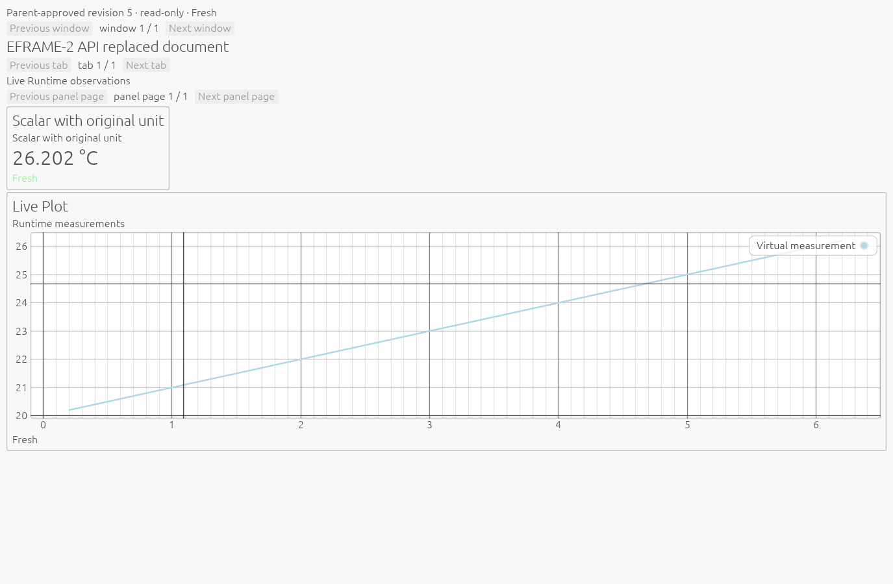
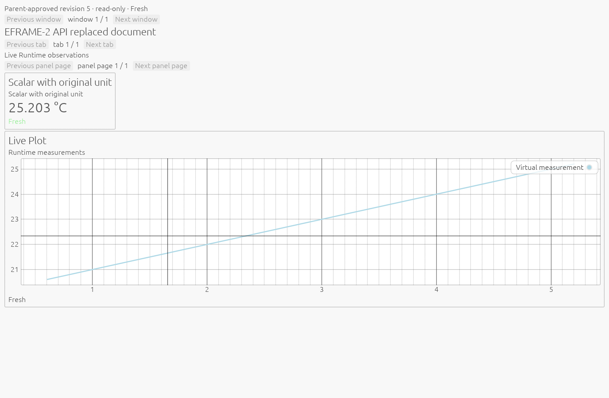

# EFRAME-2 validation: real Runtime to standard isolated Workbench GUI

Experimental Windows/MSVC integration; **Draft, pending independent review**.
`ACTIVATION_QUALIFIED=false`. No EFRAME-2 merge, release, hardware experiment or
production activation has been performed. The [design and launch guide](eframe-2-standard-integration.md)
describes the bounded composition and remaining display limitations.

## Reviewed EFRAME-1 merge

Remote PR #47 HEAD `a02af8b97c09e7086630aba388cb5ffc8ec15cb5` and base
`d8314efd32435b7b95891216c8a1d2a4753e9ec2` matched the user's independently reviewed
identities. All 491 canonical SHA256 records were checked from the remote HEAD.
Changes after final executable-source `8cede781cf5e920bf2d64c7d466b5cb356494f56`
were documentation/evidence only. PR #47 was made Ready and merged by ordinary
merge commit, then local main was fast-forwarded and confirmed clean:

- Merge `6205d6c1751420ecce4ae85c6d52a21b2d6c8264`.
- First parent `d8314efd32435b7b95891216c8a1d2a4753e9ec2`.
- Second parent `a02af8b97c09e7086630aba388cb5ffc8ec15cb5`.
- Reviewed and merge trees both `4fc6716b200e4f1be6d5a1275c109aa283091816`.

The EFRAME-2 branch was created only after that clean synchronization.
[Merge receipt](eframe-2-evidence/eframe-1-merge.json). PR #43 remains OPEN
Draft/BLOCKED at `04c0e5180a4bc45ae12c7b62fdb3b86ad8f10e7c`.

## Actual sources and environment

Implementation source: `0c82ded383025ae4f3d7454eac0fa5e7511e0a1e`.
The eight final E2E cases use committed source
`14dbef205b8438e6abd7e7caaadacbec08bbeac6`; its only additional change corrects the
fixture's expectation for an intentionally empty Stale Plot. All application
Rust/Cargo inputs are identical to the implementation commit.
A later test-only correction, `51d28103838fe574cb84d0cadd57b03fa81c8dfa`, handles
transient metadata Busy in the legacy Custom Glow retirement observer and adds
a deterministic unit. `e86e3cd291be45163ac41b9978141a39b23e12d6` also makes the CLI unit
use a native absolute test path without adding non-Windows process hosting. Both
follow-ups change test code only; the exact
[follow-up patch](eframe-2-evidence/test-only-followup.patch) is retained. Existing
full-suite evidence is reused, followed by the new observer tests and corrected
native Custom Glow gate. Subsequent changes are documentation/evidence only.

Rust 1.95.0, x86_64-pc-windows-msvc; Windows 10 Pro build 19045; Ryzen 5 9600X.
Both stock renderers actually selected **AMD Radeon(TM) Graphics** in these runs.
WGPU used Vulkan, driver string `25.10.30.02 (AMD proprietary shader compiler)`;
Glow's original framework log reports a desktop OpenGL 3.3 Core context and
`ATI Technologies Inc.` vendor. NVIDIA is installed but was not the selected
adapter in this E2E qualification. The EFRAME-1 NVIDIA observations retain their
original scope. No adapter fingerprint is an admission allowlist.

[Environment](eframe-2-evidence/environment.json), [source inputs](eframe-2-evidence/source-inputs.json),
[binary identities](eframe-2-evidence/binary-identities.json). The [dependency comparison](eframe-2-evidence/dependency-comparison.json) confirms
the same 168 active package versions/features and identical registry/license-file
hashes as EFRAME-1. Root manifests/lock and published license evidence are unchanged.
The canonical source inventory includes 457 versioned files in each of three source snapshots. Gate receipt
provenance, including the original runner's completion-time HEAD field, is
explained in [provenance notes](eframe-2-evidence/provenance-notes.json).

## Eight real end-to-end cases

For each dev/release and WGPU/Glow combination, the fixture starts actual
`lab-runtime.exe --serve --config ...runtime.toml` with an exclusively virtual
instrument and required Recorder in a new fixture directory. It starts actual
`lab-workbench.exe` in the opt-in mode; the existing Parent launches stock eframe
through its original Supervisor/Job and bounded private IPC. No mock Runtime,
mock Application worker or test-only replacement Parent is used in these cases.

The external fixture connects only to the existing local Workbench API. It calls
hello, client_status, presentation_get and ui_replace_document, with the current
Workbench identity/revision. Documents progress through live display, an absent
selected source, and a replaced heading/document. The real window displays the
parent's scalar with its original degree-Celsius unit and the changing real
virtual measurements as an egui_plot curve. Two distinct complete captures prove
advancing sample timestamps and point counts; this is not a deterministic child
fixture feeding its own fake measurement model.

| Behavior | Dev WGPU | Dev Glow | Release WGPU | Release Glow |
|---|---|---|---|---|
| Real virtual Runtime -> Parent -> child | PASS | PASS | PASS | PASS |
| Existing API get and document replacements | PASS | PASS | PASS | PASS |
| Heading, panels, scalar/unit and live Plot | PASS | PASS | PASS | PASS |
| Fresh, absent/unavailable, real loss -> Stale | PASS | PASS | PASS | PASS |
| Abrupt child exit -> bounded same-renderer restart | PASS | PASS | PASS | PASS |
| Current Parent-approved document restored | PASS | PASS | PASS | PASS |
| One Runtime client/scope; zero extra fault-caused requests | PASS | PASS | PASS | PASS |
| Normal close, original exit 0 and IPC retirement | PASS | PASS | PASS | PASS |
| Separate normal-only close leaves Runtime process alive | PASS | PASS | PASS | PASS |

The final series has **8 cases, 12 original child processes and 40 verified key
PNGs**. Complete PNG signature/IEND, chunk CRCs and decoded pixels are checked.
Where metadata reports a real curve, blue curve pixels must be present in the
Plot area. Original unit/title/panel captures were also visually inspected.
The actual stock screenshots are 1375x900; no OS monitor/DPI transition or IME
qualification is claimed. These are framebuffer screenshots from a real native
window, not reconstructed SVG/HTML or simulated UI frames.

| Dev stock WGPU after API replacement | Release stock Glow after GUI restoration |
|---|---|
|  |  |

[All case results and pixel checks](eframe-2-evidence/e2-results.json); additional
live/replaced/restored/stale images are beside that file. The complete Workbench
API conversations, original client NDJSON bytes, ready/window identities, callback
receipts and all final screenshots are retained in the raw archive below.

## One client, no display-caused apparatus work

The loopback observer relays original bytes to the actual Runtime. It creates no
hello/scope/request of its own. Before and after child crash/restoration, the
same Workbench identity and Runtime scope remain, with exactly **one established
Runtime connection** and **zero additional Runtime requests of any kind**.
The Runtime process is still alive after the GUI crash. The actual restored sample
timestamps advance beyond the pre-crash replacement capture in all four fault
cases: [continuity checks](eframe-2-evidence/runtime-continuity.json). Each final case's entire
recorded request inventory contains only:

`hello`, `discover`, `measurements_current`, `reference`, `recording_status`,
`configuration_properties`, `discover`, `subscribe`.

No Runtime mutation, operation_status or Exact Retry is observed. The separate
local Workbench API connection adds no Runtime client slot. The child build has
no Runtime client, mutable dispatcher/model, mutation sequencer, recovery journal
or apparatus command interface. The original dispatcher still admits all external
presentation changes; GUI restart never calls a Runtime recovery operation.

The fault fixture then independently terminates its own **virtual Runtime** to
supply a real transport-loss/Stale observation. This intentional reset is distinct
from the earlier GUI crash and may produce the preserved relay WinError 10054.
It is not a graceful Recorder flush/durability receipt. Existing source-fence
semantics can clear the trace on loss while retaining a stale scalar; the blank
Stale Plot is expected and cannot be replaced by invented curve pixels. Required
Recorder, WAL/SHM, when present, remain together in the ignored unique fixture
folder; no scientific data or user cache/worktree is removed.

## Original process, IPC and memory evidence

For all 12 final processes the unchanged Job capsule verifies atomic containment
and explicit process/Job limits before resume. Every crash and normal-close final
receipt has original Job/process/thread object counts `[0,0,0]`, IPC handles `0`,
pending I/O `0`, and `ipc_retired=true`. A second incarnation is permitted only
through the existing Supervisor after those original obligations retire.
Normal close also records on_exit, a completed Closed write, run_native return,
and original exit code 0. Abrupt exit requires no normal callback/cleanup receipt.
The normal-only cases additionally verify that Runtime remains running.

All cases explicitly choose **1,073,741,824 bytes** for the process and Job. The
CLI requires a positive cap and supplies no deployment memory default. No cap is
raised on a failure. Maxima across the final normal/fault cases:

| Profile / renderer | Process commit peak (bytes) | Job commit peak (bytes) |
|---|---:|---:|
| dev / wgpu | 458,719,232 | 465,285,120 |
| dev / glow | 175,525,888 | 182,099,968 |
| release / wgpu | 439,689,216 | 446,259,200 |
| release / glow | 152,367,104 | 158,924,800 |

[Memory](eframe-2-evidence/memory.json). These are OS commit observations, not
Rust allocations, individual GPU object lifetime or VRAM reclamation proofs.
MP-1's earlier 16 MiB Job peak discrepancy stays **OPEN**; these 1 GiB tests neither
explain it nor establish a deployment policy. No internal GPU memory manager is
introduced.

## Regression gates and preserved failures

| Gate | Dev | Release |
|---|---|---|
| Workbench existing full suite at 14db | 542 passed / 58 ignored | 542 passed / 58 ignored |
| Follow-up deterministic Busy observer | 1 passed | 1 passed |
| Final CLI opt-in/path regression | 1 passed | 1 passed |
| Real default v1 window/API/normal close | PASS | PASS |
| Native Supervisor | 7 passed | 7 passed |
| Native private IPC | 22 passed | 22 passed |
| Original Custom Glow native suite including 17 faults/maxima | 13 passed after harness fix | 13 passed |
| CPU allocation/geometry/frame/retirement and borrowing controls | PASS / 10 compile-fail | PASS / 10 compile-fail |
| Product and stock-host Clippy, warnings denied | PASS | PASS |
| Workspace/stock fmt and diff checks | PASS | PASS |

The original dev Custom Glow run is preserved: 12 passed, one failed at
`FaultHarness::retired()` because `Bridge::status()` returned its documented
nonblocking `IPC metadata busy`. A Supervisor terminal snapshot does not reserve
the bridge mutex. The follow-up test now observes that same metadata within the
existing finite test deadline, then keeps every original retirement/credit
assertion. A deterministic Busy-then-not-retired sample verifies that Busy neither
panics the observer nor becomes retirement evidence. Production try_lock,
Supervisor, process/IPC retirement and Runtime behavior are unchanged.
The corrected dev native suite passes all 13 cases. Release's original 13-case
pass remains intact. This is a separate test correction, not an explanation or
resolution of MP-1.

Other development attempts remain separately labeled and excluded from the final
eight-case qualification: an initial attempt hit heartbeat/close deadlines with synchronous PNG work and
receipt-first scheduling; the next relay fixture retained its peer after an intentional
Runtime reset, preventing real Stale detection; an existence-only collector could
accept an incomplete PNG; and a strict first pixel classifier incorrectly required
a blue curve for an intentionally empty Stale trace. The final implementation
uses standard App::logic for progress, prioritizes challenges, serializes images
through one bounded worker, publishes complete PNGs by rename and checks actual
PNG bytes/metadata. The original weak collector's behavioral-pass JSON is retained
as an unqualified development attempt, not counted as successful pixel evidence.
One overlapping test relink also hit MSVC LNK1104 while the preceding test executable
was still running; its receipt remains, followed by a pass after original exit.

The historical EFRAME-1, #43, B3B4C, PORT-1 and RENDER-2A records are not rewritten.
The final E2E binary SHA256 values are:

| Profile / executable | SHA256 |
|---|---|
| dev / lab-runtime.exe | `4cbf0d751c20541bfbbe7ad70e453f7e89dda1529f8b5a4c438daa0605cfb45b` |
| dev / lab-workbench.exe | `6ce12093528eb5b14ec2182a42f3cfc127c3323809395604ce0e8c88c0bb8cce` |
| dev / lab-eframe-host.exe | `ccdc7792067b84878a5bd8addf5af6c2e5d6e31c4e10f16c0dfa4965b04901dd` |
| release / lab-runtime.exe | `95e94193d86734dae28947e077620c894f5aa1371e94cf0ed5dd216830e10f79` |
| release / lab-workbench.exe | `dd9aacaec6f4f265f83551f4ea698636a56d10effe4b68fa41daf0d339dc98d2` |
| release / lab-eframe-host.exe | `c85484268bb81fb0bb5f25e6647c41134f7f9244b6df2abe424e01e7734c2550` |

## Artifacts and limits

The [raw archive](eframe-2-evidence/raw-evidence.zip) contains **2,412 members /
24,982,172 compressed bytes**, SHA256
`3aabe821ceac97a95a552db070b7b9e22b0d18a058059ae9dfb8da7172117041`. Every member was decompressed and verified
against its original length/SHA256 and ZIP CRC. [Per-member manifest](eframe-2-evidence/raw-manifest.json),
[verification receipt](eframe-2-evidence/verification.json), [all 35 required gate receipts](eframe-2-evidence/gates.json).
The archive retains original development failures, partial/unpublished captures
and the original failed metadata-Busy/LNK1104 receipts as unqualified attempts;
those do not count toward the eight successful E2E cases or forty verified key PNGs.
Default v1 dev/release native smokes also passed, with a real window owned by the
Workbench PID, real API freshness/presentation, exit 0 and Runtime still alive. No executable, dependency cache, private key or published
release artifact is bundled. Only virtual fixture data is exercised. The real
laboratory/hardware, other adapters/drivers/platforms, arbitrary graphics-device
loss, GUI actions, automatic renderer fallback, production memory policy and
production activation remain outside scope. M-CLEAN is not started.

Canonical SHA256 records for changed source, report and evidence are in
[eframe-2-sha256.txt](eframe-2-sha256.txt). No executable inputs change after the
qualification/test-only follow-ups; the final report commit changes documentation
and evidence only.
