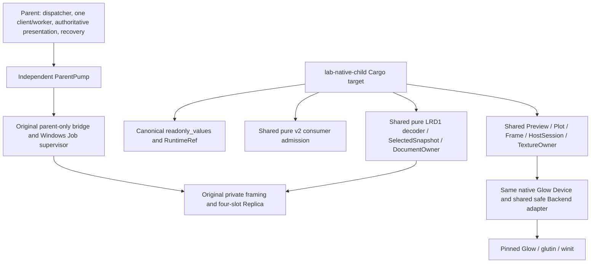
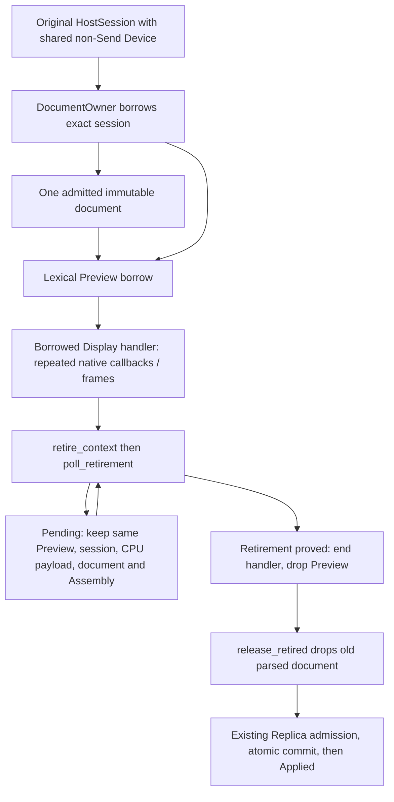

# DGUI-4C7B3B4B: read-only consumer and first isolated frame gate

**FIRST ISOLATED REAL GL FRAME FROM PARENT-APPROVED READ-ONLY SNAPSHOTS — PASS.**
The verdict concerns the B3B4B fixed Windows profile. Full B3B4 lifecycle and
memory qualification remains **BLOCKED**. `ACTIVATION_QUALIFIED=false`.

Qualification source: `1d297ad885b0e97069033d60e75a910c880a8ce1`.
The final documentation/evidence commit changes no executable inputs from it.
The dev/release matrix and exact binary/source hashes are in the evidence inventory.

Evidence: [verified matrix](first-isolated-renderer-frame-evidence/verification.json),
[commands and timings](first-isolated-renderer-frame-evidence/gates.json),
[native results and memory milestones](first-isolated-renderer-frame-evidence/native-results.json),
[binary identities](first-isolated-renderer-frame-evidence/binary-identities.json),
[compiler graph](first-isolated-renderer-frame-evidence/child-compiler-inputs.json),
[source boundary audit](first-isolated-renderer-frame-evidence/source-boundaries.json),
[raw archive](first-isolated-renderer-frame-evidence/raw-evidence.zip) and
[member manifest](first-isolated-renderer-frame-evidence/raw-manifest.json).
The [outer SHA256 inventory](first-isolated-renderer-frame-sha256.txt) covers the
report and evidence. Actual GL examples:
[dev selected Plot](first-isolated-renderer-frame-evidence/dev-selected-plot.png),
[release selected Plot](first-isolated-renderer-frame-evidence/release-selected-plot.png),
[release scalar](first-isolated-renderer-frame-evidence/release-scalar.png),
[replacement](first-isolated-renderer-frame-evidence/release-document-replacement.png).
[Image provenance](first-isolated-renderer-frame-evidence/frame-pictures.json)
links each PNG to the original RGBA member and SHA256.

## Reviewed merge and source identity

B3B4A PR #40 was independently accepted at
`25ca736074e304d83c1c74b03d5dca5d16697e41`, qualified source
`6b0646befac13d730d2718c9eb69798edf536ca5`. Its title/description were narrowed to
admission handoff, native capsule and selected provider, explicitly stating that
there was no renderer child. Remote HEAD and base were unchanged; PR #40 became
Ready and was merged normally as `754857771b6fb55491599817010871736f748027`.
Its exact parents are:

1. `76c2ae718c7c1f368ccf7b9bb90dbb7540ab19a2` (previous main).
2. `25ca736074e304d83c1c74b03d5dca5d16697e41` (reviewed PR head).

Local main was synchronized and clean before creating
`feature/dgui-4c7b3b4b-first-isolated-frame`. B3B4A evidence remains unchanged.
Qualification source and the separate final documentation HEAD are recorded in
the evidence inventory; no release, activation or B3B5 work is included.

## A–C: shared safe consumer

[`readonly_values.rs`](../../apps/lab-workbench/src/readonly_values.rs) now owns
the single Freshness, LivePoint, ScalarKind, ReadQuality, ReadAbsence and ReadBinding
definitions and the 4096-point parent ring constant. Old private model paths
reexport them. The serde-only RuntimeRef/ConfigurationOwner source is reused
directly. Runtime/Application DTOs and the mutable model owner are unchanged.

[`ReadOnlyProvider`](../../apps/lab-workbench/src/gui/readonly_v2/observation_source.rs)
provides synchronous borrowed scalar inspection, a borrowed point iterator,
original freshness and optional child epoch/incarnation. The callback bounds the
lifetime of the parent's existing frame-local TypedRead result; the existing typed
resolver is reused. [`readonly_cache.rs`](../../apps/lab-workbench/src/readonly_cache.rs)
implements this adapter over the original RuntimeObservations cache, without
creating a model, point Vec or snapshot copy. Oversized text is rejected before
the existing resolver can clone it. The parent cache has no invented child identity.

SelectedSnapshot implements the same consumer directly over validated LRD1 bytes.
It preserves typed values/absence, unit, quality, original boot/projection/revision,
entity revision, generation, timestamps/cursor, source floor and original points.
The independent non-current latch only downgrades freshness. Global Unknown,
Rebuilding and Stale fences remain effective. The existing codec also rejects
falsely Fresh entries before publication. Successful heartbeat cannot clear the
latched non-current state.

Preview::prepare/run_plot, Page::prepare and read::data/entity/typed now use the
provider. Plot projection and decimation iterate copied individual LivePoints
from borrowed cache/encoded storage into the **existing** final point arena.
There is no new retained point Vec. Both scans of each visible source, including
repeated LRD1 references, reserve the unchanged MAX_POINT_VISITS before scanning.
The 16384-point output bound, FiniteTraceItem, shape/geometry limits, B1 and 8 MiB
Preview allowance are unchanged. The maximum per-source LRD1 input does not
authorize 32 repeated scans outside that visit budget.

LRD1 does not contain raw entity JSON or source buffer eviction counts. The child
shows raw entity presentation as unavailable and displays eviction counts as
`unavailable`; it never substitutes zero. The parent adapter retains its actual
cached raw entity and actual dropped-count semantics.

The CPU SelectedSnapshot gate covers canonical admission, scalar `-0.0` and unit
`V`, exact selected trace coordinates, source/generation/epoch fences, absence,
stale/rebuilding/unknown states, bounded geometry and rejection of repeated-source
visit overflow. It ran in dev/release before native execution. Existing handoff
instrumentation still observes **at most one actual admitted document**, four
encoded slots and zero persistent parsed documents in the no-GPU consumer.

Audit also found two parent-adapter freshness defects in the initial source:
the pre-clone oversized-scalar path and raw entity presentation could use global
Fresh while their individual entry was Stale. Two real Preview regressions failed
before correction. The fallback now retains entity freshness, and a raw borrowed
entity carries its own freshness together with its value. These are internal
consumer changes; the original typed resolver and active v1 are unchanged. The
first final-suite attempt was stopped for this correction; its completed results
and partial CPU-probe output remain evidence, not final-source qualification.

## Cargo and protected dependency graph

[`presentation/v2/consumer.rs`](../../apps/lab-workbench/src/presentation/v2/consumer.rs)
contains the existing admission items and safe modules once. Workbench includes
those items at the original v2 scope and adds parent-only conversion/export/v1
syntax there. The child compiles the same consumer source directly. Numeric wire
and document limits moved once into readonly_limits and retain old internal
reexports. The original LRD1 decoder/scanner moved once into read_decode; the
parent encoder/Plan remain outside the child. No admission or decoder algorithm
was copied into a second implementation.

The child Cargo/source graph contains no Workbench model/client/dispatcher,
external API server, recovery journal, Application worker, Runtime client,
OutputAuthority or experiment authority. Its test harness is disabled as a Cargo
binary test target; Workbench owns CPU/native qualification tests. The same native
Device source remains the sole local unsafe module, private and non-Send.
Workbench and protected packages keep unsafe_code=forbid. The safe FrameBackend
adapter moved from the standalone witness to a shared source used by both targets;
its completion/deletion forwarding logic is unchanged.

Cargo compilation/Clippy and negative E0277/E0453 proofs cover the real target.
Cargo.lock changes only local dependency edges; third-party versions/checksums
are unchanged. See the source-boundary and compiler-input inventories for exact
definitions, protected files, dependency edges and binary hashes.

## D–F: native ownership and actual frames

The [`entrypoint`](../../apps/lab-native-child/src/entry.rs) is an experimental
qualification target, not a product host. It connects the original two private
pipes and validates the original parent PID/identity. Launches use the existing
atomic Job startup; no second supervisor or watchdog worker is introduced.
The Job's existing executable-directory cwd and SystemRoot-only environment are
preserved. Evidence paths derive from that cwd plus parent PID, Workbench identity
and incarnation, so earlier sessions are not overwritten.

Winit's pinned Windows pump_app_events accepts a borrowed ApplicationHandler. A
Preview lives continuously in a lexical document scope while that handler borrows
it across callbacks. Redraw work stays inside RedrawRequested. There is no owning
self-reference, raw-pointer lifetime cast, transmute, leaked reference or new unsafe.
Frame preparation releases the selected view before GPU wait/readback. Local
keyboard/pointer/focus/IME input is bounded and stays in the child; it cannot
submit Runtime work. Unsupported drawable size/DPI prevents drawing/readback.

Ordinary replacement never uses terminal shutdown. Pending does not admit a new
generation or release CPU payload. The native code reuses original Device,
Preview, HostSession, completion/deletion and TextureOwner implementations.
Display incarnation, PresentationEpoch, ContextGeneration and GL object identities
remain distinct. Type/CPU proofs are **not** native completion/deletion evidence.

The harness checks no-data, scalar/unit, selected Plot, live update
and document replacement against actual GL readback. It starts one ParentPump,
one parent presentation owner and an explicitly virtual bounded Application-worker
fixture. It publishes through the actual parent bridge and checks the external
Workbench API/recovery and zero additional Runtime submissions. The intended
readback size is exactly 1280 * 960 * 4 = **4,915,200 bytes**. Captures/admissions
and test lifetime are explicitly bounded; these evidence bounds are not product
document/Preview quotas or deployment policy.

## Owner progress, faults and recovery

The actual child performs Hello/HelloAck, canonical admission, selected observation
admission, Preview preparation, original texture upload/mesh submission, actual
completion observation and GL framebuffer readback. The no-data control has zero
cyan trace pixels. Scalar labels contain the actual selected value and Runtime
unit. The 64 original LRD1 points produce a visible curve; adding point 65 changes
actual pixels. Replacing the document changes the y-axis after checked retirement
and gives a distinct framebuffer at presentation revision 3. Curve sample checks
inspect the actual RGBA readback around original mesh positions. GDI images are
only the separate legacy v1 smoke evidence. PNG illustrations are lossless row
flips of the GL readback, whose original bottom-up bytes remain in the archive.

The profile uses the **same existing B2B2 process-local**
`EventLoop::builder().with_dpi_aware(false)`: Preview, drawable and readback are
1280x960 at scale one. The desktop compositor can scale the window. This does not
change OS DPI settings or qualify a new monitor/DPI profile. The original Device
scale/size guards and limits are unchanged. Resize, unsupported DPI and minimized
windows stop drawing while native event-loop pumping continues. These guards
are not a separate native qualification of resize/DPI/monitor configurations.

Supervisor process-alive/exit observations use the original process handle.
IPC connected/handshaken/progress remain distinct from native event-loop progress.
Status responds from the native owner, with its real event-loop counter. One
coalesced 56-byte `LGR1` diagnostic after a Status reports render-owner iterations,
actual submissions/completions, own objects, released generations and Pending.
The measured optional metadata field is 56 bytes on this MSVC target.
This uses the existing Diagnostic variant and storage; no wire version, DTO,
encoded slot or watchdog worker was added. The parent only observes this record:
it cannot promote freshness, replace a completion/deletion ledger, or prove exit.
The observation is cleared on a new incarnation. A codec test rejects malformed
or impossible completion counts; unrelated legacy diagnostics remain supported.

Five actual native tests run separately from the default Workbench suite:

| Scenario | Checked result |
|---|---|
| Normal first frames, live/document replacement | Actual pixels differ; exact own-object ledger ends empty; original process exit 0 and all IPC receipts permit ExitedHealthy |
| Crash after a real frame | Original exit 73 with deliberately held original IPC retirement stays ExitUnconfirmed; replacement is rejected until receipts release |
| Native owner stall after reported completion | No helper pong masks the stall; supervisor deadline contains the process, while parent model/API/recovery continue |
| GPU completion Pending, replacement and Stop | Actual submitted frame retains fence/ledger, Preview/HostSession, CPU payload, old parsed document and completed Assembly; no new admission/Applied for >2.2 seconds; Stop ends through OS containment, never a GPU cleanup claim |
| Snapshot channel stall and parent source fence | Existing original-Fresh sample becomes explicitly Stale/non-current despite continuing owner heartbeat; parent Runtime model stays Fresh |

Each fault test preserves the original Workbench identity, parent presentation
revision, accepted Runtime scope/sequence/boot/op/args and recovery record. The
Application-worker fixture records **zero additional query/mutation/status/Exact
Retry submissions**. After original process exit AND original IPC retirement,
explicit restart creates incarnation 2 and renders the latest parent-approved
revision/points. There is no automatic restart loop or replay of GUI actions or
transport messages. Four encoded credits return to baseline, with zero IPC handles,
bytes and pending operations after successful retirement.

For ordinary replacement the order is GPU completion/deletion obligations, retained
CPU FrameData/Context, old Preview, old admitted document, new admission/atomic
publication. Terminal shutdown is used only for close. The unchanged B3B4A handoff
regressions also cover malformed candidates, old accepted encoded bytes, duplicate
candidates, Pending cancellation and maximum **one actual live parsed document**.
The native Pending test checks intermediate Assembly/admission/Applied states,
not just final counters. No new cleanup receipt is inferred from containment.
Final glutin-owned WGL destruction remains **LIMITED/no new receipt** even after
healthy own-object release.

## Preliminary memory qualification

The **test-only** process and Job commit cap is **1,073,741,824 bytes**. It is an
upper fence for these tests, never deployment C or a deployment recommendation.
`memory-milestones.json` records original-Job cumulative peaks sampled at startup,
window/context Ready, no-data frame/readback, scalar, Plot, observation replacement,
document replacement/readback and normal shutdown. Parent sampling is asynchronous:
phase labels do not isolate an allocation or prove an instantaneous phase boundary.
The final original-Job retirement reading provides the overall measured peaks.

| Memory domain | Separate accounting/evidence |
|---|---|
| CPU Preview | Unchanged 8,388,608-byte allowance; deterministic CPU probes measure accounted peaks separately |
| Parsed document | Exactly one; the actual two-panel fixture accounts 1,056,640 bytes in admitted-N.json |
| Selected provider view | 9,336 fixed bytes plus admitted RuntimeRef string capacities; actual native signal view 9,348 bytes, maximum CPU fixture 9,390; zero encoded-copy bytes |
| Selected target metadata | Unchanged 32-entry/131,072-byte target-capacity bound; tagged trace view adds 256 fixed bytes already in the fixed view accounting |
| Encoded/IO/diagnostics | Four 1,048,576-byte encoded slots per endpoint; unchanged per-endpoint ENCODED_STORAGE ceiling 4,399,104 bytes and actual parent I/O storage 139,264 bytes; no fifth Assembly/cache |
| Renderer staging | Original Device ceiling 4,194,304 bytes; staging counters recorded per actual frame/retirement |
| Frame readback | Exactly 4,915,200 bytes; one original Device buffer, no extra child screenshot buffer |
| Logical GPU objects/payload | Original Device limits and checked identities; per-frame/native-retirement counters record objects, textures and buffers separately |
| OS process/Job commit | Actual original-Job cumulative peaks, separately for dev/release and fault/restart episodes |
| General child Rust/native window/event-loop/driver/VRAM | No allocator-complete attribution inferred from OS commit or logical GPU payload; whole-host Rust budget stays BLOCKED |

The final normal first-frame/replacement/close episode measured:

| Profile | Process commit peak (bytes) | Job commit peak (bytes) |
|---|---:|---:|
| dev | 112,672,768 | 119,242,752 |
| release | 129,990,656 | 136,548,352 |

The release Job peak already exceeds 128 MiB (134,217,728 bytes). Neither the old
32 MiB nor 128 MiB no-GPU fixture caps can be substituted for this renderer.
These are observed cumulative peaks, not a portable maximum or a deployment cap.
Per-stage and fault/restart values remain separate in native-results.json.

These incompatible measures are never added into one artificial receipt. Peak
measurements for the qualified source are tabulated in the machine-readable
native results/memory inventory. The existing standalone Glow smoke, Pending and
individual-object failure controls remain independent of child qualification.

Deployment **C remains unselected**: this is a first-frame/selected-Plot profile,
not a full maximum-Plot/Unicode/all-faults memory and 100-cycle qualification with
reviewed headroom. Test-only 1 GiB is not a proposed C. No Preview/B1/FiniteTraceItem,
point-visit or IPC quota was increased to obtain a pass.

## Verification and provenance

The evidence directory contains the final matrix, identical dev/release test
inventory, source-input hashes (Git blobs and local compiler input bytes), native
compiler graph, binary SHA256 identities, CPU summaries, actual GL images and raw
transcripts/metadata/RGBA in a lossless ZIP with an individual-member manifest.
The outer SHA256 inventory covers those artifacts and this report. Earlier source
attempts are retained with their own identities and never counted as final results.
The source-boundary audit compares the reviewed B3B4A baseline: original Device,
HostSession/TextureOwner/completion/deletion, GPU bounds, protocol/Replica/
DocumentOwner, supervisor, dispatcher, active v1, Runtime/core/Job/clients remain
unchanged. The only parent backend change observes the bounded renderer diagnostic
and adds test-only Job sampling, outside the publication lock. All 463 third-party
lock records and seven extracted numeric limits are unchanged.

Exploratory failures are preserved in experiments.json and raw transcripts:

- The first owner prototype used default DPI-aware winit startup and hit the
  unchanged scale-one guard on a scale-1.25 desktop. It initially appeared to be
  a host blocker. The independently passing original B2B2 standalone control
  exposed the missing existing process-local profile setting. Reusing that exact
  setting resolved the startup; no guard or OS DPI change was required.
- Early startup diagnostics/cwd assumptions and a test observer assertion under
  the supervisor status mutex were corrected. The observer panic was not a
  production supervisor change. Some intermediate child/standalone binary identities predate per-run archival
  and were overwritten: unavailable hashes are explicit, never reconstructed.
- A document title-only replacement did not change the Plot's default visible
  pixels because the title is behind Details. The test now changes real axis
  configuration. The failed assertion's large numeric dump is preserved compressed.
- Normal own-object release initially consumed the exact Close challenge in an
  interim Status. Parent correctly classified exit 0 as contained. Retaining the
  Close challenge until checked release yields ExitedHealthy.
- Two individual-entry stale cache paths initially promoted global Fresh; real
  Preview regressions failed before correction and pass after it. Earlier final
  matrix attempts are historical to their exact source and remain archived.

The final matrix has **42 successful commands**. Scope verdicts remain separate
from command exit status, including expected retained-root fault controls.

| Gate | dev | release |
|---|---:|---:|
| Full Workbench | 529 PASS / 49 ignored | 529 PASS / 49 ignored |
| Selected CPU / handoff / provider / stale-cache regressions | 23 PASS | 23 PASS |
| ParentPump / supervisor / API selection | 43 PASS | 43 PASS |
| Native Job supervisor | 7 PASS | 7 PASS |
| Native private IPC | 22 PASS | 22 PASS |
| Actual renderer child framebuffer/fault tests | 5 PASS | 5 PASS |
| Virtual acceptance (M17.4 explicitly skipped) | 13 PASS | 13 PASS |
| Borrowing compile-fail controls | 10 expected rejections | 10 expected rejections |
| CPU geometry / memory / frames / no-upload / retirement | 119 / 125 / 12 / 4 / 9 PASS | 119 / 125 / 12 / 4 / 9 PASS |
| Cargo native capsule / Clippy / non-Send / unsafe-policy | PASS | PASS |
| Standalone actual Glow smoke / Pending / 20 fault controls | PASS | PASS |
| Strict native v1 smoke | PASS (2 connections, 1 explicit mutation, 0 status/replay) | same |

The 578-test Workbench inventory is identical between profiles. These ignored
native/virtual tests were invoked explicitly in separate commands. The CPU
geometry maximum remains **4,610,337 / 8,388,608 bytes** in both profiles.

Full final Windows/MSVC dev/release gates include Workbench suites, selected CPU/
handoff/provider tests, ParentPump/API/recovery, native B3B2/B3B3 groups, real Cargo
capsule and negative unsafe/non-Send controls, actual child tests, independent
standalone Glow smoke/Pending/object faults, borrowing compile failures, CPU
allocation, virtual acceptance, strict v1 smoke, fmt, warning-denied Clippy and
diff/source/hash checks. Exact counts and timings belong to gates.json and
verification.json rather than a claim based on the default suite's ignored tests.

**READY FOR INDEPENDENT REVIEW — B3B4B first isolated frame scope**. The
recorded matrix supports this bounded verdict. Full B3B4 remains **BLOCKED** pending its broader qualification.
Historical hello-only remains **UNQUALIFIED**; M17.4 Recorder overlap, terminal GPU
lifecycle in its prior general scope and whole-host Rust budget remain **BLOCKED**.
Full 100+ lifecycle cycles are **not qualified**. GUI v2 stays inactive. No Runtime,
Recorder, OutputAuthority, public API/DTO, Clojure, active v1 scheduling or Linux
backend changes, no B3B5, release or merge of B3B4B are included.
