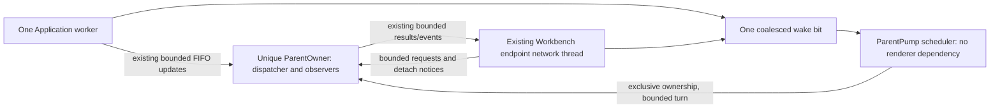

# DGUI-4C7B3B1: independent parent model pump

PR #36 was verified at `f5e2b38ffe437c7452f3e7d3ca104646f615460d`, made Ready and
merged normally as `14bbe58aa54ef6b2320a6d11ccfb98cf2ee67697`. The reviewed commit
is its second parent. Main was synchronized and clean before branch
`feature/dgui-4c7b3b1-independent-parent-pump`.

This implements the first prerequisite of the approved
[native host ADR](native-gui-host-adr.md#integration-admission-and-next-prs): a
working independently scheduled model owner with a renderer-free fake-client
harness. It does not select a new product host or activate GUI v2.
`ACTIVATION_QUALIFIED=false`.

## Implementation and single authority

[parent.rs](../../apps/lab-workbench/src/parent.rs) owns the model execution path:

- `ParentOwner<C>` owns one WorkbenchDispatcher, its one client/update receiver,
  RebuildCoordinator, operator/status/Exact Retry observers, selected presentation
  identity and optional WorkbenchEndpoint.
- `turn()` consumes up to 64 FIFO ClientUpdates, applies each once, routes its
  events, advances the existing workflow observers/rebuild in the original order,
  performs the existing implicit default-plot transition and services one fair
  external-owner turn. It requires no egui context, frame, window or GPU.
- `ParentPump<C>` moves that unique owner into one named thread. The running
  handle exposes neither model/dispatcher nor a mutable model borrow. The
  production `ParentPump<ClientHandle>::connect` constructor uses one existing
  Application worker and the existing endpoint with a renderer-neutral wake.
- `PumpSignal` holds one pending bit, one stop bit, a Mutex and Condvar. It has no
  callback backlog or payload queue. Client and endpoint producers publish the
  bit; the runner clears it before a turn, preserving a publish during processing.



There is no shared writable dispatcher mutex, second Runtime connection or cloned
RuntimeObservations map. Thread transfer moves the existing heap ownership. A
stopped owner can be retained after joining for diagnostics; it has no client or
API endpoint and is never another running authority. External requests still use
the sole `WorkbenchDispatcher::dispatch()` path. The dispatcher rebuild seam is
generalized only over its existing internal RebuildClient trait for qualification
with a fake client; no public API/DTO changes.

## Legacy v1 scope

WorkbenchApp now owns `ParentOwner<ClientHandle>` and delegates its model turn.
Its `drain_updates`, update staging Vec, workflow/rebuild application and direct
`endpoint.service_owner` path are removed. UI/operator methods access the same
owner's fields on the legacy GUI thread, preserving controls, Confirm, revision
fences, selection and presentation behavior. There is no parallel thread applying
updates to that legacy-owned object.

**The active v1 host retains its existing cooperative scheduling and repaint
adapter.** The independent runner is real implementation available to the future
parent root, exercised without GUI callbacks here; it is not concurrently started
beside v1. A stalled active-v1 event loop is not newly qualified as independent.
This follows the approved ADR's explicit requirement to keep the active v1 host
unchanged while proving the renderer-free parent harness. Closing the whole v1
Workbench remains parent shutdown. Closing the harness's separate display is not
parent shutdown.

The calls independent of GUI in the new runner are update receive/application,
external API service, workflow observations, rebuild/freshness barriers, default
presentation transition and root shutdown. GUI is a scheduler adapter, not the
definition or required caller of those operations.

## Bounds, wake and shutdown

| Item | Bound/policy |
|---|---|
| Application client workers / dispatchers / update receivers | One of each per parent root |
| Updates and observer/rebuild steps per turn | At most 64 each; no 64-update staging Vec |
| External service | One existing service_owner turn, at most four callers; existing rotating fairness cursor |
| Client command / update mailboxes | Existing 32 / 64 capacities, unchanged full/stop policies |
| External owner mailboxes | Existing 32 messages and 16,777,216-byte credits; caller/output/framing limits unchanged |
| Additional scheduling storage | One coalesced wake state and one join record; no callback/model-snapshot queue |
| Idle | Condvar wait with 100 ms fallback; stop interrupts it; no renderer wake required |
| Saturated update turn | Requests another turn through the same pending bit; external service still runs each turn |
| Root shutdown observation | Three-second application deadline, finite 10 ms waits; join only after is_finished |

Existing RebuildCoordinator advances at most one rebuild command per applied
update. Its projection/reference/controller/resource bounds remain unchanged.
All work inside an existing API operation retains its admitted JSON/document and
allocation bounds. A turn counter is not a universal instruction/time bound.
The 100 ms ADR target is a measurement reference, not a Windows scheduling or
driver guarantee. The committed evidence records the measured 64-update fixture;
it does not extrapolate that fixture timing to every maximum-payload operation.

Root shutdown first closes API ownership, then stops the existing client. No
Runtime shutdown, mutation, status or Exact Retry is synthesized. Repeated
shutdown preserves failure and performs no second client stop. A join timeout
retains the same join/owner obligation for later observation; no replacement
worker is started. The barrier regression checks that timeout is not successful
shutdown and later confirmed exit releases that exact owner. Trusted owner panic
and client-stop failure remain errors on subsequent shutdown calls.

Drop requests the same bounded stop and reports failure. It cannot force-kill a
Rust thread or establish a universal OS teardown bound; an unfinished thread
continues owning its capture if a root is forcibly dropped after failure. This is
not a successful cleanup receipt. This stage introduces no native child, GPU
resource or OS-process terminal qualification.

## Renderer-free evidence

[parent/tests.rs](../../apps/lab-workbench/src/parent/tests.rs) uses a bounded fake
client and the real loopback WorkbenchEndpoint. Its actual parent thread receives
updates and responds through the existing protocol while a separate fake display
thread is held at a Barrier. No eframe logic/ui or renderer callback is invoked.
Update-count Condvar barriers establish application before snapshot assertions;
socket timeouts are failure bounds, not sleeps used as progress evidence.

The tests verify:

- Full discovery/measurement/subscription/cursor freshness barrier without a GUI;
  Runtime update acceptance and external hello/status/presentation/recovery reads.
- Atomic presentation revision 1 -> 2 and rejection of a stale revision, with
  exact ambiguous recovery identities retained. The display exits while parent
  API remains usable and fake client stop count remains zero.
- No Runtime mutation/status/retry from absent display or snapshot restoration;
  only existing rebuild read/subscription commands arise from actual updates.
- Physical input split across writes; explicit mutation acceptance followed by
  caller detach; ambiguous projection and one explicit exact-target status call.
  Detach does not cancel acceptance or create local-rejected/retry submissions.
- Existing status/Exact Retry observer state across disconnect/reconnect,
  outcome_unknown and accepted/ambiguous records. Explicit status and Confirm
  submit once; subsequent idle/stale updates submit nothing automatically.
- Full fake update mailbox rejection, a producer inserting a 65th FIFO update
  during the turn, exactly 64 consumed, and the last update handled next turn.
- 10,000 notifications coalesced into one bit, publish-during-turn retained, idle
  Condvar waiting without GPU wake, and stop priority over pending work.
- Startup validation/thread-start failure, repeated shutdown, worker stop error,
  owner panic and deadline-unconfirmed join followed by real completion.

The legacy GUI drain regression now tests the real owner turn instead of the
removed GUI helper. Architecture guards reject a GUI-side update/application/
external-service path and enforce one production ClientHandle creation site in
the parent component. The stopped-renderer claim covers this deterministic
headless harness, not actual GPU device loss or a native child implementation.

The follow-up wake regression starts the real ParentPump with its bounded fake
client. The receive seam pauses inside ParentOwner::turn after dequeuing the first
update, before applying it. A separate producer sends the second update and wake
while the initial pending bit is already clear. The seam returns Empty once to
end that first turn at one applied update; no saturated-turn self-wake is possible.
The second turn must apply the other update with zero idle timeouts. Two fixed
test-only observations record reports and client-error projections: one update
and one rebuild step per turn, first then second, exactly two total applications,
and zero submissions. Thus a lost wake cannot be concealed by the 100 ms fallback.
No sleep establishes ordering and no full RuntimeObservations copy is introduced.
The separate stop test publishes the same second update and wake, sets stop before
releasing the barrier, and verifies that only the in-progress turn completes:
the pending bit remains set, no second turn runs, and the client stops once.

The shutdown barrier also requests shutdown twice before releasing the owner.
Both calls return unconfirmed, retain the same thread ID in the sole join slot,
retain no stopped-owner replica and submit zero client stops. After actual exit,
repeated shutdown and root destruction retain a total of exactly one client stop.

## Native v1 follow-up smoke

[v1-parent-pump-smoke.py](../../scripts/support/v1-parent-pump-smoke.py) drives the
existing LAB_WORKBENCH_GUI_SMOKE_RESULT mechanism with the real MSVC Workbench
and a fresh copy of the virtual deployment. Its sole test proxy observes actual
Application requests through explicit disconnect/reconnect and both GUI transport
closures (EOF or a separately recorded Windows reset). This observer is not a new
model owner, product transport or child host.
It permits at most four connections, 256 request records and 1 MiB per directional
buffer/frame; overflow fails the probe. No dependency or production GUI hook is
added. Python uses only its existing standard library.

The sole reference_retune is held before forwarding while real signal events
continue flowing. A Condvar waits for at least five observed signal events before
capturing the native client area. The committed captures were inspected and show
Ready/Fresh, the scalar data and a cyan curve in the live graph. After release,
the unchanged smoke verifies Confirm state, one accepted/completed mutation,
authoritative revision 1 -> 2 and target 50.25, minimize/restore, disabled stale
controls, reconnect and controls re-enabled only after Fresh. The GUI closes
normally with exit code zero. The proxy observes both transport closures before
stopping: exactly one mutation, zero operation_status and zero repeated mutation
identities, including the close path. recording_status remains a normal rebuild
query and is not counted as an operation_status submission.

A qualification attempt exposed a test-observer defect: a Windows TCP reset with
unread event bytes ended its I/O thread and listener, so native reconnect reached
the smoke deadline. The instrumented reproduction captured error 10054 with one
connection. The observer now accepts only GUI-side reset as a transport closure,
records its distinct mode, and continues accepting the next session. Unexpected
Runtime-side EOF/reset still fails. A deterministic abortive-close/reconnect probe
verifies one reset, one EOF and exactly two forwarded hello requests; native
release then passed three consecutive attempts. Original failure audits remain
under target. Complete Runtime-bound frames are recorded before forwarding; a
discarded partial frame cannot become an admitted Runtime request. This audit
does not claim to count locally rejected commands that never enter the transport.

Reproducible per-profile request inventories, binary/capture digests and existing
smoke results are in [dev JSON](independent-parent-pump-native-dev.json) and
[release JSON](independent-parent-pump-native-release.json). The client-area
captures are [dev](independent-parent-pump-native-dev.png) and
[release](independent-parent-pump-native-release.png). This qualifies the existing
automated operator/Confirm path and native presentation. The harness does not
click Confirm with a mouse or perform GL framebuffer readback, device-loss or
terminal GPU cleanup qualification. Active v1 remains cooperative.

An extra release ignored-process run exposed an existing operator-fixture race:
its comparison across the entire conflict wait also included a legitimate
Reference event from the deliberately intervening successful mutation. A passing
targeted rerun did not settle that failure. The fixture now correlates the failed
reply to the exact stale command, preserves full observation equality immediately
before/after that reply, applies other updates normally, and independently waits
for the intervening mutation's Fresh revision 3/target +1.0. The stale target
+0.75 must never become authoritative. Runtime and production GUI behavior are
unchanged; the final dev/release process runs exercise the corrected fixture. This is
separate from the unchanged M17.4 Recorder overlap fixture below.

## Validation and next prerequisite

Windows x86_64 MSVC dev/release results, operation counts, full regression scope
and CPU allocation comparisons are in [gate evidence](independent-parent-pump-evidence.txt).
The CPU probe wrapper includes the new parent module to compile the real v1
adapter; its scenarios, profiles, allocator and borrowing gates are unchanged.
No CPU budget/quota or numeric policy is raised. Preview allowance remains
8,388,608 accounted bytes, with the prior qualification preserved independently
from parent-thread/whole-host allocation claims.

An additional historical ignored M17.4 process-overlap gate remains **BLOCKED**:
its held Recorder Start fixture returns recording_unavailable before the second
mutation is accepted. The same failure was reproduced by compiling and running
the unmodified archived B3A merge source with the exact locked test artifacts,
without the new parent component; see the [original baseline reproduction](https://github.com/alexandervolkov1/lab-runtime/blob/4bfec46962851351f7452ef80cf4d8ce6a3380bb/docs/developer/independent-parent-pump-evidence.txt#L40).
This gate drives dispatcher/rebuild directly.
Its original fixture/assertion remains unchanged; thirteen other virtual process
acceptance cases pass in each profile. A suitable acceptance-aware Recorder fault
fixture requires separate qualification, not weakened overlap assertions or a
Runtime change hidden in this refactor. The new parent accepted/detach/status
harness is separately PASS.

The [final evidence](independent-parent-pump-evidence.txt) records the exact tested
Rust and native-observer HEADs and the 503-test inventory: 488 passed and the same 15 documented
ignored fixtures in each full suite. Thirteen non-M17.4 virtual process fixtures
are also run explicitly in each profile. The subsequent evidence commit changes
only documentation and captured artifacts. The observer correction changes no
Rust/Cargo inputs, so the full Rust gates retain their exact tested HEAD. The
source inventory makes this distinction
checkable, without embedding a commit's own SHA in its contents.

```powershell
cargo test -p lab-workbench --locked -- --test-threads=1
cargo test -p lab-workbench --release --locked -- --test-threads=1
cargo test -p lab-workbench --locked -- parent::tests --test-threads=1 --nocapture
python scripts/support/v1-parent-pump-smoke.py --profile dev
python scripts/support/v1-parent-pump-smoke.py --profile release
python -B scripts/support/v1-parent-pump-smoke.py --self-test-reset
./scripts/test-v2-renderer-allocation.ps1 -BuildProfile dev
./scripts/test-v2-renderer-allocation.ps1 -BuildProfile release
cargo clippy -p lab-workbench --all-targets --locked -- -D warnings
cargo fmt --all -- --check
git diff --check
```

The next Windows Job supervisor still needs its own single-record lifecycle,
atomic Job-contained startup, limits/membership checks, independent bounded OS
work, heartbeat/observed-exit evidence and failure/parent-death qualification.
The future product parent root must retain workspace ownership and select the
independent scheduler, rather than retain the v1 repaint pump as its model owner.
Bounded supervisor/model status communication, private read-only snapshot IPC and
renderer child remain separate prerequisites. None is implemented here.

Runtime, OutputAuthority, public DTO/API, B1, FiniteTraceItem, dependencies and
active-v1 user operations are unchanged. GPU terminal and whole host Rust budget
verdicts remain BLOCKED. No Job supervisor, child launcher, named-pipe IPC, new v2
host, Typed Parameter API, Manual Output API, GUI Actions or ExperimentRunner is
started. One Draft PR is required for independent review; no merge, next stage or
release is authorized for B3B1.
