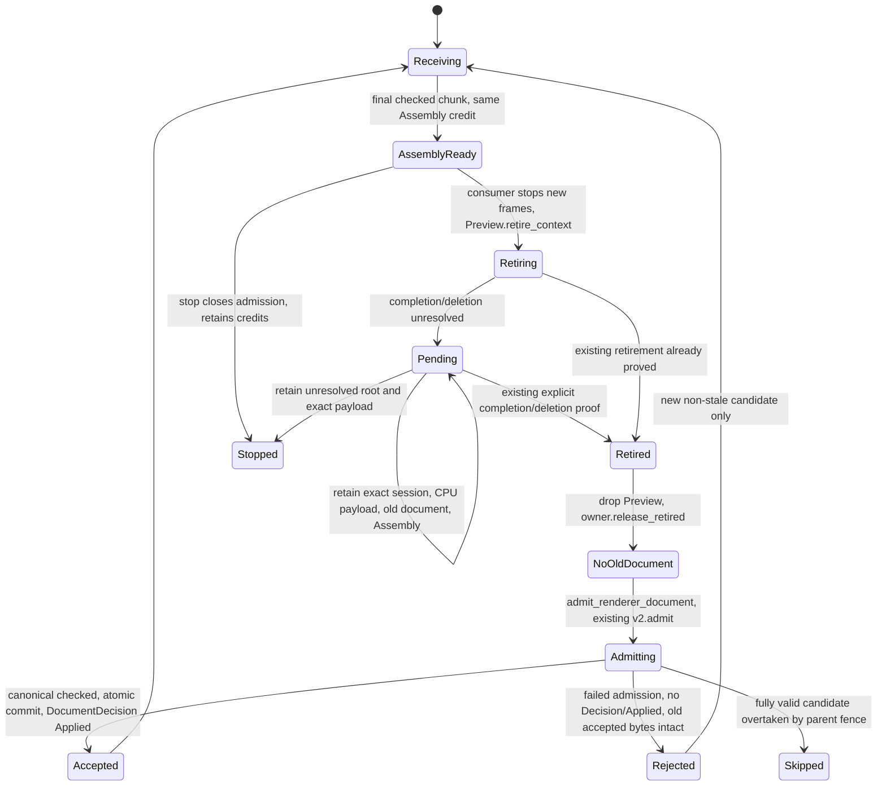
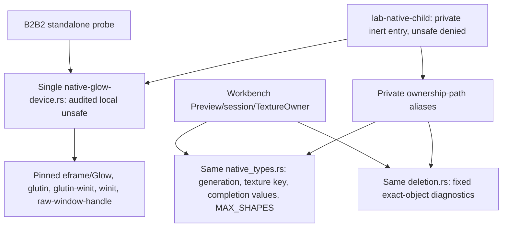

# DGUI-4C7B3B4A: compatibility seams

**READY FOR INDEPENDENT REVIEW — B3B4A.** Windows/MSVC dev/release qualification
passed on exact source `6b0646befac13d730d2718c9eb69798edf536ca5`.
The scope is **B3B4A compatibility seams only**. Full isolated renderer integration
remains **BLOCKED**. `ACTIVATION_QUALIFIED=false`.

## Review decision and preserved baseline

Independent review accepted the [original compatibility assessment](https://github.com/alexandervolkov1/lab-runtime/blob/4eded4648ce96db3dcc9304fa20bd492e0ab1096/docs/developer/isolated-native-renderer-child.md)
and selected **Option B: explicit admission handoff**. Work continues in Draft
[PR #40](https://github.com/alexandervolkov1/lab-runtime/pull/40), branch
`feature/dgui-4c7b3b4-isolated-native-renderer-child`. The original assessment,
compile controls, raw evidence and hashes remain historical at `4eded4648ce96db3dcc9304fa20bd492e0ab1096`;
the old evidence directory and SHA256 file are not overwritten or relabeled.

B3B3 PR #39 was made Ready and merged normally as
`76c2ae718c7c1f368ccf7b9bb90dbb7540ab19a2`, with first parent
`5190760603ddbef4e567dc6b08a52001e046fe78` and reviewed second parent
`0230c89045802ee78ed1872cee3697137eaabdad`. Its qualified source remains
`82d8ad12e3cf71f7b389a21e94e456b214da9e0d`. Main was synchronized and clean before
this branch. B3B4A does not amend that merge or any published release.

Option B places the permission boundary at parsed admission, where the conflicting
ownership actually occurs. A complete candidate already has stable Assembly
storage and can be tested independently of a native event-loop strategy. Option A
would instead require the native adapter to park the first replacement chunk and
coordinate old Preview lifetimes across pumping scopes before delivering more
bulk input. B avoids that extra coupling to the callback/pump strategy and retains
the accepted parent, supervisor, transport, framing and cancellation mechanisms.

## Document lifetime and admission state machine

[`Replica::chunk()`](../../apps/lab-workbench/src/private_ipc/replica.rs) now only
assembles document bytes. A complete transfer exposes its exact original Header
through `document_candidate()` and borrows its bytes through `candidate_bytes()`.
No parsed admission, Current publication or Applied receipt follows from assembly.

`Replica::renderer(&mut original_session)` creates one paired
[`DocumentOwner`](../../apps/lab-workbench/src/private_ipc/document_owner.rs).
The owner borrows that exact HostSession for its whole lifetime. Its immutable
admitted document, Header identity and session are disjointly borrowed by `parts()`
for Preview construction. A sealed local Rc key pairs it with its one Replica;
an unrelated owner and the encoded-only admission method cannot bypass this gate.
The key is fixed metadata, not a document identity, snapshot cache or queue.

Normal replacement uses `Preview::retire_context()` and its forwarding poll or
`HostSession::poll_retirement()`. The handoff itself performs no GL operation,
delete, retry, native Device Drop or terminal shutdown. `release_retired()` only
checks the original session's Idle/Retired state, zero owned keys and absent retained
CPU FrameData/Context before dropping the old document. A Pending or Active session
cannot grant permission. Admission also rechecks that same session before parsing.

The order is the existing B2B2 order: GPU obligations, then CPU FrameData/Context,
then old Preview and parsed document, then the new parsed admission. Normal
replacement never calls `HostSession::shutdown()`, which permanently closes work.
The successful harness creates another frame/generation afterward to verify that
replacement left ordinary admission open. Display incarnation, parent epoch and
process-local ContextGeneration remain distinct; no new authoritative epoch is
invented. No new GL completion/deletion or final WGL destruction receipt is claimed.

Rust borrows reject document release/admission while Preview lives, dropping the
original borrowed session, and mutating a Replica while Assembly/provider bytes
remain borrowed. These are compile-fail proofs, not a claim of linear destruction
for arbitrary Rust owners. Like HostSession, the trusted outer root must retain
DocumentOwner while unresolved; forcibly dropping the whole unresolved root remains
outside the native lifecycle contract. No leak/forget workaround is introduced.

## Bounds, rejection, control progress and receipts

The candidate occupies one of the **same four 1 MiB slots** in `Credit::Assembly(0)`.
There is one document transfer/handoff record, no ready queue, fifth slot or second
reassembly buffer. Duplicate/interleaved candidates are rejected without another
admission or credit. One fixed attempted Header fences replay, including malformed
or noncanonical attempts, by snapshot/epoch/source; successful accepted identity is
unchanged until commit. One 16-byte Rc allocation in renderer mode and fixed state
metadata are separate from the encoded byte ledger. Encoded-only mode allocates no
key and retains zero parsed documents.

The two-second transfer deadline applies only while bytes are incomplete. A full
Assembly waiting for GPU retirement does not falsely expire as a partial transfer.
It still owns one bounded episode; this does not authorize another child, queue or
watchdog. Stop closes admission permanently and marks reads non-current without
freeing the Assembly. Process exit and original I/O receipts remain the separate
B3B2/B3B3 retirement obligations. No process-exit or cancellation receipt is inferred
from a stop request, and no OS/driver completion deadline is invented.

An admission error releases only the completed, unborrowed candidate after its
parsed scratch is gone. It leaves old accepted encoded bytes/epoch intact and
returns no `DocumentDecision`, so the fixture emits no Applied. A fully validated
candidate overtaken by a fence returns Skipped, preserving prior B3B3 semantics.
The fixture's ordinary path explicitly calls `admit_encoded_document()`, drops its
one temporary parsed value, and then sends the post-admission Decision.

Sequential restoration is explicit: no pending candidate, no retained parsed
document, original session retired and accepted epoch still permitted by control
fences. It re-admits the original accepted bytes once; it does not publish a new
epoch or clear the independent read latch. An announced newer epoch prevents old
document restoration. Source/freshness fences continue to govern read consumption.
A later heartbeat cannot make old readings Fresh.

The no-GPU native fixture can hold a completed replacement and use its existing
Diagnostic variant once to report that state. Control challenges continue through
the same owner loop. Existing wire VERSION, variants, lengths, LRD1 schema and all
public APIs/DTOs remain unchanged. The new real-pipe cases test waiting beyond the
partial deadline, graceful retirement, crash, explicit restart and actual parent
API/recovery progress with zero added mutation/status/Exact Retry submissions.
These are **no-GPU** cases, not isolated renderer integration qualifications.

## Measured admitted-document ownership

Test-only instrumentation at the actual `v2::admit` entry and actual admitted-value
construction/Drop counts attempted admission, simultaneous live values and release.
It adds no production fields, allocation or quota. Fixture source documents are
serialized and dropped before the measured child-consumer interval.

| Observed boundary | Live admitted documents | Admission calls | Encoded ownership |
|---|---:|---:|---|
| Initial complete Assembly | 0 | 0 | Assembly only |
| Initial renderer commit | 1 | 1 | Current document |
| Replacement ready with old Preview/frame alive | 1 | 1 | Current + Assembly |
| Repeated Pending retirement/control turns | 1 | 1 | Same Current + same Assembly address |
| Retirement proved, Preview dropped | 1 | 1 | Same credits, old document still alive |
| Old document explicitly released | 0 | 1 | Same encoded bytes |
| Replacement admitted and atomically committed | 1 | 2 | New Current, no Assembly |
| Final healthy mock retirement/release | 0 | 2 | One encoded Current |

The measured peak is **one**, including noncanonical admission rejection and
sequential restoration. Six deterministic handoff groups check intermediate states,
wrong-owner/encoded-only bypass, malformed/noncanonical rejection, stop/cancellation,
repeated candidates and zero persistent parsed values in the no-GPU consumer.
Three provider groups and the existing codec groups cover selected semantics.
The extra five borrowing cases supplement all five existing B2B2 cases.

## Native Cargo capsule and dependency graph

[`lab-native-child`](../../apps/lab-native-child/src/main.rs) is an inert, standalone
Cargo binary target. Its entry point constructs no native owner, window, event loop,
HostSession, Preview, IPC or Runtime client. Building it type-checks the real Device;
it does not constitute a renderer implementation or launch qualification.

There is no first-party Cargo dependency from the target to Workbench or Runtime,
and no client/model/dispatcher/recovery/Application worker in its source graph.
Small safe ownership declarations moved once and are reexported at their original
private renderer paths. The generation allocator, 192-primitive cap and struct/enum
layouts are preserved. Device and deletion implementation source remain unchanged;
no GL logic was copied. The Device stays private, non-Send, thread/current-context
checked and ledger-owning. Workbench/Runtime/lab-core retain unsafe_code=forbid.

The [capsule safety/license review](native-child-capsule-safety.md) documents exact
versions/features. Cargo.lock adds only the local package; no third-party records,
versions, checksums, vendor licenses, SDK or toolchain changed. Per-profile proof
builds the real Cargo target, runs Clippy -D warnings, rejects Device: Send with
E0277 and rejects direct protected-forbid inclusion with E0453. The existing B2B2
standalone also compiles and runs Clippy through its new CompileOnly switch.
No proof script executes native GL or the capsule binary.

## Selected borrowed provider and remaining renderer migration

[`ReadOnlyProvider`](../../apps/lab-workbench/src/gui/readonly_v2/observation_source.rs)
exposes only local `selected`, epoch/incarnation, original overall freshness and the
independent current flag. Selected values carry the original typed RuntimeRef,
Boolean/Integer/Number/Text/Enum or exact absence, unit, quality, original freshness,
boot/projection/revision/entity revision/generation, observed/source monotonic time,
event cursor and bounded trace points/source floor. It has no request, discovery,
Runtime event, mutation or recovery operation.

`SelectedSnapshot` borrows the accepted Current slot and reuses the one LRD1 scanner
for validation and view construction. No-GPU validation still drops one scratch
RuntimeRef per record. The provider may retain at most 32 parsed references, with a
131,072-byte checked sum of their actual String capacities; all scalar text, unit,
provenance and trace bytes keep borrowing the original slot. There is no point Vec,
encoded cache, synthetic discovery or reconstructed RuntimeObservations model.

The maximum fixture measured a **9,080-byte fixed view + 54 target string bytes =
9,134 accounted view bytes**, borrowing 16,384 points with zero encoded-copy bytes.
The checked retained view ceiling is 9,080 + 131,072 = 140,152 bytes at this layout;
parser scratch/allocator overhead remain separately scoped. This is not a Preview
allowance, process commit cap, whole-Rust allocation or VRAM receipt. The view's
mutable Replica borrow also prohibits a second simultaneous provider or replacing
its underlying credits while used.

Freshness is preserved independently: a false child current latch can only downgrade
an originally Fresh display to Stale; Unknown/Rebuilding/Stale and original quality
remain intact. Actual Replica timeout followed by parent heartbeat stays non-current.
Tests also preserve negative zero, i64::MIN, 512-byte Unicode Text, Enum, Boolean,
units, not-observed absence/quality and original source/generation/cursor identities.

The existing renderer is deliberately not rewritten in B3B4A. The exact migration
interfaces for a separately reviewed implementation are:

| Existing interface | Required narrow change |
|---|---|
| Preview::run / prepare / run_plot | Borrow a ReadOnlyProvider during bounded frame preparation; release the provider before I/O or GPU waits. Keep frame/session/generation ownership unchanged. |
| read::data / entity / typed / freshness | Consume selected typed fields and original/global freshness plus non-current. Preserve exact absence, unit and quality. Unsupported Instrument/Resource/Component raw entity JSON is absent from LRD1: display explicit unavailability, never synthesize raw projections/discovery. |
| Page::prepare / describe | Pass that borrowed provider through existing bounded text planning; no persistent read-model copy. |
| plot_projection::project | Obtain typed selected metadata and a bounded point iterator instead of entities/live maps. Preserve all existing MAX_POINTS, MAX_POINT_VISITS, repetitions and FiniteTraceItem checks; reject unsupported input before geometry allocation. A 16,384-point encoded profile does not authorize a 16,384-point per-source cache repeated 32 times. |
| plot_projection::decimate | Accept the borrowed provider's point iteration while preserving original coordinates, extrema, ordering and visit budget. |
| TraceView::buffer_dropped | Represent original source dropped-count as unavailable for LRD1, which does not transmit it; do not invent zero. The parent-cache adapter can expose its real count. |
| plot_widget / PlotState | Already consume PlotView and need no RuntimeObservations dependency replacement; preserve their render/text/geometry logic. |

An eventual parent-cache provider can borrow the existing cache without copying it.
The selected provider does not require that adapter for its compile/semantic proof.
The remaining source cuts are explicit: move the pure Freshness/LivePoint and
read-kind/quality/absence declarations and the pure ReadBinding target allowlist
out of `model/projections.rs` and
`model/read_binding.rs` into one shared read-only values module, retaining old
internal reexports; reuse the already serde-only `presentation/reference.rs`;
separate the LRD1 reader/scanner from `reads.rs`'s parent-only encoder/Plan and
RuntimeObservations dependencies. Offline v2 admission also needs its shared
limit constants separated from `external.rs`, and its core receive/admit modules
separated from `source_v1`/conversion/export dependencies. Those are broader
renderer packaging changes and are deliberately stopped at this plan. The inert
capsule does not include any of those complete Workbench modules to compile.
Moving the whole renderer/read-only contract into the child source graph, actual
snapshot-to-pixel consumption and framebuffer/resource/process qualification remain
full B3B4 work after this review; this target does not import the full Workbench as
a shortcut. No production host, GUI Actions or B3B5 work starts here.

## Qualification and evidence

All **34 qualification gates** passed. The per-profile 566-test inventories are
identical. The implementation commit is `5f1de892f4c6e474491bf19d6442ad5a4c660eda`;
`6b0646befac13d730d2718c9eb69798edf536ca5` adds only the supervisor test-observer
correction described below. Final gates use the latter exact source.

| Gate | Dev | Release |
|---|---:|---:|
| Complete Workbench suite | 522 PASS / 44 ignored | 522 PASS / 44 ignored |
| Handoff + provider + existing B3B3 unit groups | 16 PASS | 16 PASS |
| ParentPump/supervisor/architecture selection | 43 PASS | 43 PASS |
| Virtual process acceptance, M17.4 excluded | 13 PASS | 13 PASS |
| Existing B3B2 native supervisor groups | 7 PASS | 7 PASS |
| B3B3 + new handoff native IPC groups | 22 PASS | 22 PASS |
| Existing + new borrowing compile-fail cases | 10 PASS | 10 PASS |
| Inert Cargo capsule, Clippy, non-Send/forbid negative controls | PASS | PASS |
| Existing native Glow standalone compile/Clippy only | PASS | PASS |
| Complete CPU Preview gates | PASS | PASS |
| Strict native v1 smoke | exactly 2 connections | exactly 2 connections |
| Workbench/Job/capsule all-targets/all-features Clippy -D warnings | PASS | PASS |

The 119 geometry, 125 memory, 12 frame, four no-upload and nine retirement CSV
rows in **each profile** match the preserved B2B2 tables exactly, apart from the
previously documented scheduling-dependent `wait_calls`. Maximum CPU Preview
accounting remains **4,610,337 / 8,388,608 bytes**. Document admission/conversion/
export allocation gates, formatting, PowerShell AST and diff checks also pass.

Both strict v1 runs observe one ordinary explicit retune, zero operation_status
and zero repeated mutation identities. Their checked GUI smoke results include
accepted/completed mutation, authoritative refresh, stale control disabling,
reconnect and minimize/restore. The inspected GDI captures show Ready/Fresh, a
cached value and cyan live curve; they are not GL framebuffer readback or a
renderer-child qualification. No active v1 scheduling/control code changed.

One first-attempt B3B2 native case failed because its test observer unwrapped
`status()` while the supervisor published through its try_lock interface and
legitimately returned Busy. The correction uses the existing bounded wait_status
to sample the same ExitUnconfirmed episode, retaining incarnation=1, one termination
request, original exit witness and all prior Job/replacement assertions. No
production supervisor policy, timeout or failure semantics changed. The original
failure at `5f1de89...` and the full rerun at `6b0646b...` are both archived; a passing
rerun alone is not used to explain away the observer defect.

[Verification](isolated-native-renderer-child-b3b4a-evidence/verification.json),
[commands/results](isolated-native-renderer-child-b3b4a-evidence/gates.json),
[source inventory](isolated-native-renderer-child-b3b4a-evidence/source-inputs.json),
[source boundaries and exact moved declarations](isolated-native-renderer-child-b3b4a-evidence/source-boundaries.json),
[binary identities](isolated-native-renderer-child-b3b4a-evidence/binary-identities.json)
and [CPU comparison](isolated-native-renderer-child-b3b4a-evidence/cpu-comparison.json)
record the scopes separately. All **343** qualified code/script/example inputs
retain exact Git SHA256 and separately recorded compiled Windows byte hashes.
All **463 third-party lock records** are unchanged; Device, deletion diagnostics,
HostSession and private wire protocol sources remain byte-identical to the starting
assessment. Three moved ownership declaration blocks compare token-for-token.

The [raw archive manifest](isolated-native-renderer-child-b3b4a-evidence/raw-manifest.json)
checks all 142 members, including the original failed attempt, final gate transcripts,
compiler controls, source identities, CPU output and v1 captures. No old native GPU
logs are relabeled as current: only current CompileOnly inputs/artifacts are copied
from the native Glow directory. The [new normalized SHA256 inventory](isolated-native-renderer-child-b3b4a-sha256.txt)
covers this report and final evidence. The final documentation/evidence commit
changes no tested Rust/Cargo/script/example inputs.

No real renderer child exists yet. Its framebuffer, process-memory, GPU/IPC
integration and >=100-cycle gates are **BLOCKED/not run**. Deployment C remains
unselected; no actual renderer commit peaks or headroom were measured. Fixture
32/128 MiB caps do not become renderer policy. **READY FOR INDEPENDENT REVIEW —
B3B4A** grants no full B3B4 integration admission.

Historical hello-only remains **UNQUALIFIED**. M17.4 Recorder overlap, terminal GPU
lifecycle and whole-host Rust budget remain **BLOCKED**. Full B3B4, >=100 renderer
lifecycle cycles and activation remain **BLOCKED**, with `ACTIVATION_QUALIFIED=false`.
This PR stays Draft; no merge, release or next-stage implementation is authorized.
