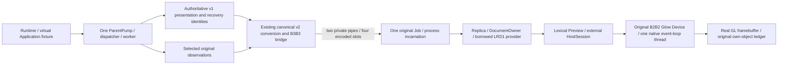
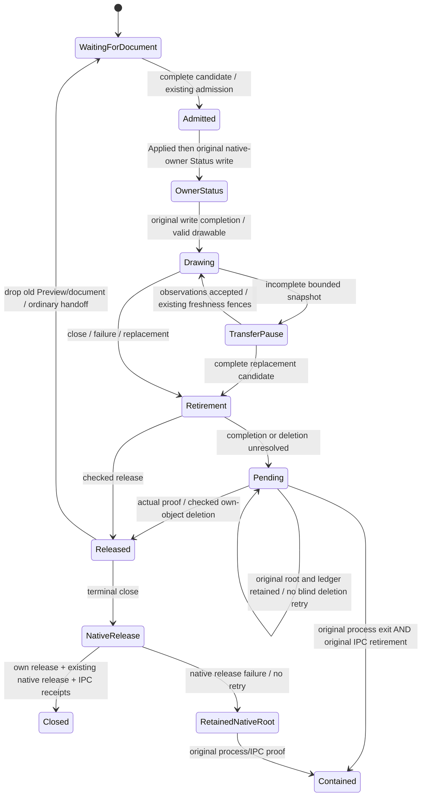

# DGUI-4C7B3B4C: isolated renderer lifecycle and memory admission

**READY FOR INDEPENDENT REVIEW — B3B4C**, for the fixed Windows profile below.
`ACTIVATION_QUALIFIED=false`. Candidate C still requires independent review.
No product host selection or production deployment admission is claimed.

## Reviewed merge and scope

B3B4B PR #41 was merged with the ordinary merge commit
`1890fafb15a53c4517a3dc7295d74d1a1756b5ea`. Its parents are
`754857771b6fb55491599817010871736f748027` and reviewed HEAD
`9884609253fa0cffc46c182461b36ddeeee515b0`. The reviewed head, base and
32-path documentation/evidence-only delta from qualified source
`1d297ad885b0e97069033d60e75a910c880a8ce1` were verified before merging.
Local main was fast-forwarded and clean before creating
`feature/dgui-4c7b3b4c-renderer-lifecycle-memory-admission`.

This stage qualifies an experimental fixed Windows child profile. It introduces
no product host selection, GUI actions, Runtime mutation authority or Linux GUI.
The accepted [host contract](native-gui-host-contract.md),
[first-frame integration](first-isolated-renderer-frame.md),
[private IPC](private-readonly-ipc.md) and
[terminal ownership limits](../../apps/lab-workbench/src/gui/readonly_v2/TERMINAL_GPU_OWNERSHIP.md)
continue to apply. Final glutin/WGL destruction has no new receipt.

## Owners, data and lifetime



The child compiles the existing safe read-only consumer and original Device.
It has no model owner, Runtime client, dispatcher, journal, experiment authority,
Application worker or OutputAuthority. Shared read-only definitions have one
canonical source. Existing completion, deletion, TextureOwner, HostSession,
Replica, protocol, four-slot accounting and supervisor implementations are kept.

A complete replacement retains its Assembly credit. New frames stop, the old
Preview calls `retire_context`, and its original session is polled. Pending work
keeps the exact Preview, CPU frame/context, parsed document and GPU identities.
Only checked retirement permits dropping Preview and the old document, followed
by one sequential parsed admission and atomic Applied for the new epoch.
Ordinary replacement never calls terminal `HostSession::shutdown`.



The maximum remains one parsed child document. The no-GPU B3B3 consumer keeps zero
persistent parsed documents. There is no new point Vec, snapshot cache, Assembly
buffer, encoded slot or parsed-document quota.

## Native progress and suspension

The actual owner distinguishes event-loop progress, render-owner progress,
submitted frames, real completion and own-object retirement. IPC availability does
not manufacture frame completion or freshness. No additional watchdog worker or
automatic restart loop was added.

A first costly GL frame waits until the post-admission owner Status original write
finishes. This is ordering of existing transport observations; the child does not
claim a parent Ready acknowledgement or a GPU completion from that write. The
40 ms redraw interval restarts after actual frame/present work, leaving ordinary
native/IPC turns after a costly frame. Complete Assembly waits do not inherit the
incomplete-transfer deadline; silent partial transfers use the original expiry
on every non-closing owner turn. An expected frame that makes no progress has a
monotonic owner-side diagnostic deadline. Paused, pending and closing states are
excluded; an OS/driver call cannot be preempted by this software check.

Occlusion, minimization, size and scale have independent suspension causes. Real
native resize above 1280x960, minimize and restore suspend frames while pumping
native/control events. The qualification also supplies an explicitly artificial
scale 1.25 policy input on that same real owner, combines it with native resize
and occlusion causes, and verifies that unrelated events cannot admit frames.
This does not fabricate a Winit ScaleFactorChanged event, render a scale-1.25
frame or qualify a new DPI/monitor profile. Only 1280x960 at scale 1 is supported.

## Lifecycle and fault coverage

The isolated fault matrix uses existing audited Device injections. Faults are
artificial, including device loss; they are not observations of a physical driver
reset. Every unresolved case preserves original object identities and execution
and deletion diagnostics. One hundred retirement polls check an unchanged ledger
and deletion call count; no ambiguous deletion is retried.

| Scenario | Required observation |
|---|---|
| Normal close after maximum Plot/documents | Own objects zero; checked deletions before CPU/root release |
| Injected timeout, then real fence proof | Retire without resubmission; new generation only after release |
| Wait failure / artificial device loss | Original unresolved root remains until containment |
| Texture, buffer, shader, program, VAO, fence deletion before/after | Original identity and disposition retained; no blind retry |
| Original submission error plus shader deletion failure | Both diagnostics survive in the same original session |
| Native context release failure | Own objects already released; native root retained, no repeated release |
| Stop with pending GPU/document handoff | Old parsed document, Assembly and CPU/GPU obligations retained |
| Crash with original I/O outstanding | Exit proof alone cannot release IPC or admit replacement |
| Native owner stall | Original supervisor contains it; parent API/recovery continue |
| Expected redraw suppressed | Live event loop cannot be mistaken for rendering progress |
| Snapshot stall / source fence | Original read stays non-current despite owner heartbeat |
| Deliberately insufficient 16 MiB Job cap | Startup denial is contained; no healthy GPU claim |
| Parent shutdown during GPU/IPC retirement | Pending exit/IPC proof is reported; later receipts finish checked retirement |

All 17 isolated GPU injection cases passed in both profiles. The six object
classes each have before-delete and after-delete failures (12 cases), plus timeout
with later proof, wait failure, artificial device loss, original execution plus
delete failure, and native release failure. The separate B2B2 standalone control
retains its own 19 contained fault outcomes with general terminal lifecycle BLOCKED.

The native-release failure records native owner progress separately during Close:
interim Status must not consume the original Close challenge. Job peaks for parent
shutdown are taken from final original Job retirement, not the earlier
ExitUnconfirmed status that has no final reading yet.

## Memory scopes and proposed C

Metrics below remain separate. No sum of Rust accounting, OS commit and GPU
payload is presented as a memory receipt.

| Scope | Bound or measurement |
|---|---|
| Canonical document | Exactly 1,048,576 bytes through the existing parent v1-to-v2 conversion |
| Parsed admission | 2,335,040 accounted bytes for that qualified maximum fixture |
| CPU Preview | Existing 8,388,608 accounted allowance; final allocation controls reported below |
| Borrowed selected provider | 9,348 bytes repeated-source / 9,742 bytes 32-source view in initial max-frame receipts; original points stay encoded |
| Encoded/IPC storage | Four slots; existing 4,399,104-byte per-endpoint encoded/control/diagnostic bound |
| Renderer staging/readback | Existing <=4 MiB staging, <=8 MiB staging overlap; one 4,915,200-byte readback |
| Own GPU payload/objects | Existing texture/buffer limits and fixed 15-object ledger; exact counters per native receipt |
| Native window/event-loop and Rust allocator attribution | Not separately exhaustively attributed; OS stages are not a Rust heap proof |
| Original Windows process/Job commit | Kernel peak counters from original Job; independent stage/fault/incarnation receipts |
| Driver/VRAM/kernel-global memory | Unknown outside the stated own-object payload and Job charge |

The 1 GiB fence was used only for initial qualification. The sealed proposal is
**C = 234,881,024 bytes (224 MiB)**, before any fixed-cap tests. It rounds
1.5 times the maximum initial measured Job peak up to a 16 MiB increment:
148,529,152 bytes, maximum 32-source selected profile in dev. Headroom is
86,351,872 bytes (82.3515625 MiB), or 58.1379957%. The 50% policy allowance is an
explicit assumption tested with fixed-cap scenarios and cold cycles, not a
complete allocator/driver bound. C was never raised after a failed test.

Profile: Windows 10 Pro 10.0.19045 x64; Rust 1.95.0 x86_64-pc-windows-msvc;
AMD Ryzen 5 6600H / AMD Radeon(TM) Graphics driver 32.0.21030.2001. The original
process-local DPI-unaware B2B2 window uses GL drawable 1280x960 at scale 1; desktop
compositor scaling is not a newly admitted GL DPI profile. C is proposed for
independent review, not installed as a production deployment policy.

Allocation denial can cause a Rust/native failure or process exit. It does not
permit raising quotas, uncontained fallback, automatic restart or a fabricated
GL cleanup receipt. The deliberate 16 MiB denial control is a separate failed
admission experiment, not another candidate C. Driver/VRAM and universal OS/GL
operation latency remain outside the claim.

## Final results and provenance

Qualified source HEAD: `f444da9322e9db75d9bcb7e6ae908833a6a17b67`.
All **48 final gate receipts PASS**; their commands, durations and log SHA256 are
in [gates.json](isolated-renderer-lifecycle-memory-evidence/gates.json).
The raw transcripts are retained even where a group repeats a filtered subset.
They are not added together as a unique-test total.

| Gate | Dev | Release |
|---|---:|---:|
| Full Workbench suite | 530 PASS / 58 ignored | 530 PASS / 58 ignored |
| Handoff/provider/selected Preview/progress | 23 PASS | 23 PASS |
| Parent/supervisor/API/architecture subset | 44 PASS / 14 ignored | 44 PASS / 14 ignored |
| Virtual process acceptance | 13 PASS | 13 PASS |
| Native Windows supervisor | 7 PASS | 7 PASS |
| Native B3B3 IPC | 22 PASS | 22 PASS |
| Actual isolated renderer | 13 PASS | 13 PASS |
| Cold lifecycle cycles | 101 PASS | 101 PASS |
| Suspension controls, exact source imported by path | 2 PASS | 2 PASS |
| OS capsule unit | 1 PASS | 1 PASS |
| Borrowing compile-fail controls | 10 expected rejections | 10 expected rejections |
| Native capsule / non-Send E0277 / protected E0453 | PASS | PASS |
| B2B2 native smoke / Pending / fault matrix / compile | PASS | PASS |
| Strict native v1 smoke | PASS | PASS |
| Clippy, all targets/features, `-D warnings` | PASS | PASS |

The shared test inventory contains 588 names and is identical across profiles.
The child Cargo binary has `test=false`: its Cargo test receipts are compilation
only, with zero executed unit tests. The two suspension tests above were actually
compiled and run separately against the original production module; the wrapper,
commands, results and test-binary hashes are archived. No copied implementation
or new Cargo dependency was introduced. Formatting, document allocation controls,
PowerShell AST, observer reset and diff checks also passed.

CPU Preview allocation controls retain 119 geometry, 125 memory, 12 frame,
4 no-upload and 9 retirement rows per profile. Maximum accounted bytes are
**4,610,337 / 8,388,608**. The dev command executed on
`0fd2ace12e704b3ee90e8a67aa67f211df471245`; all its actual compiled inputs are
byte-identical at the final source. The only later paths are native child entry
and the `cfg(test)` parent native oracle, neither compiled by those probes.
[cpu-source-equivalence.json](isolated-renderer-lifecycle-memory-evidence/cpu-source-equivalence.json)
and the original, unchanged receipt document this bounded reuse. Release CPU,
full Workbench and all final native groups executed at the final source HEAD.
No command is falsely attributed to a later execution HEAD.

### Maximum framebuffer and geometry

The existing parent conversion admits an exact 1,048,576-byte canonical document
with 14 bounded Plot items and long/Unicode labels. The two isolated profiles
exercise 32 traces: one original 4,096-point source repeated across traces reaches
**262,144 MAX_POINT_VISITS**, while 32 selected sources with 512 original points
each admit **16,384 selected points** and reach 32,768 visits. Both project
16,384 points and 16,352 segments. Every maximum readback matches **32/32** selected
curve samples in real GL pixels, with zero geometry failures and four encoded
slots. Three sequential document replacements produce exactly epochs 2, 3, 4, 5;
each receipt observes a maximum of one live parsed document.

Real Page/scalar/Plot navigation, full and partial uploads, no-data, live selected
replacement, document replacement, missing/unavailable/rebuilding and stale source
fences are covered. Absence never becomes a Fresh zero. Maximum own-object receipts
record full uploads in both profiles; the full native qualification also records
partial uploads in both profiles. The standalone B2B2 smoke remains independent.

[Dev maximum Plot](isolated-renderer-lifecycle-memory-evidence/dev-maximum-repeated.png)
and [release maximum Plot](isolated-renderer-lifecycle-memory-evidence/release-maximum-repeated.png)
are lossless views of original GL framebuffer buffers. See
[frame-pictures.json](isolated-renderer-lifecycle-memory-evidence/frame-pictures.json)
for each raw member and SHA256. PNG creation reverses the GL row order only;
GDI images are used solely for the separate v1 regression. Original `.rgba` and
frame metadata remain in the raw archive.

### Fixed-C memory results

| Final original-incarnation peak | Dev bytes | Release bytes |
|---|---:|---:|
| Process commit maximum | 142,036,992 | 141,410,304 |
| Job commit maximum | 148,611,072 | 147,947,520 |
| Largest Job peak during 101 cold cycles | 138,305,536 | 138,768,384 |

The maximum in both profiles is the repeated-source maximum Plot with canonical
maximum document and sequential replacements. The final overall maximum leaves
**86,269,952 bytes (82.2734375 MiB), 58.0508241% of measured peak**, below proposed
C. This slightly exceeds the initial calibration peak; the sealed C is unchanged.
All fixed-cap scenarios and all 202 cold incarnations stayed within C. The separate
16 MiB negative control verifies denied admission and checked containment.

[memory-summary.json](isolated-renderer-lifecycle-memory-evidence/memory-summary.json)
retains independent original stage/fault/restart/cycle receipts, including startup,
native context, Preview/no-data, scalar, Plot, readback, replacement, pending work
and final shutdown. Startup samples can occur before Ready and are explicitly
sampled cumulative OS peaks; they are not instantaneous phase allocations. Final
original Job readings, including late retirement, bound the full incarnation.
Native Rust allocator/window/event-loop charges cannot be exhaustively separated
from these peaks. The 50% calibration policy and observed margin are empirical
headroom for this precise hardware/driver profile, not a universal memory theorem.
A different driver/DPI/profile requires new measurement and review.

### Cycles, containment and parent continuity

Each profile completes 101 cold incarnations: 51 healthy closes, 50 intentional
crashes and 100 explicit restarts. Each receipt checks its exact original
incarnation and PID, original exit code (0 healthy / 73 intentional crash),
zero outstanding supervisor native handles, zero IPC handles/pending operations,
and actual encoded credit classes **[2 free, 2 latest, 0 current, 0 writing,
0 Assembly]**. Healthy closes have zero own objects and no unresolved ledger entries;
crashed processes have no fabricated own-object deletion receipt.

There are 24 generic original-fault/restart scenarios per profile, including the
17 GPU cases, plus dedicated parent-shutdown and absence tests. Restart is explicit
and remains fenced by original process exit AND original IPC completion/retirement.
Pending handoff retains the original Preview/document/HostSession and Assembly
past the incomplete-transfer deadline without admitting the replacement. Existing
supervisor and IPC regressions separately exercise unconfirmed OS termination and
cancellation; no replacement bypass or indefinite restart worker was added.

ParentPump/dispatcher/API/recovery continuity uses the existing bounded virtual
Application fixture with original Workbench identity, presentation revision,
Runtime boot/scope/next request sequence and accepted recovery identities. It
records zero additional Runtime query/mutation/status/Exact Retry submissions
from display faults, restoration and restarts. The explicit Runtime-gap/rebuilding
case has one independently caused baseline Discover and zero display-caused
submissions. The separate 13-test virtual process acceptance suite exercises an
actual Runtime process. These distinct scopes are not conflated. Strict v1 smoke
retains its intentional one operator mutation, two connections and zero status or
repeat submissions.

### Source, binary and failure provenance

[source-inputs.json](isolated-renderer-lifecycle-memory-evidence/source-inputs.json)
records raw and Git-blob SHA256 for 359 source/build/fixture inputs.
[source-boundaries.json](isolated-renderer-lifecycle-memory-evidence/source-boundaries.json)
proves 52 protected files and 10 protected roots unchanged from the B3B4B merge.
The original Device, completion/deletion/HostSession, Replica/DocumentOwner,
protocol, supervisor, parent dispatcher, protected models and Cargo lock are
unchanged. No quota or third-party version was raised.

The actual Cargo dependency graph and 51 child compiler source inputs are saved
in [native-cargo-tree.txt](isolated-renderer-lifecycle-memory-evidence/native-cargo-tree.txt)
and [child-compiler-inputs.json](isolated-renderer-lifecycle-memory-evidence/child-compiler-inputs.json).
The child uses the original single Device source with non-Send ownership and
local audited unsafe permission; Workbench retains `unsafe_code=forbid`.
No client/model/dispatcher/recovery/export/conversion module is compiled into it.

[binary-identities.json](isolated-renderer-lifecycle-memory-evidence/binary-identities.json)
records exact child, Workbench/test, Runtime, IPC/supervisor fixture, CPU probe and
standalone executable identities. Original standalone identities are captured
before execution, separately from later compile-only binaries. The dev CPU
execution source exception above is retained in its own original receipt.

[raw-evidence.zip](isolated-renderer-lifecycle-memory-evidence/raw-evidence.zip)
contains commands, raw successful and failed logs, original native JSON/RGBA,
CPU controls, reproducer wrappers and intermediate source inventories.
[raw-manifest.json](isolated-renderer-lifecycle-memory-evidence/raw-manifest.json)
checks every archived member. Earlier failed experiments and their provenance
limits are explicit in [experiments.json](isolated-renderer-lifecycle-memory-evidence/experiments.json):
in particular the failed max-transfer attempts, old-incarnation observer rejection
and partial-JSON diagnostic read are preserved. Unknown early uncommitted inputs
or overwritten intermediate binary hashes are not reconstructed as exact evidence.
The final [SHA256 inventory](isolated-renderer-lifecycle-memory-sha256.txt) covers
this report and all committed evidence; final review commits change documentation
and evidence only from the qualified source.

| Verdict scope | Result |
|---|---|
| Fixed-profile maximum framebuffer and read-only handoff | PASS |
| Healthy own-object completion/deletion | PASS |
| Unresolved obligations retained / checked OS and IPC containment | PASS |
| Fixed candidate 224 MiB tests / 101 cycles per profile | PASS; C proposal awaits review |
| Parent/API/recovery continuity / display-caused replay | PASS / zero additional submissions |
| Unsupported-scale rejection policy on actual native owner | PASS; scale input explicitly artificial |
| Actual non-1 DPI / other monitors and drivers | UNQUALIFIED |
| Final glutin/WGL destruction receipt | LIMITED / no new receipt |
| General terminal GPU lifecycle | BLOCKED, prior scope preserved |
| Whole-host Rust heap budget | BLOCKED |
| M17.4 Recorder overlap | BLOCKED |
| Historical hello-only | UNQUALIFIED |
| Production activation | `ACTIVATION_QUALIFIED=false` |

**READY FOR INDEPENDENT REVIEW — B3B4C** is limited to these measured fixed-profile
claims. Deployment C selection, product host selection and B3B5 require subsequent
independent review and authorization.

The cycle harness requires an explicit cap below the 1 GiB qualification fence.
It completed 101 cold incarnations per profile (51 healthy closes, 50 intentional crashes),
100 explicit restarts, and one original Job/process per incarnation. Each writes
its own original process exit, handle/IPC/credit baseline, own-object verdict,
commit peak and no-additional-Runtime-submission receipt. GPU deletion is not
inferred from a deliberate crash. A partial run records its exact completed count.

## Reproduction and preserved limits

```powershell
./scripts/test-isolated-renderer.ps1 -BuildProfile dev -QualificationCommitCap 234881024
./scripts/test-isolated-renderer.ps1 -BuildProfile release -QualificationCommitCap 234881024
./scripts/test-isolated-renderer.ps1 -BuildProfile dev -QualificationCommitCap 234881024 -TestFilter native_hundred_fixed_cap_cycles
./scripts/test-isolated-renderer.ps1 -BuildProfile release -QualificationCommitCap 234881024 -TestFilter native_hundred_fixed_cap_cycles
```

Historical hello-only session remains UNQUALIFIED. M17.4 Recorder overlap,
general terminal GPU lifecycle and whole-host Rust budget remain BLOCKED in their
previous scopes. Final WGL destruction remains LIMITED/no new receipt. No Runtime,
OutputAuthority, Recorder, public DTO/API, Clojure, active v1 scheduler or dependency
version was changed. No release, activation, merge of B3B4C or B3B5 is authorized.
