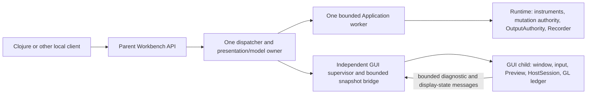
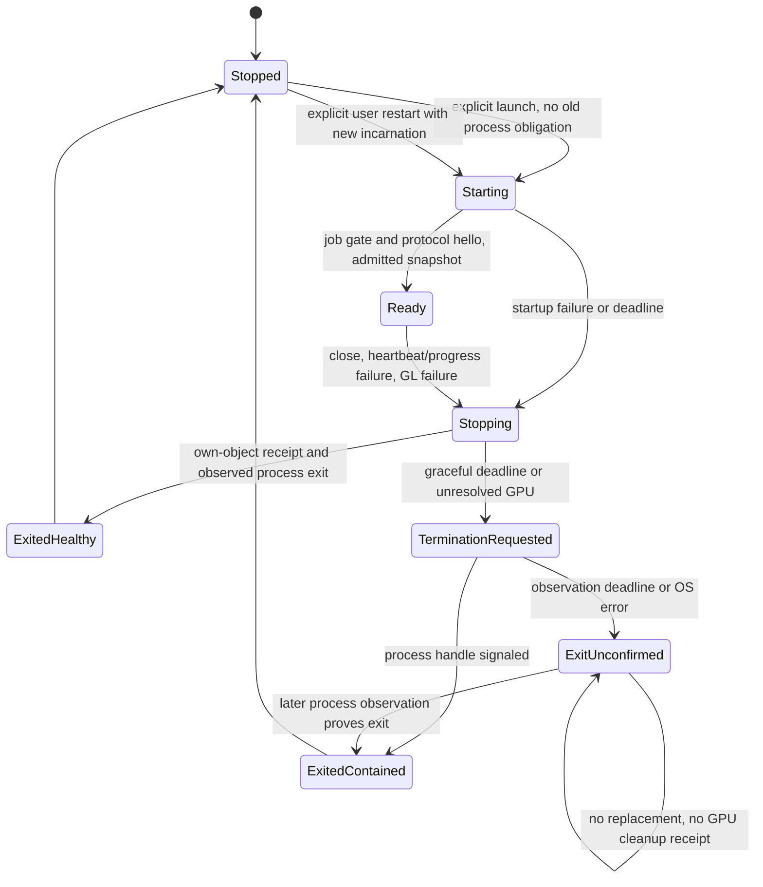

# Native GUI host: ownership and qualification contract

This is the supporting contract for the proposed
[DGUI-4C7B3A decision](native-gui-host-adr.md). All production supervisor/IPC
behavior below is a design requirement, not implemented evidence. The no-GPU
[Job probe](native-gui-host-probe.txt) covers only its listed OS expectations.
`ACTIVATION_QUALIFIED=false`.

## Authority and trust



The child is trusted compiled code behind a failure containment boundary, **not
a security sandbox**. A normal same-user Job does not prevent malicious code from
opening other services/files. No Runtime connection, instrument handle, command
sequencer, output authority, job handle or parent termination handle is passed to
the child. Private protocol allowlists and dependency/architecture guards enforce
the intended software boundary. External Workbench calls continue through
`WorkbenchDispatcher::dispatch()`, not its internal `client()` accessor.

| State | Owner and lifetime |
|---|---|
| GUI v2 document | Parent's sole accepted presentation owner; child independently admits one immutable bounded replica |
| PresentationEpoch | Parent-supplied presentation owner identity/revision; child cannot invent a replacement epoch |
| RuntimeObservations | Parent's current authoritative-client projection; child gets a bounded selected read replica with real quality/freshness/source identities |
| Renderer HostSession | Child native root, outside Preview; survives Preview Drop while GPU obligations remain |
| GL context, textures, fence and remaining ledger | Child, creating thread/current context; existing completion/deletion rules |
| OS Job/process handles and watchdog | Parent supervisor, separate from Application worker/model turn |
| Runtime session, mutations and recovery | Existing parent worker/dispatcher; never transferred to child |
| Renderer error log | Bounded best-effort child records mirrored to parent diagnostic ring; never scientific Recorder evidence |
| GUI process status | Parent's observed process handle plus fenced heartbeat/render evidence; child cannot self-certify its process exit |

Each launch has a fresh parent-assigned display incarnation. Every private message
is fenced by parent Workbench identity, incarnation, protocol version and sequence;
document/read messages also include their exact presentation epoch and source
snapshot identity. ContextGeneration remains child-local. Parent diagnostics refer
to `(display incarnation, ContextGeneration, TextureId/native name)` so identical
numeric GL names after restart do not merge old obligations into new ones. This
does not change the existing renderer's `(ContextGeneration, TextureId)` key.

## Windows ownership and process startup

Create an unnamed Job with KILL_ON_JOB_CLOSE, active process count one, and
explicit per-process/job committed-memory limits before creating the GUI. Keep
the sole Job handle non-inheritable; do not duplicate it into the child or leave
copies in logging workers. Parent death closes its kernel handles and triggers
the last-handle policy. Descendants must not escape; the GUI implementation does
not spawn helpers. Incompatible native libraries needing helper processes require
a separately reviewed policy, not silent relaxation.

Use Windows 10+ creation-time JOB_LIST and CREATE_SUSPENDED; check API outcomes,
configured limits and actual membership before ResumeThread. A separate spawn then
AssignProcessToJobObject has an owner-death gap even while the child is suspended.
If startup fails, retain/terminate any exact created fixture/process and observe
its exit; never resume an uncontained GUI. Unsupported attributes or incompatible
inherited/nested Job constraints fail closed. The parent, Runtime and unrelated
processes are never added to the GUI Job. Nested jobs and last-handle behavior are
documented by [Microsoft](https://learn.microsoft.com/en-us/windows/win32/procthread/nested-jobs).

Set/read both commit limits; ACTIVE_PROCESS=1 limits process count, not thread
count or all kernel resources. Use a fixed application thread topology and measure
library threads/handles. Do not infer process exit from a Job notification: ordinary
completion-port notifications can be missed. Retain the original process handle
and poll it. Never find a replacement process by an unfenced PID.
The [extended-limit API](https://learn.microsoft.com/en-us/windows/win32/api/winnt/ns-winnt-jobobject_extended_limit_information)
defines committed virtual memory; this is not resident memory, Rust allocator
requests, pipe/kernel storage or GPU VRAM.

## Lifecycle and watchdog



Candidate initial test policy: heartbeat challenges every 250 ms; two-second
startup/heartbeat/progress observation deadline; two-second graceful-close window
and two-second post-termination exit-observation window. These are monotonic
application deadlines, **not OS/driver execution-time guarantees**. One termination
request per episode; after an error/unconfirmed exit, continue bounded observation
of the same record, without a retry queue, another supervisor thread or new child.
No automatic restart loop. One explicit restart is allowed only after observed
exit and transport retirement. New OS commit cap cannot compensate for an old
process still alive.

All potentially blocking creation/termination/query/I/O work belongs to one
supervisor thread. Its model-facing interface has one latest-status slot and one
pending stop/restart request; stop takes precedence, overflow rejects restart.
The parent model uses bounded nonblocking turns and never joins that worker from
the Application worker or renderer callback. If an OS call stalls, retain that
one worker/episode and report supervisor unresponsive; do not spawn another worker
to obtain a nominal deadline. Parent teardown itself has no universal OS bound.

Heartbeat must attest progress of the native event/render owner: an IPC helper
thread's pong is insufficient while GL is stuck. Include received challenge
sequence, owner-loop progress and last checked render completion. Idle/minimized
windows need owner-loop progress without forcing unnecessary GPU frames. A stale
pong or process liveness alone is not rendering/completion proof.

Normal shutdown rejects new frames, obtains actual Quiesced, confirms deletion of
all own objects, releases CPU payload, checks native currentness/order and then
exits. The parent's process-exit observation and child's healthy own-object
diagnostic are separate facts; final WGL destruction remains unqualified at the
current seam. On GPU failure, the child root retains exact unresolved obligations
and rejects rendering, new generation and deletion retry. Parent sends close over
control IPC, then may terminate the entire GUI Job after its graceful deadline.

[TerminateProcess](https://learn.microsoft.com/en-us/windows/win32/api/processthreadsapi/nf-processthreadsapi-terminateprocess)
requests termination asynchronously; pending I/O can delay actual exit.
[TerminateJobObject](https://learn.microsoft.com/en-us/windows/win32/api/jobapi2/nf-jobapi2-terminatejobobject)
applies termination to the Job. A successful request, vanished window, broken pipe
or deadline is not observed exit and never confirms deletion of each GL object.
No glFinish, forced GL-thread kill or manual glutin-owned WGL destruction is used.

## Bounded IPC, observations and input

Choose two private local named-pipe instances, one control and one snapshot
stream, both with overlapped I/O. Separate streams keep a large snapshot from
blocking shutdown/watchdog messages. Use explicit owner-only ACLs, remote-client
rejection, first-instance creation, an inherited connected endpoint allowlist
and a fresh incarnation handshake. Pass only the connected child endpoints,
with HANDLE_LIST when inheritance is enabled; parent Job/process/client handles
remain non-inheritable. No public TCP listener or external GUI-process API is
added. Connection/handle setup and peer/incarnation verification need a native IPC
probe before implementation is qualified.

Anonymous pipes are an alternative for a small prototype, but writes can block on
a stalled reader and they do not support overlapped I/O
([Microsoft](https://learn.microsoft.com/en-us/windows/win32/ipc/anonymous-pipe-operations)).
Do not put their synchronous writes or GUI joins on the dispatcher/Application
worker. Named-pipe sizes are advisory and kernel storage can expand; requested
buffer size is **not** a proven total kernel-memory ceiling
([CreateNamedPipe](https://learn.microsoft.com/en-us/windows/win32/api/winbase/nf-winbase-createnamedpipea)).

Proposed application limits for the first fixed-profile integration harness:

| Item | Maximum, capacity and overflow |
|---|---|
| Children / pending launch episodes | One; no replacement while exit or IPC cancellation is unconfirmed |
| Native renderer generation / frame payload | One / one, including retirement Pending |
| Control frame | 4,096 bytes including envelope; fixed one TX and one RX buffer; unknown variants rejected |
| Snapshot chunk | 65,536 bytes including header; fixed one TX and one RX chunk buffer |
| Full canonical document | Existing 1,048,576-byte cap; existing admission/4 MiB accounting remains mandatory |
| Selected observation snapshot | Proposed 1,048,576 encoded-byte cap; selected references only, at most 32 traces/16,384 points for the qualified profile |
| Snapshot retention | Current plus one latest replacement per document/observation stream; no histories or per-subscriber copies |
| Incomplete transfer | One per stream, declared length checked before reservation; two-second partial-message deadline; no allocation from unchecked length |
| Reassembly and queued encoded storage | At most four 1 MiB slots per endpoint, with shared credit for current/pending/reassembly; not four additional assembly buffers |
| Diagnostic ring | 64 fixed 1,024-byte records including metadata; overflow drops oldest terminal diagnostics and increments fixed counters |
| Owner input turn | At most four messages/65,536 bytes per scheduled turn; latest snapshot coalescing, control processed independently |

The resulting proposed encoded/IO/diagnostic storage ceiling per endpoint is
4,399,104 bytes (four MiB slots, two 64 KiB chunks, two 4 KiB control buffers and
64 KiB diagnostics), **not a whole host allocation allowance**. Parsed objects,
admission scratch, read-model reconstruction, allocator slack and OS buffers are
separate charges. Credit covers in-progress writes and cancellation as well as
queued frames; superseded bytes cannot be reused while I/O still borrows them.
Oversized/unknown/truncated/interleaved or wrong-incarnation input rejects the
channel. Slow consumers coalesce eligible complete snapshots; never truncate
data into a fabricated measurement or accumulate a recovery backlog.
Use a fixed length/version/variant header for this private protocol; document
payload stays canonical v2 JSON with existing admission. The closed selected-read
codec needs separate count/type/finite-value validation. It is not a public
Workbench/Runtime DTO change or permission to weaken their wire limits. This
stage specifies no executable-action variant.

Read snapshots replace atomically and retain real Runtime boot/source/revision,
quality and freshness. Their ordinal is transport identity, not Runtime mutation
sequence. A missing reference is displayed unavailable/stale; received data is
never interpreted as live merely because heartbeat succeeds. Do not clone the
whole arbitrary RuntimeObservations map into every message. The bounded selected
projection and reconstruction adapter require their own semantic/allocation gate.

Child owns window events, monitor changes, scale, IME, pointer/keyboard focus,
Unicode input and current pixel viewport. Coalesce pointer motion/resize/DPI
updates; bounded input overflow cancels local gesture/focus state with a visible
diagnostic rather than replaying or dropping an action as if it completed. Reserve
close/heartbeat handling. Minimize/zero-size events suspend drawing. B2B2's scale-1
proof covers only 1280x960: enforce a maximum drawable/readback byte area before
rendering new dimensions, or declare unsupported and suspend. Other DPI/monitor
profiles require new pixel and memory evidence; do not silently grow readback.

Cancellation is not completion. Retain OVERLAPPED and borrowed buffers until
their completion is observed even after CancelIoEx; allow one quarantined IPC
episode with bounded storage and prohibit another child/transport episode if it
does not retire. The parent model still progresses. OS I/O cancellation is not
universally guaranteed by drivers
([Microsoft cancellation contract](https://learn.microsoft.com/en-us/windows/win32/fileio/cancelioex-func)).

## Failure and recovery

```mermaid
sequenceDiagram
    participant R as Runtime
    participant P as Workbench owner/worker
    participant S as Supervisor
    participant G as GUI child
    P->>G: Fenced immutable document + real read snapshot
    G--xS: GPU failure or native-owner heartbeat stalls
    S->>P: Display degraded; no Runtime mutation
    S->>G: Stop, finite graceful observation
    S->>S: Request Job termination if needed
    alt Process exit observed and IPC retired
        S->>P: ExitedContained, GPU cleanup unknown
        P->>S: Explicit restart request
        S->>G: New incarnation + current snapshots only
    else Exit or IPC retirement unconfirmed
        S->>P: ExitUnconfirmed; no replacement
    end
    R-->>P: Existing Application stream/recovery continues
```

Do not reconnect/recreate the Runtime worker on display failure. Parent preserves
document/PresentationEpoch, Workbench identity, current observations and accepted
mutation/recovery records. Restoration sends current **read-only** snapshots, not
old interactions, prepared confirmation, Runtime mutations, status requests or
Exact Retry. Local hover/zoom/focus may reset; optional restored navigation must
be bounded, parent-accepted and epoch-fenced. No command is inferred from replayed
window/input events. GUI error history is not a second recovery journal.

If the parent itself dies, its Job ownership contains the child under OS semantics;
Runtime experiment lifetime still does not follow either GUI process. A new
Workbench gets a new identity and uses existing manual recovery/rebuild rules.
Neither reconnection nor GUI restart rearms outputs or repeats ambiguous writes.

## Memory scopes and admission gates

| Scope | Promise and outstanding qualification |
|---|---|
| CPU Preview | Keep 8,388,608 accounted bytes; B2B2 measured max 4,610,337; reuse unchanged CPU gates |
| Document admission | Keep existing accounting/quotas; one admitted child document; retire/drop old before admitting replacement, no two-document budget inflation |
| Controlled child Rust storage | Existing staging <=4 MiB, old/new overlap <=8 MiB, readback 4,915,200; fixed 15-object ledger, one generation/frame; add IPC/admission/read replicas under separately measured charges |
| Whole host Rust allocations | B2B2 still BLOCKED: native cache/event allocations and residual attribution; process isolation does not prove a leak-free or fully bounded Rust heap |
| Owned GPU payload | Existing eight <=4 MiB RGBA8 textures, VBO/EBO <=2 MiB each, <=15 GL objects; pending ownership stays bounded |
| OS child committed memory | New deployment policy C, set/read in Job before launch; allocation beyond C fails; separate OS accounting, not Preview bytes or Rust-only usage |
| Parent storage / IPC kernel storage | Parent queues and fixed supervisor record must be measured; Job cap on child does not cover parent or exact pipe/kernel overhead |
| Driver/VRAM | Exact allocation and teardown duration unproven; shared driver/system failures remain possible |

**No production value for C is selected here.** The probe's 32 MiB cap is only a
small no-GL fixture. B2B2's Rust requested-byte peak (12,420,002) cannot determine
native committed memory. Measure Job process/job peaks through startup, max Plot,
Unicode/DPI, full/partial update, replacement, readback, pending retirement and
shutdown, then propose a fixed cap and headroom for a specific deployment profile
in the renderer-child PR. A cap selected from those data needs review. Fail the
profile if it cannot meet that cap; do not raise Preview/B1 quotas for a pass.

Admission to opt-in **virtual** integration tests requires all of:

- Job limits/membership verified before any child code; one live incarnation;
  parent crash, startup failure, repeat stop and active-limit tests; no uncontained
  fallback. Under tested normal OS fixtures, observe exit within two seconds;
  separately inject/verify ExitUnconfirmed and refuse replacement.
- At least 100 cold-launch/close/crash/restart cycles under the proposed fixed C:
  every measured commit peak <= C, healthy own-object obligations zero, process
  handles/IPC obligations return to their defined baseline; remaining native Rust
  blocks get explicit attribution, not a blanket leak-free claim.
- Current native framebuffer 32/32/no-data/full/partial evidence and CPU allowance
  retained in dev/release; each newly supported drawable/DPI configuration gets
  separate bounds. No device-loss simulation is labeled real hardware proof.
- Slow/flooded/malformed IPC cannot grow its stated credits or delay the fake
  parent worker/model harness beyond its scheduled 100 ms test observation target;
  prove turns are bounded independently of OS scheduling. Test detached caller,
  cancellation-pending buffers, stale incarnation/epoch, and atomic observation
  replacement. No new thread/child is created to evade a stuck existing episode.
- Native-owner heartbeat stalls are detected by policy; no IPC-helper-only false
  health. Window close, IME/Unicode, input overflow, minimize, resize and DPI events
  exercise the specified fallback paths.
- Renderer restart preserves parent presentation/API identity and Runtime scope;
  controlled virtual instrumentation shows **zero added mutation/status/retry
  submissions** from fault, watchdog, restart and restored display snapshots.

These are measured acceptance criteria, not universal latency guarantees. Required
Runtime acquisition/control/Recorder work never waits for GUI acknowledgement.
The future parent model pump must stay independent of its GL event loop; retaining
the current v1 GPU pump would defeat this property. A shared OS/kernel/GPU failure
can still affect both processes and Runtime scheduling. Existing physical authority
guards remain mandatory; this decision adds no physical safety certification.
The proposed admission uses independently qualified **OS PROCESS CONTAINMENT**
and controlled storage/payload bounds. It can permit limited virtual experiments
while TERMINAL GPU LIFECYCLE and whole HOST OWNED RUST BUDGET retain their stated
BLOCKED scopes, provided architecture review accepts those limits. No verdict is
renamed or upgraded, and experimental admission never authorizes activation.

## Limits and Linux portability

Remaining limits are final/failed GL cleanup, driver/global GPU memory, unbounded
OS call latency, shared-kernel/driver resets, full native cache/input allocation
attribution, future IPC cancellation/parent ownership qualification and untested
driver/DPI profiles. There is no promise that a Job cap prevents a driver/system
outage or that child termination releases every GL object within a deadline.
For an absolute process-exit requirement after every driver failure, stop at this
blocker; explicit operator/OS recovery is the next escalation, not endless retries.

Keep supervisor state machine, closed transport envelopes and presentation/recovery
ownership platform-neutral. A later Linux backend can evaluate delegated cgroup
v2 `memory.max`, `pids.max`, `cgroup.kill`, process-handle equivalents and a service
manager for owner death. These memory charges differ from Windows commit limits;
permissions, atomic launch containment and desktop integration need separate
qualification. No Linux PASS is inherited from the Windows probe
([kernel cgroup v2 reference](https://docs.kernel.org/admin-guide/cgroup-v2.html)).

## Validation and provenance

The standalone Job probe uses only the existing Rust 1.95.0 x86_64 MSVC toolchain,
standard library and Windows Kernel32 ABI. No third-party package, dependency,
SDK installation or license inventory change is introduced. Raw Win32 FFI is
confined to the probe module, with ABI size checks, persistent attribute storage
and unique owned handles. Production Workbench keeps its unsafe prohibition.

```powershell
./scripts/test-native-host-job.ps1 -BuildProfile dev
./scripts/test-native-host-job.ps1 -BuildProfile release
rustfmt --check --edition 2024 scripts/support/native-host-job-probe.rs
cargo fmt --all -- --check
git diff --check
```

No production Rust/Cargo/B1/DTO/numerical policy or active v1 inputs changed.
B2B2's full regression/native/CPU evidence is reused for those unchanged inputs,
not relabeled as a new GPU or full host-budget run. See the committed probe
transcripts and [normalized source/evidence hashes](native-gui-host-sha256.txt).
