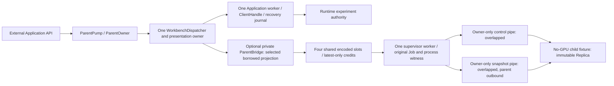
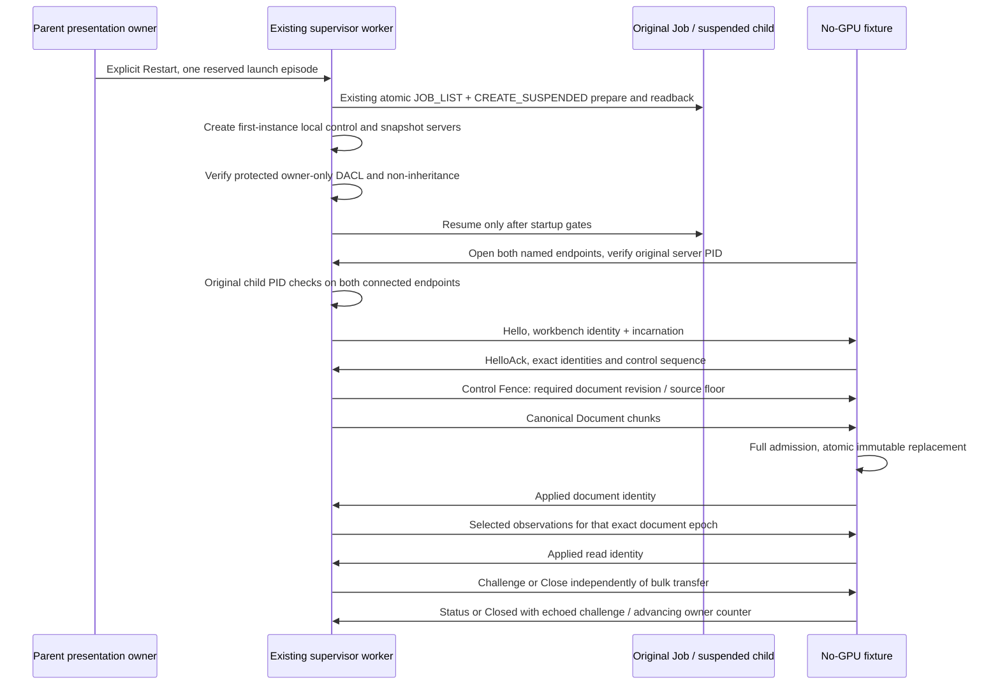

# DGUI-4C7B3B3: private read-only IPC and snapshots

Qualification status: **READY FOR INDEPENDENT REVIEW** within the private
read-only no-GPU B3B3 scope. This report does not activate GUI v2.
`ACTIVATION_QUALIFIED=false`.

## Baseline and source identity

B3B2 PR #38 was made Ready and merged with an ordinary merge commit after checking
the remote reviewed HEAD and current base:

- Reviewed HEAD: `ba38d64ab66f550b13ebec7dfe46272512c238f1`.
- Qualified B3B2 source: `c72e4440d5258679a8313e9894211948294373f7`.
- Merge: `5190760603ddbef4e567dc6b08a52001e046fe78`.
- First parent: `2aaf98fcd77a8b6bf73b2341d0b95298be401df6`.
- Second parent: `ba38d64ab66f550b13ebec7dfe46272512c238f1`.
- Local main was fast-forwarded to that merge and its working tree was clean.

B3B3 branch: `feature/dgui-4c7b3b3-private-readonly-ipc`.
Pinned source HEAD: `82d8ad12e3cf71f7b389a21e94e456b214da9e0d`.
The capsule audit is [private-ipc-license-safety.md](private-ipc-license-safety.md).
No dependencies, package versions, SDK installation or toolchain changes were
introduced. The task follows the [ADR](native-gui-host-adr.md),
[host contract](native-gui-host-contract.md), [ParentPump](independent-parent-pump.md),
[supervisor](windows-job-supervisor.md) and
[B3B2 follow-up](windows-job-supervisor-review-followup.md).

## Ownership and implemented scope

The parent retains its workbench identity, authoritative document and revision,
Application worker, Runtime client/scope, accepted mutations and recovery journal.
The bridge borrows the current observation cache and captures provenance at the
existing FIFO ClientUpdate boundary. It does not clone the cache or submit a
query, mutation, operation status or Exact Retry.

The active v1 host remains unchanged. The optional private adapter derives
canonical v2 bytes from the sole dispatcher's accepted v1 document through the
existing validated conversion and admission. The direct private document producer
also accepts an already admitted canonical v2 document. Both paths carry the same
parent identity and revision. Neither creates a second presentation owner or
changes the public Application API.

The child executable is generated by `scripts/test-private-ipc.ps1`. It owns a
closed protocol decoder, bounded encoded replica and one no-GPU owner loop. It
does not instantiate a Runtime client, instrument handle, dispatcher, mutation
sequencer, recovery journal, OutputAuthority, Job handle, renderer, Preview,
HostSession, window, input/DPI handler or OpenGL context. Its acknowledgements
describe read-only admission and owner progress, never laboratory actions.

`ParentOwner::turn()` performs bounded projection/admission and `try_lock`
publication only. A busy publication remains dirty and is rebuilt from the latest
parent state on a later scheduled turn. Pipe creation, connection, overlapped
submission/observation, cancellation and retirement run on the existing supervisor
worker. No additional I/O worker, blocking pipe wait, read, write or join is added
to the parent turn, dispatcher or Application worker.

## Connection, authentication and handshake

Names use the private local `\\.\pipe\lab-workbench-` namespace and include parent
PID, workbench identity and incarnation. Both servers require first-instance
creation and reject remote clients. An explicit protected DACL grants only the
current-user SID; actual owner/DACL and non-inheritable handles are read back.
Control is duplex; the snapshot server is outbound and the child endpoint is
read-only. All operations use stable OVERLAPPED storage.

Peer PID checks compare against the process retained by the original Job creation
record. No process is looked up or reopened by PID. The child checks the parent
server PID. Wire identity and incarnation checks are additional fences. A foreign
same-user process cannot become Ready or receive a document; name preemption
fails first-instance creation. This trusted same-user child is not a sandbox.
No connected handles are inherited: there is no HANDLE_LIST change, TCP listener,
alternate transport or fallback. Existing Job/process/client handles remain
non-inheritable and the B3B2 suspended-start containment checks are preserved.

## Closed wire schema

Version 1 uses a 96-byte little-endian header. Every channel has its own exact,
strictly consecutive transport sequence starting at one. It is independent of
Runtime request sequencing.

| Offset | Bytes | Meaning |
|---:|---:|---|
| 0 | 4 | `LIPC` magic |
| 4 | 2 | Version `1` |
| 6 | 2 | Closed message variant |
| 8 | 4 | Complete frame length, including header |
| 12 | 4 | Complete snapshot length; zero on control |
| 16 | 16 | Parent workbench identity |
| 32 | 8 | Current child incarnation |
| 40 | 8 | Channel transport sequence |
| 48 | 16 | Presentation epoch owner |
| 64 | 8 | Presentation revision |
| 72 | 8 | Snapshot identity |
| 80 | 4 | Exact chunk offset |
| 84 | 4 | Reserved, must be zero |
| 88 | 8 | Parent projection/source fence; real Runtime metadata is in payload |

Control allowlist: Hello=1, HelloAck=2, Challenge=3, Status=4, Close=5,
Closed=6, Diagnostic=7, Fence=8, Skipped=9, Applied=18.
Snapshot allowlist: Document=16, Observations=17. All other variants are rejected.
Handshake and message order are checked separately from structural decoding.
Applied/Skipped repeat the exact epoch/snapshot/source of the completed transfer
and one stream byte; acknowledgements are never executable commands.
Challenge/Close have an eight-byte token. Status/Closed have 32 bytes: token,
advancing owner counter, read snapshot identity, one read-current flag and seven
zero reserved bytes. Fence has two u64 values: document revision and minimum
approved parent source. Diagnostic payload is at most 1,008 bytes, leaving 16
bytes for incarnation/sequence in each ring record.

The receiver reads the fixed header into its existing RX buffer and validates the
declared sizes before reading a body or reserving an assembly slot. Unknown
version/variant, wrong channel/identity/incarnation, reserved fields, duplicate or
out-of-order sequence, zero/oversized sizes and interleaved offsets reject the
episode. Partial header/body reads and short writes continue in the same buffer
only after an original receipt. One incomplete transfer per stream has a monotonic
two-second deadline; bulk write completion also has a two-second bound.

The separate selected-read payload is `LRD1`: count u8, original overall freshness
u8, then at most 32 records. Each record contains a canonical typed RuntimeRef
(u16 UTF-8 length, at most 4,096 bytes), explicit origin tag, real boot identity
(128 bytes), optional projection token (128 bytes), optional frozen revision,
original effective freshness and quality, scalar kind/payload or explicit absence,
optional unit ID/symbol (32/16 bytes), optional entity revision, generation,
observed/source monotonic time and original event cursor. The trace suffix carries
an explicit availability/floor, u32 point count, and finite f64 time/value pairs.
All numbers use exact little-endian bits; integer, Boolean, text and enum variants
are closed. Text/enum values are bounded at 512 bytes. Optional tags, duplicates,
trailing bytes, nonfinite values, unsourced values and unavailable-quality values
are rejected. Points are bounded across the complete selected profile, not per
trace.

## Admission, atomic replacement and freshness

Canonical v2 admission retains the existing 1 MiB input and 4 MiB document
accounting checks. The child validates a complete candidate in one temporary
admitted document, compares canonical bytes, drops that parsed candidate and then
atomically switches its encoded slot. No old/new parsed document overlap is
introduced. Malformed or stale input leaves the previously accepted bytes intact.
The candidate's canonicalization output is included in the existing document
account and dropped with it; it is never another transport/reassembly slot.
Reads require the exact accepted document epoch and replace only after full codec
and source-successor checks. A new document invalidates the old read replica.

The parent performs a count-only codec pass over immutable borrows before changing
a Latest slot. The same encoder fills only the pre-admitted exact-length slot;
there is no fifth candidate buffer or partial overwrite on rejection. The child
compares boot/projection/revision/generation/source-time/freshness against its old
read. Transport reception or heartbeat never fabricates a measurement, replaces
absence with zero, or promotes stale/rebuilding/unknown data to Fresh.

The legacy live cache does not retain a point's boot/generation. The private
provenance ledger therefore records the first actually witnessed matching signal
point for each selected boot/generation. Cached points from an unwitnessed epoch
are explicitly unavailable, while the complete actual scalar and its metadata
remain intact. New generation/boot resets the floor. No cached point is relabelled
as belonging to a new source and no scalar is silently shortened. Regression tests
observe the unchanged legacy cache and the selected, correctly fenced points.

Control Fence invalidates an accepted read independently of a blocked snapshot
stream. It announces actual presentation/scope/freshness invalidations, not each
ordinary measurement. The original metadata stays readable but the child marks
that replica non-current. A two-second loss of parent control progress latches
non-current; a later heartbeat alone cannot clear it. Only another complete
validated read can clear that latch, and its original quality/freshness still
applies. Fully valid completed data overtaken by an announced parent fence is
coalesced with Skipped rather than partially applied. Actual backward source or
revision, malformed input and wrong incarnation remain channel failures.

## Numeric gates and allocation ledger

| Gate | Maximum | Admission point |
|---|---:|---|
| Control frame, header included | 4,096 bytes | Fixed header decode and TX capsule |
| Snapshot chunk, header included | 65,536 bytes | Fixed header decode and TX capsule |
| Complete canonical document | 1,048,576 bytes | Existing v2 admission before publication and child admission |
| Selected observations | 1,048,576 encoded bytes | Count-only codec and header decode |
| Selected references/traces | 32 | Parent selection and codec count |
| Selected profile points | 16,384 total | Codec preflight and decoder before point loop |
| Encoded/reassembly slots | Four 1 MiB slots total per endpoint | Fixed Pool; all credit states share it |
| Diagnostic ring | 64 x 1,024 bytes | Fixed ring; drop-oldest counter |
| Owner input turn | Four messages / 65,536 bytes | Control receive loop and combined child input budget |
| Incomplete transfer | One per stream, two seconds | Transfer identity/offset and monotonic deadline |

| Storage / representation | Owner and lifetime | Accounting / reuse condition |
|---|---|---|
| Four encoded slots | Parent Bridge or child Replica, endpoint lifetime | 4,194,304 bytes; Free/Latest/Current/Writing/Assembly share the same slots |
| Control RX/TX | Sole OS owner, connected episode through receipts | 8,192 fixed bytes; partial input/output stays in the original allocation |
| Snapshot RX/TX | Sole OS owner, connected episode through receipts | 131,072 fixed bytes; no chunk-sized assembly copy |
| Diagnostic bytes | Parent IpcBackend | 65,536 fixed bytes, including record metadata; fixture does not allocate another ring |
| Encoded + I/O + diagnostics | Each endpoint | At most **4,399,104 bytes**; cancellation and in-flight credit included |
| Slot/transfer/sequence/status metadata | Fixed Rust structs, Arc/Mutex root | Four slots, two stream records and fixed counters; separate from byte-storage formula |
| OVERLAPPED and events | One RX and TX per pipe | Four stable 32-byte OVERLAPPED structures and four events; retained until receipts |
| Admitted document candidate | Parent conversion or child complete validation | Existing <=4 MiB accounting per candidate; one child candidate at a time, zero persistent child parsed documents |
| Selected codec Plan | Borrowed parent cache and <=32 borrowed selections | Count-only pass; no owned RuntimeObservations or encoded scratch |
| Typed read temporary | One selected value at a time | Existing bounded resolver; text/enum prechecked at 512 bytes, unit strings 32/16 |
| Child RuntimeRef validation | One record at a time | At most 4,096-byte reference plus its canonical serialization; bounded parsed strings, dropped per record |
| Successor validation metadata | Borrowed bytes | Two fixed 32-entry arrays; no reconstructed Runtime model |
| Parent selected provenance | Private adapter lifetime | <=32 refs, owned string capacities <=4,096 per ref, boot/projection <=128 each, fixed revision/generation/floor; no point history |
| Parent per-turn selections | One projection turn | At most 32 shallow borrowed selections; separate small Vec/stack metadata, no point/value copies |
| Win32 creation scratch | Capsule startup only | Fixed aligned 1,024-byte token buffer, bounded local name/SID/SDDL strings and SDK LocalFree-owned descriptors; no packet-derived allocation |
| Kernel pipe buffers | Windows | 4 KiB/64 KiB creation hints, not an exact kernel allocation ceiling |
| Process/Job commit | Windows reading from original Job | Measured separately; fixture cap 128 MiB is a test policy, not production deployment cap C |

Parsed objects, admission scratch, allocator slack, metadata, kernel buffers and
OS commit are separate quantities. The 4,399,104-byte number is not a whole-host
Rust budget and is not added to commit to claim a universal ceiling. The maximum
document scenario records a **2,207,552-byte** child admission accounting peak
separately, with zero persistent parsed documents. I/O byte storage is 139,264
bytes; OVERLAPPED/event ownership is a separate fixed charge. CreateNamedPipe uses
4 KiB control and 64 KiB snapshot input/output size hints (139,264 bytes if both
directions of both instances are counted nominally). Unused direction handling,
kernel allocation growth and OS bookkeeping prevent treating those hints as an
actual kernel ceiling or as a per-endpoint Rust allocation.
The selected codec scenario saturates the 32-reference/16,384-point profile; its
encoded length is **267,132 bytes** in the maximum native fixture because the
closed shape has stronger limits.
The raw evidence records that length rather than padding a fictitious measurement.

## Latest-only scheduling and cancellation

Each stream has Current (or Writing) and at most one Latest replacement. A new
complete approved snapshot overwrites only unborrowed Latest. Starting a write
releases the old unborrowed Current; Writing and its chunk remain pinned until
the original write receipts. The two streams alternate after complete transfers.
Close/challenge take precedence over ordinary fence/status work; control receives
have their own bounded turn independent of one bulk chunk. The child enforces a
combined control/snapshot byte budget; a complete RX frame can remain held in its
original buffer until the next turn. It is not copied into another queue.

Control protocol failure latches that channel rejected. A diagnostic burst above
four records between owner-status messages is rejected; later frames cannot
continue growing diagnostic work. Bulk failure latches separately and permits an
authenticated control Close/Closed exchange. A snapshot-reader stall therefore
cannot suppress owner progress or close behind a large write.

```mermaid
stateDiagram-v2
    [*] --> Starting: Explicit admitted Restart
    Starting --> Connected: Original suspended startup gates and peer checks
    Connected --> Ready: HelloAck and admitted document / owner progress
    Ready --> Stopping: Close / explicit Terminate / watchdog / protocol fault
    Stopping --> ExitProof: Original process handle proves exit
    ExitProof --> IORetained: Cancel both pipes once; original operations unresolved
    IORetained --> IORetained: Pending receipts or observation failure; retain all ownership
    IORetained --> HandlesReleased: All original I/O completions and checked endpoint/event release
    HandlesReleased --> Retired: Release Writing credits, restore latest, original Job retirement
    Retired --> Starting: New explicit Restart only
```

CancelIoEx success or ERROR_NOT_FOUND is a request outcome, never a completion
receipt. GetOverlappedResult with `wait=false` observes the original completion;
known cancelled/broken-pipe terminal receipts retire operations, unknown failures
retain them. Both pipe cancellation requests are issued even if one side remains
unresolved. Endpoint/event handles and buffers remain owned until all receipts
and checked release. Original Job/process ownership is retired last.

The supervisor's existing ExitUnconfirmed state can also represent confirmed
process exit with unretired IPC obligations: `alive=Some(false)`, IPC
`retiring=true`, pending I/O/handles still nonzero. Pending retirement is not
recorded as a synthetic cleanup failure and may observe the same original
obligations again. A real release failure remains failed closed. No automatic
termination retry, replacement process, second worker or new IPC episode is
created. ParentPump root shutdown returns unresolved until worker completion and
all original process/transport objects retire. An unexpected unfinished capsule
drop retains bounded borrowed allocation rather than freeing kernel-owned bytes.

## Failure and recovery evidence

| Fault / acceptance group | Observed boundary and result |
|---|---|
| Two real pipes, peer and incarnation | Explicit owner/DACL checks; original child/server PID and wire incarnation verified; foreign process rejected before Ready/snapshot |
| Max document/read profile, numeric overflow | Full canonical admission and finite selected codec; oversized lengths/counts rejected before unsafe reservation or old-state overwrite |
| Fragmentation / short completion | Original RX buffer and real 17-byte WriteFile submissions; exact 4 KiB reassembly from actual completion receipts |
| Atomic replacement / stale epoch | Old accepted snapshot preserved through malformed, wrong-offset and stale candidate; no mixed revisions |
| Source/revision/freshness | Real boot/revision/generation/quality retained; regression and unwitnessed Fresh rejected before publishing |
| Slow reader / coalescing | Current/Writing plus one Latest, shared four-slot ledger; observed control owner progress and Close independently |
| Parent fence with blocked reads | Previously admitted read becomes non-current over control while owner heartbeat continues; cached bytes not fabricated fresh |
| Snapshot-only broken pipe | Original bulk error retained; control close observed and process exits normally without termination request |
| Versions/variants/length, duplicate/order | Closed decoder/order rejects authenticated child traffic; no permissive fallback |
| Truncated control/snapshot | Previously applied parent document preserved; no partial child admission |
| Flood | Fixed diagnostic ring/counters and rejected channel latch; bounded owner turns |
| Child hang/crash | One original Job/process episode, contained terminal, no automatic replacement |
| Process proof with cancellation pending | Exit proved but two original pending operations, six endpoint/event handles and Writing credit retained; Restart and second worker denied |
| Confirmed retirement / restart | Actual original receipts and all handles released before explicit incarnation 2; newest approved bytes restored, no history |
| Parent API/recovery during hung/slow child | Genuine ParentPump and Application API continue, unchanged Workbench/scope/recovery/accepted mutation, update target <100 ms in controlled harness |
| Parent root shutdown during I/O | Repeated shutdown remains unresolved with process proof and pinned I/O; succeeds only after actual receipts/checked retirement |
| Runtime submission gate | Instrumented parent sender observes zero added mutation/status/Exact Retry from faults, watchdog, restoration or IPC |

The native scenarios use the real supervisor worker, real Job and original process
witness, actual overlapped operations and visible intermediate state/credit
ledgers. Gates can withhold observation of real completion or retirement; they do
not fabricate a completion. Barriers and state notifications establish ordering.
Deadlines bound failure and busy retry; sleeps are not ordering proof.
Native ParentPump continuity uses a controlled Runtime sender and real local
Application API sockets. Separate virtual-process acceptance and strict native v1
smoke cover existing Runtime/v1 integration; this report does not claim a new
physical-instrument or GPU qualification.

## Windows dev/release qualification

Windows 10 Pro 10.0.19045 x64, Rust/Cargo 1.95.0, x86_64-pc-windows-msvc,
PowerShell 7.6.6 and Python 3.14.6. The final run completed on 2026-10-14 UTC
(2026-10-15 local Moscow date). Every gate verified the pinned HEAD and the Windows
bytes of all 368 inventoried inputs before running. All **26 command gates returned
exit code zero** on `82d8ad12e3cf71f7b389a21e94e456b214da9e0d`.

| Gate | Dev | Release |
|---|---|---|
| Complete Workbench suite | 513 passed, 41 ignored; 226.55 s command | 513 passed, 41 ignored; 23.03 s command |
| Inventory | 554 test names | Same 554 names |
| Parent/supervisor/GUI/architecture/private selection | 50 passed | 50 passed |
| Non-M17.4 virtual process acceptance | 13 passed | 13 passed |
| Existing B3B2 native groups | 7 passed | 7 passed |
| New private IPC native groups | 19 passed | 19 passed |
| Capsule real-pipe unit and doc checks | PASS | PASS |
| Native v1 strict ordinary smoke | PASS, exactly two connections | PASS, exactly two connections |
| Borrowing compile-fail gates | All five PASS | All five PASS |
| Complete CPU Preview allocation probe | PASS; 535.83 s including wrapper | PASS; 65.89 s including wrapper |
| Clippy, affected packages, all targets/features, `-D warnings` | PASS | PASS |
| Runtime/Workbench locked builds | PASS | PASS |

Formatting and diff checks passed. The inventory's sorted names, UTF-8 with LF,
have SHA256
`37ace04e6619b0cd7d874bd789df99df8bfcb6c869c06e4d32381ffe04c45714`.
Geometry (119), memory (125), frames (12), no-upload (4) and pending retirement
(9) cases match the existing CSV accounting in both profiles, excluding only the
scheduling-dependent `wait_calls` count. Raw values are retained. Plot and bounded
outputs match B3B2 evidence with normalized line endings. The maximum CPU Preview
charge remains **4,610,337 / 8,388,608 bytes**. GPU-pending tables are CPU ledger
evidence, not terminal GPU qualification.

Native retained-episode evidence records confirmed original process exit with two
unobserved I/O operations, six retained endpoint/event handles, 139,264 I/O bytes
and one Writing slot. Both explicit-stop and root paths prohibit replacement;
after original receipts and checked handle release the same worker retires them.
The maximum canonical/read fixture records 1,048,576 document bytes, 32 references,
16,384 points and 267,132 encoded read bytes. Slow-reader evidence records 99
coalesced replacements with advancing control owner progress. The controlled
ParentPump update observations were 113/124 us in dev and are retained per mode
in release evidence; all satisfy the 100 ms harness gate.

Normal-fixture OS readings are separate: dev peak process commit 8,183,808 bytes,
peak Job commit 14,737,408; release 8,134,656 / 14,688,256. They are observations
from the original Job, not estimated Rust heap size or a production cap decision.

The [evidence directory](private-readonly-ipc-evidence/) contains command receipts,
test inventory, exact Git-blob/tested-Windows-byte SHA256 for each source input,
CPU comparison, separate memory ledger, protected-source equality, executed binary
identities and the two native v1 audits/captures. `raw-evidence.zip` retains 146
unedited log/probe/session/development files; `raw-manifest.json` hashes every
archived member. The binaries themselves remain local test snapshots; none is
released. The smokes execute the preserved Runtime/Workbench snapshots whose
hashes match their audits. Private IPC and supervisor fixture and CPU probe binary
identities are recorded separately. A source identity is not a claim that builds
with a different feature graph have identical executable bytes.
The [SHA256 inventory](private-readonly-ipc-sha256.txt) covers the final report,
navigation, capsule audit and every evidence file. Text hashes use Git's LF blob
representation; raw archive/capture hashes use their exact bytes. The inventory
excludes its own bytes to avoid a self-referential hash.

Development attempts used changing, unqualified working sources. Their raw errors
remain archived: fixture artifact selection, test observations of busy metadata
or unpublished prepare counters, flood scheduling, and completion-observation
gates were corrected before the pinned run. Compiler/Clippy failures are also
retained. The packaging helper initially missed a RETAINED diagnostic because it
shared a line with the Rust test name; that helper failure is archived and its
parser was corrected without changing any source or test result. No failed attempt
is counted as qualification PASS. A separate final-audit receipt retains the
helper's premature check of its to-be-generated hash inventory; the order was
corrected. Earlier transcript-only failures cannot be
reconstructed as original raw files and are not represented as archived receipts.

This report, navigation and evidence are a documentation-only follow-up to the
qualified source HEAD. Final verification compares all tested Rust/Cargo/script
and example input blobs against that exact HEAD; only documentation/evidence is
added after qualification. The final branch HEAD is the Draft PR's head commit.

The only B1 fixture changes expose the existing cfg(test) maximum-document helper
to sibling private IPC tests. Production admission, quotas, public types and
canonical conversion behavior are unchanged. The CPU probe wrapper includes the
new optional parent module so it still compiles the actual production modules;
its borrowing cases, scenarios and numeric assertions are unchanged.

## Remaining verdicts and phase fences

- B3B3 private read-only no-GPU scope: **PASS**, **READY FOR INDEPENDENT REVIEW**.
  Independent review remains required; this phase is not merged or activated.
- Historical extra hello-only v1 connection: **UNQUALIFIED**. Controlled
  `scope_in_use` reattach is already established on B3B1/B3B2, but does not explain
  that historical session. Runtime reconnect semantics and the strict ordinary
  two-connection native smoke assertion are unchanged.
- M17.4 Recorder overlap: **BLOCKED** in its historical scope.
- Terminal GPU lifecycle: **BLOCKED**; no renderer or GPU work in this phase.
- Whole-host Rust budget: **BLOCKED**; encoded credit is not that proof.
- Production GUI Job commit cap C: unselected. The fixture's 128 MiB test cap is
  not a production decision.
- `ACTIVATION_QUALIFIED=false`. B1, FiniteTraceItem and the 8,388,608-byte CPU
  Preview allowance are unchanged. No B3B4, GUI actions, Typed Parameter/Manual
  Output API, ExperimentRunner, public API v2, Linux backend, release or B3B3 merge.
