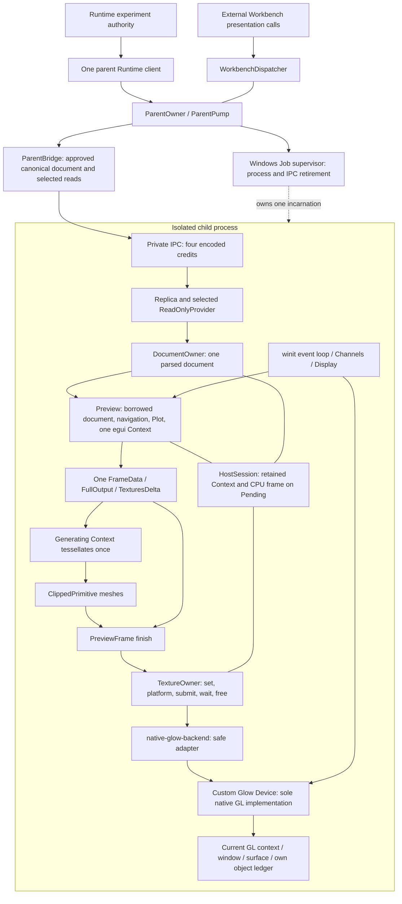
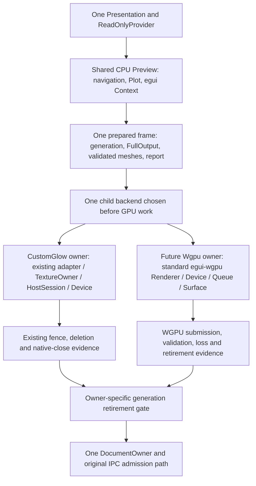

# RENDER-1: Backend Separation and WGPU Feasibility

Status: **design ready for independent review**. `ACTIVATION_QUALIFIED=false`.
This change contains documentation and evidence only. It recommends **B: shared
egui frame preparation with independent GPU owners**, and a future Windows proof
using the standard **egui-wgpu Renderer in the existing winit child**. It does not
implement a WGPU renderer, a new trait, backend selection or fallback.

The UI data path is compatible at the source-interface level. The ownership path
is not a drop-in adapter: `Preview`, `PreviewFrame`, `HostSession`, `DocumentOwner`
and `Replica` currently couple Context retirement to `FrameBackend`. Changing that
coupling requires a dedicated ownership change and renewed borrowing, memory and
handoff qualification. RENDER-1 stops at this design boundary, as requested;
RENDER-2 requires an independent decision before implementation.

## Merge and source identity

PORT-1 [PR #44](https://github.com/alexandervolkov1/lab-runtime-legacy/pull/44) was marked
Ready and merged using an ordinary merge commit after rechecking the remote
HEAD/base, all 398 canonical hashes and the post-qualification delta:

| Identity | SHA |
|---|---|
| PORT-1 qualified executable source | `18c1aeb77899e0c7736831fcc0e49b8161f54702` |
| Reviewed HEAD / merge second parent | `14f6b3fe8b3bec23dda011569ab80b9547e28a62` |
| Base / merge first parent | `d96111f488d8535c294879e767832d537219108a` |
| Merge / RENDER-1 branch base | `ea5789c1077ed1c8ac7f0651599d7daea2a232ed` |

The 38 paths after qualification contain only developer documentation/evidence.
The merge tree equals the reviewed HEAD tree. Local main was fast-forwarded and
verified clean before creating `feature/render-1-backend-separation`.
[Pre-merge audit](render-1-evidence/pre-merge.json) and
[merge parents](render-1-evidence/merge.json) preserve these checks.
[PR #43](https://github.com/alexandervolkov1/lab-runtime-legacy/pull/43) remains an unmerged
historical BLOCKED record; its HEAD is `04c0e5180a4bc45ae12c7b62fdb3b86ad8f10e7c`.

## Current dependencies and ownership

This diagram describes the experimental isolated renderer path. Normal Workbench
startup still uses GUI v1. Existing native tests supply bounded virtual fixture
observations; this is not the deferred real-Runtime B3B5 startup integration.

| Source | Responsibility and actual boundary |
|---|---|
| [readonly_v2/mod.rs](../../apps/lab-workbench/src/gui/readonly_v2/mod.rs) | Borrowed Presentation; one navigation/Plot state; creates and retires an isolated Context; `prepare`/`run_plot` call `Context::run_ui`; input, page and text limits. `Preview<B>` also borrows `HostSession<B>`. |
| [frame.rs](../../apps/lab-workbench/src/gui/readonly_v2/frame.rs) | One CPU frame slot retained in Preview; exclusive guard; one tessellation attempt on its generating Context; rejects callbacks, malformed meshes and non-finite geometry. `finish` calls `TextureOwner::process`; it is not a CPU-only extraction API. |
| [texture_owner.rs](../../apps/lab-workbench/src/gui/readonly_v2/texture_owner.rs) | Eight texture slots, sixteen updates; namespace and partial-update checks; register before attempted upload; set/platform/submit, bounded wait, completion-object release, free. Failure may already have created obligations. |
| [host_session.rs](../../apps/lab-workbench/src/gui/readonly_v2/host_session.rs) | External serial owner outlives Preview; retains Context and frame on unresolved work, forbids another generation, preserves original errors. Drop is not a completion proof. |
| [native-glow-backend.rs](../../scripts/support/native-glow-backend.rs) | Safe adapter to the one Device; restricts platform output; maps errors and preserves the completion/deletion contract. |
| [native-glow-device.rs](../../scripts/support/native-glow-device.rs) | Current-context/thread checks, uploads, GLSL, draw/scissor, fence/flush/wait, exact native deletion identities, readback, healthy native close. Its GPU ownership remains unchanged. |
| [entry.rs](../../apps/lab-native-child/src/entry.rs) | Lexical Device/session/document/Preview owners; winit events, suspension, finite qualification deadline, Channels progress, replacement retirement, captures and shutdown. Unresolved roots stay alive for containment. |
| [document_owner.rs](../../apps/lab-workbench/src/private_ipc/document_owner.rs) and [replica.rs](../../apps/lab-workbench/src/private_ipc/replica.rs) | One parsed document, paired non-forgeable admission key, borrows preventing replacement during Preview; retirement checked before parse/apply/restore. Encoded candidate remains bounded while the old generation is pending. |
| [parent.rs](../../apps/lab-workbench/src/parent.rs), [supervisor](../../apps/lab-workbench/src/supervisor/mod.rs), [private_ipc](../../apps/lab-workbench/src/private_ipc/mod.rs) | Runtime authority stays in the parent; scheduling, launch, original process-handle exit and original I/O retirement are independent of which GPU API draws. |

### Neutral data versus implementation-specific promises

Presentation admission, `PresentationEpoch`, `ReadOnlyProvider`, freshness,
navigation, Scalar, Plot projection/text/finite geometry and egui CPU output are
backend-neutral. `ContextGeneration` is a non-recycled process-local namespace;
it is neither a GL object name nor a Runtime scope. Texture IDs need that namespace
even with WGPU, because different egui Contexts can reuse the same numeric ID.

`FullOutput` includes platform/viewport output as well as textures and shapes.
`ClippedPrimitive` itself permits callbacks, but the existing supported subset
does not. [FiniteTraceItem](../../apps/lab-workbench/src/gui/readonly_v2/finite_trace.rs)
emits ordinary egui meshes/shapes; there is no GL Plot implementation to replace.
The egui Context that generated a frame must perform its tessellation; it cannot
be replaced by an unrelated eframe Context after shapes have been generated.

`FrameBackend` has portable Rust argument types, but its contract requires all
dependent work to quiesce before native release, including partial failures.
`WaitFailure::{MissingFence,InvalidFence}`, deletion identities for VAO/program/
shader/fence, and `DeleteDisposition::Ambiguous` encode the present native path.
`HostCompleted` currently follows a successful wait and release-frame operation;
it does not mean desktop presentation or final WGL destruction was proved.
`HostSession` contains no GL calls but is coupled to that completion model.

Native window/input handling is a third concern. Platform-output admission can be
shared, while applying cursor/viewport events belongs to the native host. Windows
Job supervision and private IPC remain outside both GPU owners.

## A versus B

| Criterion | A: make both implement current FrameBackend | B: shared preparation, independent GPU owners |
|---|---|---|
| Shared UI and mesh data | Possible | Possible without renderer-specific widgets |
| Existing Glow behavior | Temptation to weaken its receipts or expand every diagnostic enum | Preserve Device, adapter, TextureOwner and HostSession contracts |
| WGPU completion | Would need to translate queue/device semantics into fence-shaped failures | Own submission identity, polling, validation/loss and native lifecycle evidence |
| Texture/resource release | Would imply a synchronous deletion receipt where the upstream API returns none | Distinguish logical removal, submitted work completion and actual native reclamation |
| CPU bounds | Existing checks still need extraction from mixed owners | Share CPU validation once; keep backend allocation accounting separate |
| Cost | Fewer apparent methods, but misleading semantics or a large associated-type abstraction | A focused ownership seam across five existing modules plus child orchestration |
| Recommendation | Do not implement a WGPU FrameBackend shim or fabricate `Quiesced` | Recommended design, pending review and implementation proof |

A radically smaller trait expressing only frame consumption could work, but it
would no longer provide today's `FrameBackend` lifetime contract. A data boundary
and a small native dispatch point express the present two-backend requirement
without introducing a general plugin system or a common GPU deletion algebra.

## Recommended boundary

This is a proposed structure, not an implemented API. Keep it private to the
experimental child/Preview. The smallest useful separation has these rules:

1. Separate CPU state and operations in `Preview` from its current host binding.
   Keep document/epoch, navigation, page/text/Plot state, Context and one pending
   frame together. Preserve current Context turnover on page/text/document changes.
   The existing `Preview<B>` facade can delegate to this CPU core while retaining
   its Glow host binding and all old tests; do not leave a second copy of paint code.
2. Expose a scoped, non-clone frame borrow containing generation, texture delta,
   platform output, validated mesh slice, pixels-per-point and report. Do not return
   an owned `FullOutput`/Vec to an unrestricted caller or expose a clonable Context.
   One guard, one tessellation attempt, one slot; forgetting it still blocks the
   next frame. Drop/discard must preserve the appropriate retirement obligation.
3. Keep shared preparation/tessellation validation, and preflight the new WGPU
   input before its first GPU side effect. Extract pure protocol/dimension/mesh
   helpers only where semantics match; preserve the original Glow process order,
   limits and defense checks, including partial-failure retirement. Do not move
   Glow waits or deletion into the shared CPU core. Texture namespace/partial
   update metadata uses one fixed ledger, not an unbounded second model. Native
   objects and backend staging never become fields of shared presentation data.
4. Keep moves of the original Context and pending frame into retirement storage
   explicit. A submitted or ambiguous attempt retains that single payload and its
   generation until its owning backend permits release. For the first WGPU proof,
   retaining it through observed submission completion is the conservative policy;
   no optimization that enlarges overlap or queues a second frame is implied.
5. Native dispatch chooses one concrete host once per child incarnation. Prefer a
   small private enum or concrete entry branches, not `Box<dyn FrameBackend>` for
   both APIs. Each branch consumes the same prepared frame through its own owner.
   A new WGPU owner is not a second UI, document owner or Runtime client.
6. Make document admission depend on an exclusive, paired host retirement gate,
   independent of GPU method dispatch. A sealed gate can delegate to the existing
   Glow `ensure_retired` proof or a future WGPU proof. It must not accept a caller
   boolean, fabricate a Glow `CleanupOutcome`, permit stale proof reuse or release
   the document while a frame/Preview borrow exists. Keep the single canonical
   parser/commit/restore path in `Replica` and its paired admission key.

The gate concerns permission to retire the **presentation generation**. Its
diagnostic receipt must retain the backend tag and precise evidence; it must not
assert that GL deletion and WGPU reclamation are identical. Final native-root
closure and OS process/IPC retirement remain separate facts.

### Why this PR stops before the Rust extraction

`Preview::prepare` may retire a Context during preparation, not only at final
shutdown. `PreviewFrame::finish` controls error-triggered transfer into
`HostSession`. `DocumentOwner::parts` lends the same exact session as the document,
and `Replica` checks that pairing on admission and restoration. Exporting meshes
alone or substituting `CpuOnly` for the session bypasses those obligations.

This is a cross-owner change, not a safe accessor addition. No widgets or Plot
algorithm need rewriting, but all three borrow chains (frame/Preview,
Preview/document/session, and native root/IPC) need a reviewed migration together.
The minimal proof below establishes reusable data, not completed ownership
separation. There is no claim that WGPU already runs in this architecture.

## WGPU host feasibility

The inspection uses eframe/egui/epaint/egui-wgpu **0.36.2**, winit **0.30.13** and
the cached candidate wgpu **30.0.1**. The repository currently enables eframe Glow;
egui-wgpu/wgpu are not in its Cargo.lock. Inspected upstream files and cached crate
archives were SHA256-checked against Cargo checksums in
[upstream-sources.json](render-1-evidence/upstream-sources.json). Source availability
is not dependency approval. RENDER-2 must pin and review its actual feature graph,
licenses, unsafe boundary and supply-chain evidence before adding dependencies.

| Criterion | Stock eframe with WGPU | Standard egui-wgpu in existing winit child |
|---|---|---|
| Same egui UI | `App::ui(&mut Ui, ...)` can call shared paint routines, but eframe owns the outer Context/run/tessellation path | Directly consumes the prepared texture deltas and mesh slices from the present isolated Context |
| One isolated process / parent client | Possible; eframe does not require a Runtime client | Existing child process and parent authority stay in place |
| Private IPC | Needs scheduling integration with eframe's event loop and exit sequence | Keep current Channels/Replica and event-loop progress scheduling |
| Context memory policy | Must reprove cache turnover, pending output and borrowed-document lifetime under a framework-owned Context | Retain explicit Context lifetime and bounded preparation |
| Resize/DPI support | Framework supports native integration; our CPU contract still needs PORT-2 | `ScreenDescriptor` carries physical size/scale; winit supplies events; our admission still needs PORT-2 |
| Shutdown | `on_exit` is a notification, not this project's original-resource retirement receipt | Root can keep the exact device/queue/surface and old payload while pending |
| Custom low-level work | Least window/presentation code, greatest change to present custody | Small surface/queue/poll/readback host glue; standard renderer owns shaders, buffers, textures, draw implementation |
| Choice for RENDER-2 | Keep as an alternative if ownership policy is independently redesigned | Preferred: preserves the current lexical child owner and avoids rewriting Preview widgets |

The [eframe App API](https://docs.rs/eframe/0.36.2/eframe/trait.App.html) and inspected
native integration show that eframe runs its Context, tessellates, accumulates
texture deltas and invokes its painter. Calling `Preview::run` inside `App::ui`
would nest an independently owned egui frame; it is not the proposed integration.
Stock eframe remains a useful future compatibility reference, not evidence of
equivalent startup, boundedness or cleanup here.

Two direct integration levels were inspected. The convenience
[egui-wgpu winit Painter](https://docs.rs/egui-wgpu/0.36.2/src/egui_wgpu/winit.rs.html)
also owns a Context handle, surface maps and screenshot channels; its paint call
does not return the submission identity, and `destroy` supplies no cleanup
receipt in this version. Adapting those hidden responsibilities would undermine
the narrow owner. Prefer the lower-level standard `egui_wgpu::Renderer`; do not
fork its renderer, reproduce its shaders, or write a parallel WGPU Plot.

### Minimum feasibility evidence

| Existing output | Matching standard interface | What this establishes |
|---|---|---|
| `eframe::egui::ClippedPrimitive` from the generating Context | `Renderer::update_buffers` / `render` take `&[epaint::ClippedPrimitive]` | egui 0.36.2 reexports the same epaint types; a version-unified future build needs no mesh conversion or new Plot |
| `FullOutput::textures_delta`, ordered updates per texture ID | `Renderer::update_texture(..., TextureId, &ImageDelta)` and `free_texture(&TextureId)` | Existing CPU image updates can feed the standard renderer; preserve per-ID order and generation binding |
| Frame pixels-per-point and fixed physical size | `ScreenDescriptor` | Necessary screen metadata already exists; this does not authorize new dimensions/DPI |
| CPU validation rejects callbacks | Standard renderer accepts mesh jobs | No custom paint callbacks or user command-buffer implementations are needed for the read-only UI |

The [Renderer API](https://docs.rs/egui-wgpu/0.36.2/egui_wgpu/struct.Renderer.html)
exposes texture updates, buffer preparation and rendering in that order. Its
render pass requires `forget_lifetime`; that safe API moves encoder misuse checks
to runtime. Keep the render pass scoped and dropped before encoder finish; do not
use unsafe casts or let it escape the owner. A future Cargo check must prove a
single egui/epaint version in the enabled graph. **No WGPU compile, adapter/device
creation, pixel test or cleanup qualification was performed in RENDER-1.**

Fresh execution of the unchanged frame/Preview and native Glow tests below
confirms that the actual shared CPU path still produces usable meshes and pixels
and retains the original Pending behavior. This combination is a feasibility
review, not a substitute for RENDER-2 execution.

## WGPU memory, lifetime and failure risks

The future WGPU root owns one instance/adapter/device/queue, one window/surface,
one standard Renderer, at most one acquired surface image, one submission record
and one bounded readback request. Preserve the existing single CPU frame and one
parsed document. No callback queue, second supervisor, secondary viewport, cloned
Context cache or background Runtime client is authorized.

| Risk | Required RENDER-2 control / current limitation |
|---|---|
| Queue staging before submit | Arm an obligation before the first update. Include pending upload writes in a submission fence, including a bounded empty submission where required to drain queued writes after a later failure. Never re-upload/re-draw to recover. Failure to establish completion retains the root. |
| Submission versus completion | Retain exact `SubmissionIndex`; use bounded event-loop polling and a fixed completion flag. `submit`, present or callback delivery alone must not erase validation, loss or original errors. No unbounded `Wait`, spin, callback history or new poll worker. |
| WGPU release semantics | `free_texture` returns no deletion Result; after submission the implementation may retain native resources. Do not manufacture GL object names or synchronous deletion success. Observe queue progress, release application references and report native reclamation limits separately. |
| Device loss / panic / OOM | Retain original diagnostics and original ownership where execution can continue; otherwise contain the original child via its existing Job. Error scopes/callbacks are bounded evidence, not Rust OOM recovery. Do not catch arbitrary post-submission unwind and resume rendering. |
| Renderer buffer growth | Preflight checked arithmetic and predicted upstream capacities before calling it. Input bytes alone do not bound allocation or replacement overlap. Reject before growth exceeds the unchanged allowance; do not increase quotas to make the proof pass. |
| Textures and sampler cache | Keep eight live keys/sixteen updates, finite options, partial bounds, image lengths and aggregate payload checks. Audit full-replacement overlap and cache lifetime per generation, including same-ID replacement. |
| Hidden driver/surface allocation | Measure process/Job commit separately from Rust CPU, WGPU payload and VRAM. Device limits are not total-memory limits. No transfer of the 224 MiB historical profile or the 512 MiB PORT-1 experimental result to WGPU. |
| Readback | One admitted fixed-size request, checked row-pitch alignment/length, bounded map completion. A map callback is not an unlimited screenshot queue; report actual GPU buffer bytes. |
| Retirement during document replacement | Keep the old generation and parsed document until the owning proof permits release, then use existing encoded candidate and single parser. No simultaneous parsed candidates or fallback session. |
| Native close | Stop admissions; observe pending work; retire application resources; close surface/device/window in reviewed order. Timeout/loss leaves the root retained for containment. OS exit alone does not prove GPU cleanup. |

[Queue](https://docs.rs/wgpu/30.0.1/wgpu/struct.Queue.html) records submission and
offers completion callbacks that require polling/submission progress; callbacks
must remain short. [Device polling](https://docs.rs/wgpu/30.0.1/wgpu/struct.Device.html#method.poll)
has distinct wait/error behavior. The proof must test uploads without a successful
draw, lost device and pending readback, not just healthy submitted frames.

Source inspection of the
[standard renderer](https://docs.rs/egui-wgpu/0.36.2/src/egui_wgpu/renderer.rs.html)
found initial buffers of 1,024 vertices and 3,072 indices, growth by
`max(2 * old_capacity, required)`, staging writes and a retained sampler map.
Its old/new allocation overlap and staging must be charged. The existing Glow
draw limits are 192 primitives and 2 MiB each of packed vertex/index input, with
4 MiB staging and 4,915,200-byte readback. Keeping those input limits is necessary
but does not by itself qualify WGPU's internal buffers. If a finite standard-API
usage cannot stay within the reviewed budgets, stop for a memory-policy decision;
do not fork egui-wgpu or silently raise them.

CPU Preview stays at 8,388,608 bytes; existing document maxima, selected-read
bounds, four encoded credits and 4,399,104-byte IPC/IO/diagnostic accounting stay
unchanged. Rust allocator lifetime, OS commit and GPU/VRAM cannot be added up as
one proven bound. Third-party initialization/polling can overrun software deadlines;
process containment remains necessary and does not create a GPU cleanup receipt.

## Future backend selection contract (not implemented)

| Explicit selection | Future behavior |
|---|---|
| `glow` | Attempt CustomGlow only; diagnose capability or initialization failure |
| `wgpu` | Attempt standard WGPU only; record actual adapter API/features/limits and surface compatibility |
| `auto` | Prefer Glow admission; one WGPU attempt may follow a diagnosed unsupported capability only after original child/IPC retirement |

Keep selection separate from default-v1 versus experimental-host admission.
Absence of a future explicit experimental choice continues to mean v1. Hardware
vendor/model/CPU/driver strings remain diagnostics, never an allowlist. WGPU
admission must inspect features, limits, surface formats and actual API support.

For the first future implementation, use a new child incarnation for any backend
change. Even an admission failure with no GPU work must retire its original process
handle and control/snapshot I/O before replacement. Preserve the parent client,
dispatcher, API endpoint, workbench_id, revision, scope/boot/next sequence and
recovery journal. Only approved read-only snapshots cross into the new child.

The bounded policy has at most two attempts per explicit `auto` launch episode:
Glow, then WGPU once. A generic initialization failure, OOM, runtime GPU fault,
unknown outcome or lost native root stops the episode; it is not assumed to be a
capability rejection. No automatic runtime restart loop or cross-backend retry.
`ExitUnconfirmed`, unfinished I/O retirement, a failed retirement release, parent
shutdown or a non-replaceable supervisor phase forbids the next child. A later
explicit restart uses existing containment/retirement conditions. Display failure
never invokes a Runtime mutation, status request or Exact Retry.

## Necessary Rust changes and RENDER-2 proof plan

These are proposed review units, not implemented work or an instruction to proceed.
No repository relocation or public API change is necessary.

| Unit | Files / work | Acceptance before the next unit |
|---|---|---|
| R2.0 dependency and budget decision | Pin candidate egui-wgpu/wgpu features for Windows; exact-version license/safety review; finite initialization and allocation policy | One compatible egui/epaint type graph; numerical budget for all new allocation/overlap classes; no new whitelist or automatically raised cap |
| R2.1 shared CPU custody | `readonly_v2/mod.rs`, `frame.rs`, private validation helper; minimal adaptation of `host_session.rs` payload binding; keep old facade/TextureOwner/Device behavior | One paint/Plot implementation; full old CPU, borrowing, generation, retirement and native Glow gates; forgotten-guard and partial-error behavior preserved |
| R2.2 document/root pairing | `private_ipc/document_owner.rs`, `replica.rs`, `entry.rs`; sealed owner-specific retirement admission and one parser | Wrong owner, stale generation, active Preview, Pending and unresolved original IPC cannot admit/restore; no duplicate document or parser |
| R2.3 bounded WGPU proof | New child-only safe host using standard Renderer; fixed 1280x960 scale 1; explicit test-only backend argument, no auto | Scalar and the same Plot produce actual GPU readback; actual adapter/capability diagnostics; no new Runtime client or app API |
| R2.4 faults and review | Fixed output/error/capture records; deterministic retirement controls plus actual process tests | Partial uploads, submit failure, loss, timeout, close, replacement, map failure, parent exit; unchanged Glow + Workbench regression; report measured commit/payload/CPU separately |

R2.1/R2.2 touch at least five coupled ownership modules and child orchestration;
they are medium-to-high-risk custody work, not a directory cleanup or a replacement
renderer project. Keep each review unit independently revertible and the original
Glow facade operational throughout. If safe separation expands into rewriting
the widgets, protocol, parent model, Context budget policy or upstream renderer,
stop for another architecture review. A line-count/time promise would be premature
before R2.0 and the borrowing prototype.

The proof should start offscreen with the same canonical fixtures, then the actual
Windows Job/private-IPC child. Use one real WGPU device, not a fake completion
adapter. Test Page/Plot, absent/stale reads, document revision, a Pending handoff
and explicit close with actual GPU buffers. Compare geometry/labels and documented
color tolerances rather than demand identical cross-backend rasterization. Negative
compiler tests must cover escaped frame/Context, concurrent generation and document
replacement. WGPU errors must never be converted into a healthy Glow receipt.

Do not claim stock eframe equivalence until a separately reviewed reference and
isolated-child test matrix establishes it. Dynamic size/DPI is still PORT-2;
Linux/macOS process hosting still needs platform-specific ownership tests. RENDER-2
does not authorize B3B5, controls, production activation or real instruments.

## Validation and evidence scope

See [validation](render-1-validation.md) for fresh checks, unchanged-source reuse,
actual GL captures, source/binary identities and remaining limits. All executable
inputs, Runtime, OutputAuthority, Recorder, Clojure client, public API, quotas and
historical qualification files remain unchanged. No new dependencies were built
or enabled for this review.

Historical hello-only: **UNQUALIFIED**. M17.4 Recorder overlap: **BLOCKED**.
General terminal GPU lifecycle: **BLOCKED**. Whole-host Rust budget: **BLOCKED**.
Final WGL destruction: **LIMITED**. WGPU execution, memory and cleanup:
**UNQUALIFIED / pending RENDER-2 review**. New resolution/DPI, other-platform child
hosts and real-Runtime isolated B3B5 integration remain outside this evidence.
`ACTIVATION_QUALIFIED=false`. No RENDER-1 merge, release or activation is authorized
by this document.
