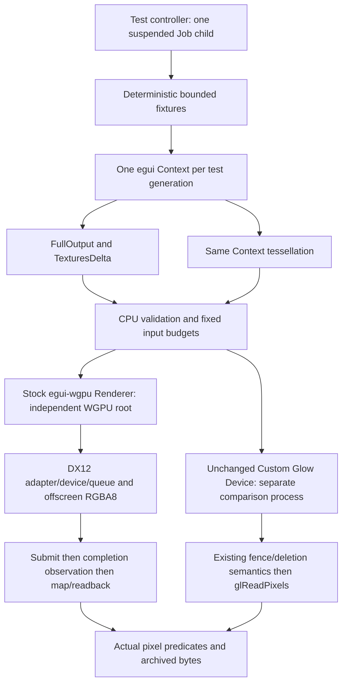

# RENDER-2A: standard egui-wgpu feasibility proof

RENDER-2A is an isolated Windows/MSVC, fixed-size **test proof**, using the approved
RENDER-1 decision B: shared egui preparation, independent GPU owners. It adds no
product backend, backend selection, automatic fallback or Workbench startup path.
`ACTIVATION_QUALIFIED=false`. See [validation and receipts](render-2a-validation.md)
for the final review verdict, commands, hashes, failed attempts and measured peaks.

## Merge and scope

Reviewed PR #45 HEAD `cf5f4a0b93950d0cccb69ae0f6e53d581ea554ab` and base
`ea5789c1077ed1c8ac7f0651599d7daea2a232ed` were checked again remotely. All 21
changed paths were documentation/evidence, and 381 canonical hashes were checked.
The PR was made Ready and merged with an ordinary merge commit:

- Merge: `072bd36b32bdb6d5f9f9c13ff7880094d8073719`.
- First parent: `ea5789c1077ed1c8ac7f0651599d7daea2a232ed`.
- Second parent: `cf5f4a0b93950d0cccb69ae0f6e53d581ea554ab`.

Main was fast-forwarded to that merge, its tree matched the reviewed tree, and the
working tree was clean before creating `feature/render-2a-wgpu-proof`. The
[merge receipt](render-2a-evidence/merge.json) and
[pre-merge check](render-2a-evidence/pre-merge.json) retain these facts. PR #43
remains an unmerged historical BLOCKED record. No release was created.

No existing executable input is modified. In particular Preview ownership,
PreviewFrame::finish, HostSession, TextureOwner, DocumentOwner, Replica, Glow
Device, ParentPump, Job capsule, private IPC, Runtime/Application API,
OutputAuthority, Recorder and Clojure clients retain their exact source. This
proof constructs neither a Presentation model nor a Runtime client. Its simplified
test Context is **not** evidence for future document/session paired ownership.

## Dependency contract

The independent [test workspace](../../scripts/support/wgpu-proof/Cargo.toml)
has its own lockfile; root Cargo.toml/Cargo.lock and product feature resolution
remain unchanged. The new lock was seeded from the root lock and resolved offline.
All 339 common package/version entries retain their checksums. There are 23 new
registry package/version entries plus the local proof package; platform and
product dependencies that this workspace does not use are absent from its lock.

| Component | Exact version / selected features |
|---|---|
| egui, epaint, eframe | 0.36.2, single compatible type graph |
| egui-wgpu | 0.36.2, default features off |
| wgpu/core/hal/types/naga | 30.0.1; wgpu `std, dx12, wgsl, counters` |
| egui_plot | 0.37.0, same stock Plot implementation as existing code |
| winit / glutin / glutin-winit | Existing 0.30.13 / 0.32.3 / 0.5.0, Glow comparison only |

The [Windows inventory](render-2a-evidence/dependencies.json) records all 160 active
packages, exact license expressions, license-file hashes, features and verified
registry archive hashes. [Feature tree](render-2a-evidence/features.txt) and raw
Cargo metadata preserve transitive edges. [Safety/license review](../../scripts/support/wgpu-proof/DEPENDENCIES.md)
identifies upstream unsafe/native boundaries. All extracted registry source bytes
were checked against their lock-pinned archives. No product release notice or
published license evidence is rewritten. This is not an exhaustive vulnerability
audit or authorization to redistribute a new product backend.

## Proof structure



These are alternative test processes, never simultaneous renderer incarnations.
There is no private IPC in this proof; the controller exchanges only bounded
receipt files. Existing private IPC tests remain separate regressions. The
controller retains original Job/process/thread handles and verifies actual exit
and handle retirement before starting the next case. It does not use PID polling
as a replacement receipt. Startup checks membership and exact limits while the
child is suspended, before ResumeThread.

The chosen target is offscreen RGBA8Unorm, 1280x960, scale 1, with one 4,915,200-byte
readback buffer and 5120-byte aligned row pitch. Surface formats, presentation,
resize, minimize, DPI, window input and monitor changes are not qualified by an
offscreen proof. Glow comparison still creates its original fixed WGL window.

`fixtures.rs` builds standard egui labels and standard egui_plot Lines. It does
not implement another production Plot or Presentation. Both renderers consume
the same fixture function and tessellated geometry. The twelve frames are no-data,
scalar with number/unit, one curve, two curves, changed values, changed title/axes,
full image upload, partial image update, larger full replacement with changed
filter, image free, image recreation and dense two-curve buffer growth. Two
successive Context generations exercise reuse of managed numeric texture IDs
after completion/free. The normal partial-update bounds check also rejects an
out-of-bounds candidate atomically before any GPU write.

No custom WGPU shader, texture manager or Plot painter is added. All pipelines,
sampler caching, texture uploads and vertex/index growth belong to the exact stock
[egui-wgpu Renderer](https://docs.rs/egui-wgpu/0.36.2/egui_wgpu/struct.Renderer.html).

## Finite experiment and memory findings

The [policy](../../scripts/support/wgpu-proof/EXPERIMENT.md) selected **805,306,368
bytes (768 MiB)** for both process and one-child Job **before the first GPU run**.
This is an exploratory test ceiling, independent of historical Glow 224 MiB and
PORT-1 512 MiB. No failure raised it. A separate 16 MiB negative experiment tests
admission under insufficient commit. Original Glow regressions retain their
separate original 512 MiB test cap.

The 16 MiB negative case has an **unresolved accounting anomaly**: the returned
PeakJobMemoryUsed exceeds the configured JobMemoryLimit, while PeakProcessMemoryUsed
does not. Both configured limits and flags passed exact readback. The control
proves observed initialization refusal and original-process containment, not a
strict 16 MiB aggregate peak ceiling. No limit was raised and no source in the
existing Job capsule was changed. See the exact readings and open issue in
[validation](render-2a-validation.md). The normal 768 MiB experiments stayed below
both configured limits. This finding blocks a general WGPU memory-policy claim.

Application fixture ceilings are 32 frames, 192 mesh primitives, 2 MiB vertex and
2 MiB index data per frame, eight live managed textures, sixteen updates per frame,
4 MiB/image, no mipmaps, callbacks or native/user texture registrations. Frames
submit serially; completion and readback/unmap finish before another frame. These
are input and test-loop bounds, **not whole-host WGPU/Rust/VRAM bounds**.

The stock source initially requests 20,480 vertex bytes and 12,288 index bytes.
Growth is `max(2 * previous_capacity, required_bytes)`. Final dense-frame requested
capacities are 1,337,040 / 1,197,096 bytes. Those capacities are source-derived,
not public Renderer introspection. Actual DX12 allocator reports separately show
initial 65,536-byte allocations for each buffer and maximum observed allocations
1,376,256 / 1,245,184 bytes. The fixed RGBA8 target's payload is 4,915,200 bytes but
its reported allocation is 5,242,880 bytes. Readback reports 4,915,200 bytes.

With diagnostic counters enabled, snapshots are retained before/after Renderer
creation, writes, buffer preparation, submit, completion/unmap/free and reference
release. They expose staging allocations, cache retention and allocated versus
reserved allocator bytes. The sampler cache reaches two entries (nearest and
linear), survives individual texture frees, and disappears with Renderer reference
release. A zero counter is not proof of no memory: this backend reports zero for
`memory_allocations` even while its allocator report contains live allocations.

A full replacement creates the new texture/bind group and queues its write before
the old entry is replaced. Old/new overlap inside that call follows from the
verified upstream source, but these snapshots do not capture every intra-call
peak. Partial failures can leave pending writes from earlier successful updates;
they cannot be treated as no-work errors. Staging, old buffers, internal zero-init
buffers, descriptors, allocator reserves, compiler/driver allocations and native
cleanup are separate costs. The maximum observed sampled allocations and actual
kernel process/Job peaks are tabulated in [validation](render-2a-validation.md).

For a future policy, the 2 MiB input ceiling implies each standard buffer capacity
stays below 4 MiB under this growth rule, but it does not bound simultaneous old
buffers, staging, DX12 alignment/heaps, compiler memory or driver bookkeeping.
Texture input limits similarly do not establish a native texture-memory maximum.
Separate memory-policy qualification remains necessary; the Job cap cannot serve
as a VRAM limit, Rust allocator proof, allocation-success promise or cleanup proof.

## Queue work, errors and shutdown

The proof distinguishes CPU preparation, texture writes, encoding, submit,
submitted-work callback, mapping callback, mapped bytes, unmap, application
reference release and original-process exit. It uses finite nonblocking poll loops
with 5-second observation deadlines; the controller has a 30-second containment
deadline. Neither deadline bounds time spent inside an OS/driver call. At most one
frame and one mapping operation are pending.

`Queue::write_texture` can enqueue work waiting for submit. A failed draw/partial
update does not cancel prior writes. The isolated error controls issue an empty
submit and observe completion before releasing their references; they do not
retry the failed draw or texture update. This follows the pinned
[Queue API contract](https://docs.rs/wgpu/30.0.1/wgpu/struct.Queue.html).

| Control | What is actually exercised | Limit of evidence |
|---|---|---|
| No adapter | Real request_adapter error with empty backend mask | Deliberate configuration, not a machine lacking a GPU |
| Unsupported format | Actual ASTC format capabilities reject render attachment | Surface-format selection remains UNQUALIFIED |
| Write then no draw | Queued texture write, empty submit, completion callback | No claim that the write was complete before submit |
| Validation/submission | Invalid same-buffer copy, invalid command submission, captured validation error, later empty drain | Not arbitrary driver/device failure |
| Partial error | Out-of-bounds Queue::write_texture error after a valid queued full write | Deliberate bypass of the normal CPU gate; no subsequent recovery frame claimed |
| Mapping error | MAP_WRITE on MAP_READ buffer, actual error callback/validation | No read of unmapped/failed storage |
| Device loss control | Device::destroy, actual `Destroyed` callback | Involuntary removal/TDR remains UNQUALIFIED |
| Delayed observation | Withhold polling for 100 ms, then observe completion without resubmit | Not a forced physical GPU stall |
| Timeout | Withhold completion observation, retain original root, Job termination and original exit/retirement | GPU completion/cleanup remains unproven |
| Insufficient cap | 16 MiB Job, failed DX12 adapter initialization, original containment/retirement | Reported API error is no adapter; do not relabel it a proven WGPU OOM |

Original error messages, callback results and process exit codes are retained.
Unexpected errors stop the controller series. Panics abort without unwinding an
unresolved GPU root and retain a bounded diagnostic file. There is no restart or
backend-fallback loop. Healthy reference release and observed reduction in HAL
counters are not receipts for physical VRAM release or final native teardown.
No OpenGL deletion receipt is fabricated for WGPU.

## RENDER-2B decision boundary

The proof supports proceeding to **independent review of a narrow RENDER-2B**:
stock egui-wgpu accepts the existing egui/epaint types and renders the same standard
egui_plot geometry using a real device. No upstream renderer replacement or widget
rewrite is needed for this result.

RENDER-2B is not implemented or authorized automatically. Its reviewed work must
establish shared CPU frame custody without changing Glow retirement semantics,
paired document/Context/backend ownership, admission before any write, error-state
retention including pending queue writes, bounded staging/overlap policy, and
native surface/private-IPC integration. WGPU completion/reference semantics need
their own owner; do not force them through TextureOwner's GL deletion contract.
Each borrowing, replacement and stale-generation invariant needs tests before a
production owner is changed. Large refactoring still requires a separate decision.

WGPU product support, B3B4C-equivalent WGPU lifecycle qualification, surface/eframe
equivalence, automatic selection/fallback, other adapters/APIs/OS, dynamic DPI,
B3B5 real Runtime end-to-end and controls remain outside this proof. Historical
hello-only: UNQUALIFIED. M17.4 Recorder overlap: BLOCKED. General terminal GPU
lifecycle: BLOCKED. Whole-host Rust budget: BLOCKED. Final WGL destruction: LIMITED.
`ACTIVATION_QUALIFIED=false`. No RENDER-2A merge, release or activation before review.

## Reproduce

On the recorded Windows/MSVC toolchain, use a clean committed source tree:

```powershell
python scripts/support/wgpu-proof/audit.py
python scripts/support/wgpu-proof/qualify.py dev new-dev-receipt
python scripts/support/wgpu-proof/qualify.py release new-release-receipt
```

The runner refuses an existing evidence destination or dirty executable inputs.
Its controller is the intended GPU launcher; the internal `--child` argument is
not a standalone uncapped launch procedure. Keep all failed attempts. No graphical
proof connects to Runtime, reads instruments, modifies a Workbench document or
initiates mutation/status/Exact Retry.
