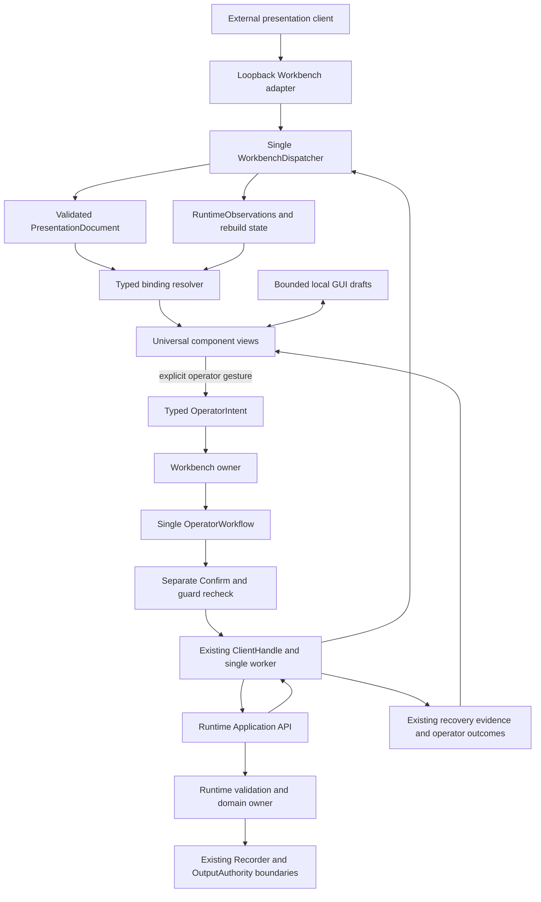

# Generic Controls Architecture

Status: **DGUI-4C architectural direction approved; DGUI-4C1 internal view
normalization implemented**. The remaining proposal is not implemented.
Baseline: DGUI-4B4 merged at
`3a86d0989f6b6ca265126da043a3df4d0f847c7b`, including the separately reviewed
Recorder property-lifecycle fix. This document changes no running contract.

DGUI-4C1 derives a frame-local `ControlView` from the four existing typed adapters
and shares indicator, bounded input and disabled-reason button primitives. It
reuses the existing eligibility, confirmation and operator workflow; the ordinary
Recorder group uses the same view path. Draft ownership/retirement, additional
ordinary GUI actions, plots and every v1 external contract remain unchanged.
This does not implement the later draft/scalar or generic read-binding stages.
Instance profile versus per-connection negotiation, binding cardinality, exact v2
limits and descriptor versioning remain open for a separate v2 contract review.

## Decision and scope

Recommend a hybrid of universal visual components, explicit typed bindings and
Runtime-provided metadata. Widgets describe interaction. Trusted Workbench binding
adapters understand a finite set of Application semantics. Runtime supplies
committed values, descriptors and final admission/execution authority. A descriptor
can populate a known binding, but cannot install a new executor.

An external client should be able to compose a Workbench interface without knowing
its Rust renderer. Adding an instrument that exposes existing signal, property or
action semantics should require no instrument-specific Workbench code. Adding a
new semantic action family still requires an explicitly reviewed Runtime contract
and Workbench adapter. Universality does not mean executing arbitrary operations by
name or inferring write authority from a parameter's type.

Goals:

- Separate reusable widgets from data selection and operation semantics.
- Share components and the existing operator workflow across ordinary and
  declarative interfaces.
- Support a coherent value model for boolean, integer, number, text and enum,
  including read-only values that cannot currently be mutated.
- Make missing metadata, unavailable actions, stale observations and uncertain
  outcomes explicit.
- Preserve bounded work, existing client compatibility and all safety boundaries.

Non-goals for this stage are implementation, new wire operations, Runtime changes,
new mutation types, actuator writes, PID, Ramp/Retune, resource controls,
persistence, a Clojure DSL, dynamic plugins and equipment integration. Logical
windows remain inside the existing native Workbench. Acceptance clients and virtual
fixtures illustrate the contracts; they do not define them.

The [project status](developer/project-status.md) describes qualification limits;
its possible future directions are not implementation authorization. This proposal
builds on the [ownership architecture](architecture.md),
[extension boundaries](extending-runtime.md), [Workbench API](workbench-api.md) and
[Application API](api/README.md).

## Existing architecture and evidence

### Presentation and execution

| Element | Current responsibility | Reuse or limitation |
|---|---|---|
| [PresentationDocument](../apps/lab-workbench/src/presentation/document.rs) | Strict version-one document; windows, tabs, Status/Plot/Controls panels, plots, traces and controls | Layout and stable presentation IDs are equipment independent. Control kinds bundle interaction with an operation category. |
| [RuntimeRef](../apps/lab-workbench/src/presentation/reference.rs) | Instrument, Signal, Reference, Controller, Resource, Component, Recorder and ConfigurationProperty identities | Already typed; Signal uses instrument/parameter, property uses owner kind/ID/property. Property owners are Instrument, Component or Resource. There is no arbitrary field selector or Actuator variant. |
| [WorkbenchDispatcher](../apps/lab-workbench/src/dispatcher.rs) | Sole mutable presentation/model owner; serializes external calls and atomic UI transitions | Keep this owner. A replacement validates before publication, fences workbench ID/revision, increments once and emits one event. It performs no Runtime work. |
| [External adapter](../apps/lab-workbench/src/external.rs) | Bounded loopback-only NDJSON and owner mailbox | Passes replacement as bounded JSON for dispatcher decoding. It owns neither PresentationDocument nor ClientHandle. |
| [PresentationRenderer](../apps/lab-workbench/src/gui/presentation.rs) | Layout, local tabs/plot memory, observation display; returns at most one typed intent | Already has no submission authority. Shared plots serve both layouts; empty `windows` retains the ordinary GUI. |
| [OperatorControlUi and ControlEditors](../apps/lab-workbench/src/gui/controls.rs) | Four supported kind/target adapters, eligibility display and bounded local drafts | Share widgets beneath these adapters. Drafts are keyed by Control ID/full target and retired, including egui undo/focus state, on presentation revision change. |
| [WorkbenchApp](../apps/lab-workbench/src/gui/app.rs) | Owns the dispatcher, shared OperatorWorkflow, confirmation UI and existing ClientHandle connection | Keep the sole GUI execution entry. Neither widgets nor bindings receive a client handle. |
| [OperatorIntent and OperatorWorkflow](../apps/lab-workbench/src/model/operator.rs) | Typed candidates, preparation, warnings, confirmation, guarded submission and outcomes | Preserve the existing state machine and operation translation. Ordinary GUI has additional intents; that does not make them declaratively available. |
| [RuntimeObservations](../apps/lab-workbench/src/model/projections.rs) and [rebuild coordinator](../apps/lab-workbench/src/gui/rebuild.rs) | Cached committed projections, freshness, full-detail guards and bounded live samples | Sole data source for rendering. Rebuild uses the existing worker and aggregate subscription; no per-widget session or polling loop. |

The five v1 ControlKind values are semantic categories, not instrument models.
Four are executable in the declarative renderer:

| Kind and required target | Current action | Existing concurrency/authority guard |
|---|---|---|
| RecordingLifecycle / Recorder | Start with validated label, or Stop active run | Fresh Recorder state/active run and boot; Stop carries the observed run identity |
| SetReference / Reference | Configure a finite fixed `f64` value | Fresh Reference revision; `reference_configure` carries `expected_revision` |
| ControllerLifecycle / Controller | ready: Start; warming/running: Pause; paused: Resume; failed: Reset failed | Fresh observed source state rechecked before Confirm; lifecycle wire args carry controller ID, not an expected revision |
| ApplyConfiguration / ConfigurationProperty | Configure writable integer `i64` or text | Fresh property access/type/constraints/revision and mutation-class warning; `property_configure` carries `expected_revision` |
| ReconnectResource / Resource | Not enabled declaratively | Existing ordinary workflow has generation/detail guards; no new exposure is implied |

Every executable declarative action requires separate confirmation even when
`Control.confirm` is false. Ready/global Fresh/target Fresh, advertised operations,
observation-only policy, recovery blockers and one active workflow apply in
addition to the operation-specific guards. Controller state checking is a client
preflight plus Runtime lifecycle validation, not an atomic wire compare-and-swap on
the source state. Do not claim a generation/revision fence where that operation's
contract has none.

v1 validation checks shape, IDs, references, finite display numbers and size. A
structurally valid RuntimeRef need not currently resolve. Even a kind/target pair
that the renderer cannot execute can remain valid configuration and display as
disabled. Discovery is not a prerequisite for atomic presentation replacement.

### What Runtime actually describes

| Existing source | Available information | What it does not establish |
|---|---|---|
| [hello operations/capabilities](../apps/lab-runtime/src/protocol.rs) | Composition-filtered operation names; capabilities as name/version/stability; bounded limits | No general action parameter schema, per-entity enabled-action list or confirmation policy. A capability label is not an authorization credential. |
| [discover and describe](../apps/lab-runtime/src/application/discovery.rs) | Stable entities; signal generation/unit/type; selected feature flags; parameter `value_spec`, access, role and write effect | A readable/writable parameter descriptor is not a generic Application read/write command. Not every descriptor is already retained in Workbench's rebuild projection. |
| [measurement projections](../apps/lab-runtime/src/measurements.rs) | Current/latest values, quality, unavailable/not-observed states, unit, monotonic observation/source times and generation | A descriptor alone does not guarantee a sample. Integer samples are decimal strings; text and enum samples require descriptor type to distinguish them. |
| [configuration property projections](../apps/lab-runtime/src/configuration_api.rs) | Full owner/property identity, current value, type, optional unit, access, mutation class, optional min/max and revision | No universal enum-choice/text-limit schema for properties. A projected type is not proof of mutation support. Property revision currently follows deployment revision. |
| Reference, Controller, Resource and Recorder projections | Domain state, revisions/generations/run identities and selected policy/detail | No uniform descriptor covering every domain's guards, confirmation and results |

`describe` already supports boolean, integer, float, text and enum value specs,
including enum choices and text byte bounds. Configuration properties can project
boolean/number and other non-editable kinds. However, the current Application
`property_configure` decoder accepts **only an integer JSON number fitting i64 or a
string**, matching Workbench's Integer/Text candidate variants. Reference fixed
configuration is a separate finite-number operation. No generic raw output/register
write exists; `output` is read-only evidence. These distinctions are visible in the
[operation registry and argument shapes](api/operations.md).

The Required Recorder fix and DGUI-4B4 acceptance establish the existing
Integer/Text lifecycle through real virtual configuration in Idle and Recording.
They do not qualify new boolean/number/enum mutations or physical output behavior.

## Three-layer model

The following names are design vocabulary, not new Rust declarations or accepted
JSON fields. Exact DTO spelling belongs to the later versioned schema review.

### A. Universal visual components

| Component | Input and interaction | Execution knowledge |
|---|---|---|
| Button | Caption, availability/reason; emits an activation gesture | None |
| Toggle | Observed boolean and distinct proposed boolean; emits a draft edit | None; changing its position never sends a command |
| IntegerInput | Bounded decimal text, parsed exact integer, validation error | None |
| NumberInput | Bounded numeric text, finite candidate, display precision | None |
| TextInput | Bounded UTF-8 text and validation error | None |
| Select | Typed stable option tokens and display labels; proposed selection | None |
| Indicator | Typed observed value, unit, quality/freshness or absence | Read-only |
| Plot | Existing bounded numeric samples and display settings | Read-only; retain common egui_plot renderer |
| Status | Entity/operation state and explicit unavailable/error information | Read-only |

An editor may compose Indicator + Input + Button. Recorder and Controller lifecycle
views compose Status + Button, with a TextInput for a recording label where needed.
Composition does not create a workflow per component. Both ordinary and declarative
GUI can instantiate these components with the same bound view model.

Toggle is a view choice, not a promise of immediate actuation. A configuration
boolean binding would propose a value, then require Apply and Confirm. A future
typed lifecycle or actuator binding would need its own reviewed state/action
mapping; `true` must never be guessed to mean Start, Enable, Arm or physical power.
If two authoritative states cannot faithfully map to a boolean, show Status and
Button instead. Missing data must not look like `false`.

### B. Typed data and action bindings

Keep three concepts distinct:

| Concept | Proposed contents | Owner and validation |
|---|---|---|
| DataBinding | Typed Runtime target and a closed semantic selector, such as SignalSample, PropertyCurrent, ReferenceValue, ControllerState or RecorderState | Presentation chooses the source; trusted adapter decodes the appropriate observation and metadata |
| EditorBinding | Candidate type and local draft slot associated with that target; optional presentation-only formatting/restrictions | GUI owns drafts; adapter checks compatibility against Runtime metadata |
| ActionBinding | Versioned semantic family, exact typed target, typed parameter slots and optional stronger confirmation request | Adapter constructs only an existing allowed OperatorIntent; operator layer prepares authoritative arguments and guards |

Selectors are an enum of understood meanings, not JSONPath, an expression language,
arbitrary operation names or user-defined conversions. Adding a field selector
requires a bounded decoder and freshness/quality semantics. A BindingResolution is
a derived read-only view, not another mutable WorkbenchModel or experiment owner.

Initial action families are RecorderLifecycle, ReferenceFixed, ControllerLifecycle
and PropertyConfigure(Integer/Text). Each names its legal parameter slots: for
example, PropertyConfigure has exactly one typed value, and Recorder Start has a
label. Lifecycle action selection uses the existing trusted state rules. Neither
the document nor a descriptor can supply an alternate state-transition expression.

Parameter values may come from a matching local draft or an explicitly typed
literal with the same validation. Targets are explicit identities; a proposed
literal can never supply `expected_revision`, generation, boot, scope or sequence.
No cross-control formulas, chained actions, macros, automatic Apply-on-edit or
on-load handlers are included. One gesture produces at most one intent.

Illustrative internal composition, **not wire syntax**:

```text
property target = (owner kind, owner ID, property key)
Indicator <- PropertyCurrent(target)
TextInput <-> local Text draft for (control ID, target)
Button activation -> PropertyConfigure<Text>(target, draft candidate)
                  -> existing ConfigureProperty intent
```

The same composition serves any supported property with compatible Runtime
semantics. It contains no instrument kind, model name or device protocol.

Resolution checks source type, target category, widget compatibility, supported
adapter version and required metadata. Structurally malformed bindings reject the
whole candidate document. Well-formed but unresolved, read-only, unavailable or
unsupported-runtime bindings remain visible and disabled with a bounded reason.
They do not cause discovery queries from the renderer. Unknown schema/action tags
are rejected, rather than accepted as executable extension points.

Presentation can select a label, hint, precision, layout, narrower input interval
or subset of choices. It cannot widen Runtime limits, change access, suppress
mandatory warnings, change the transmitted unit or weaken confirmation. An empty
intersection or incompatible unit/type disables editing with an explicit reason.
Presentation restrictions are client UX constraints; independent Runtime clients
are not subject to them.

### C. Runtime metadata and authority

Initially resolve known bindings from current projections and the existing
operation registry. Do not add a descriptor service just to refactor four controls.
The shared binding layer is a consumer of authoritative observations; it does not
become their source.

A future Runtime descriptor extension should describe **known semantic families**
using bounded language-neutral data:

- Descriptor identity/version, target identity and applicability generation or
  revision, bound to the current Runtime boot.
- Read selector/type, canonical unit, absence/quality meaning and optional bounds,
  text byte limit or stable enum choices.
- Access and supported action-family version, legal typed parameter slots and
  referenced advertised operation, without executable request templates.
- Required authoritative revision/generation/state/run preconditions, effect or
  mutation class, minimum confirmation requirement and bounded result/error meaning.
- Snapshot/paging limits and explicit invalidation across configuration changes,
  reconnects and boot changes.

These are **future requirements**, not fields currently returned by hello. Final
admission always revalidates inside Runtime; a cached enabled flag cannot grant
authority. Unsupported family/version, malformed metadata or missing required
fence disables the action. Descriptors cannot import code, raw commands, scripts,
transport bytes, output leases or user-authored safety predicates.

Read support comes from a known query/projection and an actual observed value.
Configuration support additionally requires a supported mutation type and
`read_write` property access. Lifecycle support requires an advertised operation
and its current domain preconditions. Actuator support cannot be inferred from any
of these: it needs a separate typed Application contract with central
OutputAuthority, physical safety and ambiguity semantics. Designing that execution
contract is a later review, not a generic Toggle feature.

## Data and command flow



The diagram shows dependencies, not extra workers or a second Runtime session.
Neither loading/replacing a document, resolving bindings, typing, tab switching nor
rendering submits mutations. Normal acquisition/rebuild work may run independently
through the existing coordinator. Widgets do not query Runtime on hover or edit.

On activation the Workbench owner calls the existing workflow's preparation path.
Preparation captures target, candidate, operation arguments, boot and the
operation-specific authority guards. A separate Confirm rechecks readiness,
freshness, observation-only policy, recovery and the prepared guards before the
existing ClientHandle submits once. No binding contains a submit callback or
client handle. Preserve the architecture source guards as well as behavioral tests.

The existing external API also has explicit mediated `lab_query`/`lab_mutation`
calls. This design neither removes nor broadens them, and never invokes them from
document bindings. Those calls have their documented client/worker semantics;
they are not declarative clicks and do not acquire GUI confirmation semantics by
implication. An external client can separately use the Runtime API. Presentation
editing must not become an additional hidden mutation route.

## Types, units and metadata

| Logical type | Proposed GUI representation and validation | Current support and extension boundary |
|---|---|---|
| Boolean | Exact true/false; Unknown/absent represented separately; Toggle or Indicator | Described/read values exist; property boolean mutation is not supported |
| Integer | Exact signed i64 editor; strict decimal parse including negative and boundary values; reject overflow | Existing PropertyConfigure Integer; typed observations can have different encodings and must be decoded by source |
| Number | Finite binary64 candidate; reject NaN, infinity, overflow and invalid input; precision is display-only | Existing fixed Reference; property number mutation is not supported |
| Text | Exact bounded UTF-8 string; enforce bytes, not character count; preserve empty text when the operation allows it | Existing PropertyConfigure Text; Workbench candidate limit is 512 UTF-8 bytes, with final Runtime property validation |
| Enum | Stable typed choice token plus independent display label; reject unknown proposed tokens | Instrument value specs can already describe enum choices; generic property enum mutation/schema is not provided |

Do not coerce boolean into integer, enum into an arbitrary string, a numeric-looking
text value into a number, or an unsupported unsigned value into i64. Observations
outside the editable representation may still display exactly and remain disabled.

### Precision and bounds

Use exact integer parsing and comparisons, including endpoints near i64 min/max.
Current integer property candidates serialize as JSON numbers, while integer
measurement values and `describe` integer bounds use decimal strings. A source
adapter must honor each existing encoding; a generic JSON-to-f64 intermediate
would lose information. The current property preflight reads min/max as f64;
replacing that with exact integer-bound comparison needs its own targeted
regression step. This design does not silently claim that precision improvement
is already implemented or repair the approved production code.

For a future presentation schema, prefer tagged decimal strings for integer
literals/bounds, preserving i64 values in clients whose default JSON numbers lose
precision beyond 2^53. The trusted adapter still emits the existing Runtime
integer-number wire shape. Identifiers/revisions remain opaque typed decimal
identities, never GUI arithmetic values.

Number editors keep the candidate independent of a rounded display. Confirmation
must show enough precision to identify the actual binary64 value being sent.
No display rounding, clipping, slider snapping or locale conversion silently
rewrites a submitted candidate. Start with an explicit locale-independent decimal
grammar; localized display must not change parsing. Runtime bounds are applied when
present; no invented physical range is supplied when they are absent.

Each source adapter distinguishes missing optional constraints from malformed
constraints. Missing metadata cannot mean writable or safe. Malformed, contradictory
or nonfinite bounds disable the associated edit. Inclusive/exclusive endpoints and
enum token typing must be part of any future descriptor contract, not inferred from
a caption or JSON spelling.

### Units, quality and text

Runtime unit identity/symbol accompanies the observed raw value and the candidate.
Missing units remain unknown. Presentation unit labels are clearly display
metadata; they do not certify conversion. Existing `Trace.display_unit` continues
to label without changing values. No temperature, scale or actuator conversion is
implicit. An incompatible edit-unit assertion is an error, not a conversion rule.

Freshness and sample quality are independent. Fresh observations can authoritatively
report unavailable data. Unresolved means no matching Runtime entity; Unknown means
no usable observation; Stale and Rebuilding preserve their existing meanings. Never
substitute zero, false or an old value as a current measurement. Keep monotonic
`T+HH:mm:ss.SSS` plot time and the current single-curve geometric hover behavior; there
is no calendar conversion or new history store.

An input storage bound must not turn an oversized paste into a valid shorter
mutation. Retain bounded invalid-input evidence and require correction. Property
text uses the existing 512-byte candidate limit; recording labels keep their
separate nonblank 128-byte rule. Future Runtime text metadata may restrict these
further; generic widgets must not invent new domain rules. Empty, whitespace and
Unicode normalization have the semantics of the selected binding. Enum selection
sends the original token, never a translated label or collection index.

## Safety, failure and connection continuity

### Authority and confirmation

Eligibility is the conjunction of supported binding, compatible target/type,
current metadata, operation availability, Runtime Ready, global and target Fresh,
required full-detail observations, observe-mode policy, no recovery blockers,
available bounded action capacity and no other active workflow. It is a useful
disabled-button explanation, not an admission promise. Runtime remains the final
validator even when every local check passes.

The confirmation floor is trusted Workbench operation policy today. All four
existing families retain mandatory Confirm. The document can request stronger
confirmation but cannot lower that floor; `confirm:false` remains ineffective at
bypassing it. A future descriptor may strengthen the minimum, never weaken the
trusted adapter. Runtime does not currently publish or enforce a universal GUI
confirmation policy. Observation mode is also client policy, not a Runtime role.

Confirmation must identify the actual typed target, owner/property where relevant,
candidate and unit, captured preconditions and operation/mutation-class warnings.
Presentation labels cannot replace or hide that identity. Local edited values and
expected values must not be visually confused with authoritative current values.
Concurrent external clients may invalidate prepared work: show the conflict and
require a new deliberate preparation rather than updating expected revision and
retrying.

Property configuration remains a staged configuration lifecycle with Required
Recorder admission/durability and deployment provenance. Changing a Reference
requests Reference semantics, not direct physical power. Lifecycle actions retain
their domain checks. Neither a widget nor future metadata can bypass Recorder,
resource ownership or OutputAuthority. Accepted, committed, durable, ACK, readback
and physical effect remain distinct evidence boundaries.

### Errors and results

Reuse Idle, AwaitingConfirmation, Submitted, Accepted, Completed, Failed,
Ambiguous and reconciled terminal handling from OperatorWorkflow. Show draft parse
errors locally, bounded eligibility reasons beside controls, and authoritative
outcome/recovery information in the shared Operator action/recovery panels.
Do not maintain a second workflow state machine in each component.

Cancel before submission discards the preparation and sends nothing. After
submission, leaving a tab, removing a widget or replacing a document does not
cancel admitted Runtime work. Completed does not directly overwrite an observation;
current values come from authoritative rebuild/events. Failed is not a blanket
proof that every effect was rolled back. Ambiguous is never displayed as success,
nor resolved from a matching current value alone.

No automatic mutation retry, status poll or Exact Retry is introduced. The existing
manual recovery path retains exact boot/scope/sequence/operation/payload evidence,
quarantine and reconciliation gates. See
[recovery and faults](recovery-and-faults.md) and
[mutation lifecycle](api/events-mutations-and-recovery.md).

### Reconnect and replacement

Disconnect or event gaps invalidate binding eligibility along with observations.
Successful socket/hello is insufficient: Fresh requires the existing complete
snapshot/subscription barrier. Explicit Disconnect cancels reconnect; unexpected
loss may use only the existing bounded retained-scope episode. New boot or changed
authority invalidates preparations and descriptor caches; it never authorizes
replay, new mutation identity or rearm.

Presentation replacement advances only presentation revision. Runtime revision,
signal/resource generation, recovery generation and mutation sequence remain
separate domains. A prepared action retains its original target, candidate and
guards even when its source widget disappears. It remains in the shared action
panel for deliberate cancellation or valid confirmation; it is never retargeted,
silently confirmed or erased by a layout update. Current Runtime guards still
decide whether it can be confirmed. Recovery records survive independently.

## Local state and bounded progress

| State | Owner | Lifetime/invalidation |
|---|---|---|
| Document and presentation revision | WorkbenchDispatcher | Atomic validated UI mutation; one active document |
| Observations and descriptor cache | Existing model/rebuild owner | Current connection/boot/projection generation; no widget-owned authoritative copies |
| Input draft and parse feedback | Local GUI editor store | Key includes document identity/revision, stable control ID, full target, binding kind and candidate type |
| Focus/undo, selected tab, legend/zoom | Renderer/egui view state | Bounded current instances; retire obsolete IDs explicitly |
| Prepared/submitted action | Single OperatorWorkflow | Independent of widget lifetime; immutable target/args and existing terminal acknowledgement rules |
| Mutation evidence | Existing recovery path | Exact identity/evidence retention, not draft or layout persistence |

Keep the current conservative draft reset on any presentation revision change.
Changing target, binding/type, Runtime boot or descriptor applicability also retires
unused input and related egui undo/focus state. During transient Stale/Rebuilding,
an unchanged draft may remain visible but disabled; when authoritative metadata
returns, revalidate it. A changed type/unit/target generation requires a new edit.
Normal current-value updates do not overwrite an operator's draft. A local draft
contains no expected Runtime revision; preparation captures that from the current
authoritative view.

Two controls with the same property name but different owners have distinct keys.
Two controls for the same target also have separate drafts unless they are repeated
views of the same control ID. Repeated panel references to one control share its
candidate, with separately bounded view/focus identities. Confirmation uses a
captured candidate, never a live pointer to an editor that another view can alter.

Current bounds provide the starting budget:

| Resource | Existing bound |
|---|---|
| Presentation canonical pretty JSON | 1 MiB |
| Windows / total panels / controls / tabs per window | 64 / 64 / 64 / 64 |
| Plots / traces per plot / live points per source buffer | 32 / 32 / 4,096 |
| Presentation strings | 512 UTF-8 bytes |
| External JSON body / depth / values | 2 MiB / 16 / 16,384 |
| External callers / owner mailbox | 8 / 32 messages and 16 MiB |
| Property projection / property page | 256 records / 64 records and 8 KiB |

All applicable bounds intersect: a document that fits its byte limit may still
exceed wire value/depth limits. New components must not multiply these limits by
retaining unbounded per-widget samples, descriptor histories or event queues.
Keep one shared Runtime worker, bounded command queues and aggregate subscription.

Proposed v2 starting ceilings for review are 64 control groups/drafts, 256 visual
leaves across those groups, one data and one action binding per group, and 64 enum
choices per selector, also subject to total JSON/string limits. Repeated view
references count against a finite total (at most the existing 64 panels times 64
control references), including egui memory. These are proposed client presentation
limits, not new restrictions on Runtime values or current v1 acceptance.

Any future descriptor acquisition must reuse the bounded rebuild coordinator, with
finite pages, bytes, in-flight work and a replaceable current cache. Reject or mark
unsupported an over-budget binding; never truncate an enum into a different valid
command or silently omit safety metadata. Do not allow per-frame discovery,
recursive bindings, dependency cycles, expression evaluation or widget timers that
submit work. Keep existing overflow/fail-closed behavior and finite shutdown.

## Versioning and compatibility

### First step: internal normalization only

Keep strict `PresentationDocument.format_version = 1`, exact fields, validation,
wire protocol v1 and all 16 advertised operations unchanged while refactoring.
Translate current ControlKind/RuntimeRef pairs into the internal component/binding
model. The canonical v1 document remains the source of truth and
`presentation_get` returns it exactly; derived views are not a second document.
Do not add optional widget/binding fields under v1: its unknown-field rejection is
part of the contract.

### Later step: explicit version-two contract

Independent widget choice and reusable bindings require a new document schema.
Propose a separately reviewed format v2 retaining logical windows/tabs/panels and
stable IDs, with explicit component groups and typed bindings. Provide a validated,
deterministic v1-to-v2 conversion with a preview and explicit user opt-in. Preserve
disabled v1 combinations as disabled compatibility views; conversion cannot make
previously inert controls executable. No automatic on-disk migration is proposed.

Document version and Workbench protocol version are distinct. Merely accepting v2
in `ui_replace_document` is insufficient: old clients cannot necessarily decode a
v2 `presentation_get` result or safely issue v1 point edits. Recommended first
rollout is **explicit protocol/profile selection for the Workbench instance**,
with a later v2 endpoint contract advertising its supported document and binding
versions before any document exchange. This is a future wire change requiring its
own review; no flag or handshake extension exists yet.

| Client/instance combination in that rollout | Proposed behavior |
|---|---|
| Existing v1 client, default v1 instance | Same handshake, registry, document and UI mutations as today |
| New client using v1 instance | v1 only, with internal generic rendering |
| v1 client, explicitly selected v2 instance | Reject protocol mismatch before any mutation/document response; no silent v2 payload |
| v2 client, v2 instance | Explicitly negotiated v2 contract; v1 import is a deliberate conversion |

One instance still has one dispatcher, document and worker. Do not run a shadow v1
document or compatibility Runtime session. Simultaneous mixed-version presentation
editing is deferred; it would need an explicit representability policy. v2-to-v1
export succeeds only when lossless, otherwise rejects with a reason. Restarting or
switching a protocol profile must not discard the independent recovery journal.

Preserve workbench-ID/revision fences, single publication/event, invalid-candidate
atomicity and revision overflow fail-closed behavior in the eventual v2 design.
Unknown component/binding versions reject before publication. Transient Runtime
absence keeps a structurally valid binding unresolved. Existing workspace loading
and atomic persistence helpers do not imply autosaving API edits: current
replacement changes the in-memory document; persistence remains a separate task.

## Migration of existing controls

| Existing control | Shared components | Trusted binding behavior retained |
|---|---|---|
| RecordingLifecycle | Status, TextInput, Button | Existing shared label/validation, authoritative Start/Stop selection, run/state guards and confirmation |
| SetReference | Indicator, NumberInput, Button | Fixed finite candidate only, Runtime unit, revision guard; no Ramp/Retune exposure |
| ControllerLifecycle | Status, Button | Four existing state/action mappings and pre-Confirm state guard; other states disabled |
| ApplyConfiguration | Indicator, IntegerInput or TextInput, Button | Full owner/property identity, supported type/access, constraints, revision and mutation-class warning |

Extract widget mechanics before changing any binding behavior. Reuse the current
OperatorControlUi eligibility/preparation path; do not duplicate validation across
four small frameworks. Ordinary GUI should consume the same editor primitives and
domain adapters where its existing semantics match. Unsupported v1
ReconnectResource remains inactive; ordinary additional intents do not leak into
the declarative allowlist.

Retain Recorder/Controller duplicate-button suppression and location hints across
tabs, shared confirmation and recovery panels, ordinary GUI when `windows` is
empty, and the common plot renderer. Genericization must not lose legend, zoom/pan,
single-curve geometric tooltip or truthful freshness/unit display.

## Alternatives and tradeoffs

| Approach | Benefits | Costs and limits | Safety and Runtime requirements |
|---|---|---|---|
| Explicit typed data/action bindings with universal widgets | Fits current API; deterministic validation; small auditable adapters; no per-device branches | Workbench knows each semantic family and source decoder; new semantics require a release; some metadata is incomplete | Closed adapters preserve existing guards. No Runtime extension required for the four current controls. |
| Runtime-provided capability descriptors driving universal widgets | Centralizes types, bounds, options and applicability; clients can discover new targets without duplicated device knowledge | Needs a versioned descriptor schema, bounded acquisition/cache and invalidation; descriptor-only execution cannot safely invent semantics or recovery rules | Runtime extension required. Fully generic operation-name/request-template execution is rejected; a trusted semantic interpreter remains necessary. |
| Recommended hybrid | Typed adapters provide execution semantics; descriptors refine data/availability within known families; v1 can migrate incrementally | Two compatibility versions to manage: presentation and semantic descriptor/binding; duplicated checks must be consistent | Start with current projections; add descriptors only for demonstrated gaps. Runtime validates every action and retains all authority. |

The hybrid makes new instances and instrument types cheap when they fit established
contracts, while keeping novel physical actions reviewable. Runtime should not
provide GUI layout, translations, executable validation expressions or a transport
template as a shortcut. Workbench should not match model names or embed deployment
fixture assumptions. Unsupported semantics remain explicit rather than guessed.

## Proposed implementation sequence and acceptance

Each row is a separate small reviewable step, not authorization to implement it in
DGUI-4C. Preserve negative tests and architecture source guards throughout.

| Step | Change boundary | Acceptance evidence |
|---|---|---|
| 1. Shared internal view model | Workbench-only widget mechanics and four typed adapters; retain v1 schema/wire | Existing v1 snapshots/registry remain exact; headless click/Cancel/Confirm tests send zero/zero/one mutation; all four controls and ordinary GUI behave identically |
| 2. Draft and scalar primitives | Common editor identity/retirement, bounded validation and exact integer-bound comparison | Two owners/same property, repeated views, replacement and reconnect cannot leak drafts; i64 endpoints, finite numbers, UTF-8 overflow and read-only types are covered; presentation/recovery unchanged by editing |
| 3. Generic read bindings | Typed decoding of already available bool/integer/number/text/enum observations; bounded acquisition through existing rebuild only when needed | Existing virtual observations demonstrate available kinds; deterministic fixtures cover absent kinds without claiming real-process support; absent/stale/quality states, unknown enum and units stay truthful; no renderer queries/mutations |
| 4. v2 contract and conversion review | Freeze schema, version selection, bounds, compatibility and lossless import/export rules before implementation | Old-client/new-instance matrix, invalid-version rejection, deterministic v1 conversion including disabled pairs, no mixed-format responses, preserved single-owner atomicity |
| 5. v2 presentation implementation | External composition of universal groups and explicit bindings to existing actions only | Independent client supplies neutral layouts; one dispatcher/worker/workflow; two clients cannot lose updates; Required Recorder virtual acceptance covers existing controls and new presentation path |
| 6. Runtime metadata extension, if justified | Separate Application proposal for gaps: coherent descriptors/invalidation, property type limits/choices, confirmation/effect/fence metadata | Bounded frozen projections and stale-descriptor rejection; advertised actions agree with authoritative validation; descriptors cannot introduce unknown executors or bypass confirmation |
| 7. Additional mutation families, only after review | Separate contracts for boolean/number/enum property mutation or any new semantic action | Explicit Runtime semantics and typed adapter tests; concurrency, Required Recorder provenance/durability and manual recovery remain intact; no conversion to arbitrary forwarding |

Step 6 need not block internal reuse or known v2 bindings. Step 7 is not permission
for actuator writes, PID, Ramp/Retune, reconnect controls or persistence. Each of
those needs its own scope and safety review.

Cross-cutting acceptance keeps tests for observe mode, global/target Stale and
Rebuilding, unavailable operations, revision/state/generation changes before
Confirm, active-workflow rejection, recovery/quarantine, conflict without retry,
document replacement during an active action and bounded malformed input. Check
that a label or descriptor cannot redirect a prepared target. Preserve plot and
legacy controls tests rather than substituting protocol-only tests for GUI behavior.

Reuse existing FakeClient, headless egui cursor tests, OperatorWorkflow regressions,
endpoint helpers and real-process acceptance. Use the existing virtual deployment
when its actual properties fit the scenario, including Required Recorder Idle and
Recording; do not fabricate a real property or physical observation. Inspect
readback, revision, durable activation generation and provenance separately from
visual GUI evidence. A later missing-type fixture is an explicit test addition,
not a production special case. Native Windows GUI smoke should distinguish visual
inspection from protocol/headless evidence and verify no additional Runtime worker
or persistent session. No new testing infrastructure is required by this proposal.

## Questions for independent architectural review

1. Approve the hybrid boundary: a finite set of trusted semantic families with
   descriptor refinement, and no operation-name/request-template executor?
2. Approve strict v1 preservation followed by explicit instance protocol selection
   for v2, deferring simultaneous v1/v2 editing? If mixed-version clients are
   required, what representability/error contract should precede implementation?
3. Are decimal-string integer literals, the proposed group/leaf/choice limits and
   one data/action binding per group sufficient for the first generic schema?
4. Which descriptor gaps justify a Runtime extension first: property enum/text/type
   metadata, applicability/invalidation, or a uniform action/fence description?
   How should contract versions cover each independently?
5. Is the conservative reset of unused drafts on every presentation revision and
   descriptor identity change acceptable? Prepared actions remain independent and
   must retain their original targets under replacement.
6. Should controller lifecycle eventually gain an explicit server-side expected
   state/revision contract? The current pre-Confirm state check is retained here;
   extending its wire atomicity is a separate Runtime decision.
7. For future non-numeric generic controls, which existing virtual observations
   suffice, and which deterministic fixtures need an explicitly scoped addition?

Approval of this document should settle these boundaries before selecting an
implementation step. No runtime, GUI, persistence or physical-device capability is
declared complete by this design.
