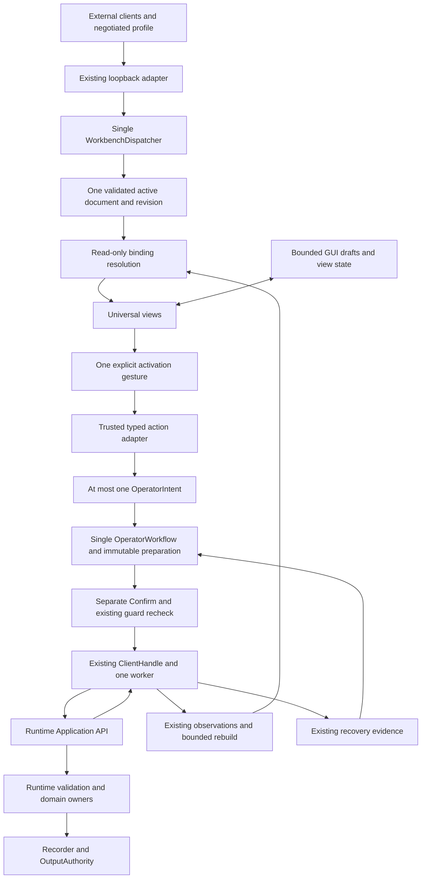

# Generic Presentation v2 contract proposal

Status: **DGUI-4C4 design for independent review; not implemented**. This is a
concrete candidate contract, not an announcement that Workbench accepts these
documents or envelopes. No Rust, Runtime API, Workbench v1 API, client, persistence,
Recorder or recovery change belongs to this stage. Approval of this document does
not authorize all proposed components or subsequent implementation stages.

The implemented baseline is DGUI-4C3, merged at
`d7dc1b8a77bb431c4799436c55eaaec8f23fc0b2`, preserving
`b284fac23bae75d1c69b3a429b3843fedc1842cd` and
`249effd02217d1cd3ed91be54b6fb0e1d6ade2c6`. See the
[architectural direction](generic-controls-architecture.md), current
[Workbench v1 contract](workbench-api.md),
[document validator](../apps/lab-workbench/src/presentation/document.rs),
[typed reads](../apps/lab-workbench/src/model/read_binding.rs),
[operator policy](../apps/lab-workbench/src/model/operator.rs), and
[rebuild coordinator](../apps/lab-workbench/src/gui/rebuild.rs).

Within this proposal, **must** states a proposed acceptance requirement. Tables
are a normative field grammar, not pseudocode for an executable schema engine.
JSON examples use neutral identities; they assert neither device availability nor
physical observations. A test client is one consumer of this language-neutral
contract and cannot define its types, limits or execution policy.

## 1. Decisions and ownership

1. One active document, one WorkbenchDispatcher, one Runtime ClientHandle/worker,
   one OperatorWorkflow and the existing recovery owner remain authoritative for
   their respective domains. No per-client presentation copies become owners.
2. Separate flat registries describe components, data bindings, local editors,
   actions and plots. Groups compose component references; they do not bind a
   whole visual group to one source or one action.
3. Read selectors and action families are closed semantic enums. References never
   contain JSONPath, expressions, code, operation-name templates or authority tokens.
4. The first rollout uses a fixed instance profile, v1 or v2. Default remains v1.
   A v2 connection negotiates document/binding versions before any document is
   returned. Simultaneous mixed v1/v2 editing is not part of the first rollout.
5. Conversion is explicit, deterministic and bounded. Export to v1 must prove a
   lossless round trip or fail. Loading a workspace never silently migrates disk.



Arrows describe ownership/data flow, not new threads. Resolving reads and painting
widgets are pure consumers of cached projections. Widgets receive neither a
ClientHandle nor a dispatcher/submission callback. The action adapter handles an
explicit returned gesture outside the read resolver; it does not run during read
resolution. Ordinary GUI and document views use the same workflow.

## 2. Common grammar and validation

All objects are closed: unlisted fields, duplicate keys and unknown union tags
reject the entire candidate. There is no `extensions` bag. Required fields cannot
be omitted. Optional fields below may be omitted only with the stated default;
explicit `null` is accepted only where stated. Object key order has no meaning;
array order does. No duplicate IDs, Unicode normalization or case folding occurs.

| Type | Exact rule |
|---|---|
| `Id`, `Label` | Nonempty UTF-8 string, at most 512 bytes; compared byte-for-byte |
| `Text` | UTF-8 string, 0..512 bytes; empty is a value |
| `U64Decimal` | Canonical string `0` or `[1-9][0-9]*`, at most 20 ASCII bytes, value <= 18446744073709551615 |
| `I64Decimal` | Canonical `0` or `-?[1-9][0-9]*`, at most 20 ASCII bytes, within signed i64; no `-0` |
| `Number` | Finite JSON number decoded as binary64; no NaN, infinity or overflow |
| `ScalarKind` | `boolean`, `integer`, `number`, `text`, `enum` |
| `Ref<T>` | An `Id` resolving to exactly one definition of category T in this document |
| `TypedScalar` | Exactly `{ "kind": ScalarKind, "value": payload }`; Boolean uses JSON boolean, Integer uses I64Decimal, Number uses Number, Text/Enum use Text |

Integer literals and presentation bounds use decimal **strings**, including small
integers. The trusted PropertyConfigure adapter still emits the existing Runtime
JSON integer, with no f64 intermediate. Runtime DTO parsing remains source-specific:
signal Integer strings and property Integer JSON numbers do not become a new
Runtime format. Enum is an exact token, never an index, translated caption or
numeric-looking text heuristic. Number presentation may show a rounded secondary
label, but the primary value and Confirm use a round-trippable representation.

`RuntimeRef` keeps the existing closed v1 shapes. Every field shown is required;
each identity string is an Id. References need not currently resolve in Runtime.

| `kind` | Other fields |
|---|---|
| `instrument` | `instrument` |
| `signal` | `instrument`, `parameter` |
| `reference` | `reference` |
| `controller` | `controller` |
| `resource` | `resource` |
| `component` | `component` |
| `recorder` | None |
| `configuration_property` | `owner`, `property`; owner is exactly `{kind:"instrument",instrument:Id}`, `{kind:"component",component:Id}` or `{kind:"resource",resource:Id}` |

An opaque nonnumeric identity accepted by v1 is not rewritten into a number by
conversion. Existing Runtime-specific identity validation can leave it unresolved.
Property identity always includes owner kind, owner ID and property key.

Validation proceeds in finite passes: bounded JSON decoding; version and closed
shape checks; IDs/registry references; component graph traversal and expansion
budget; binding/widget structural compatibility; semantic restrictions on action
parameters; canonical size/allocation budget. Unknown schema is an error, whereas
a known source/target pair that currently cannot resolve is a disabled view.
Target-category mismatches are retained as explicit `incompatible_target` and
never adapted to another target; this preserves v1's structurally valid inert
pairs. A wrong registry category or dangling document reference is an error.

## 3. Document, arrangement and components

### 3.1 Root and arrangement

| Object | Required fields | Optional fields and defaults |
|---|---|---|
| Document | `format_version:2`, `binding_version:1`, `document_id:Id`, `windows:Window[]`, `components:Component[]`, `data_bindings:DataBinding[]`, `editor_bindings:EditorBinding[]`, `action_bindings:ActionBinding[]`, `plots:Plot[]` | `settings:Settings`, default `{ "density":"comfortable" }` |
| Settings | `density:"comfortable"\|"compact"` | None |
| Window | `id:Id`, `title:Label`, `tabs:Tab[]` | None |
| Tab | `id:Id`, `title:Label`, `panels:Panel[]` | None |
| Panel | `id:Id`, `title:Label`, `components:Ref<Component>[]` | `v1_kind:"controls"\|"plot"\|"status"`, absent outside the conversion normal form |

Document ID and all definition IDs, including windows, tabs, panels, components,
bindings, plots and traces, share one uniqueness namespace. Registry references
may repeat and need not be adjacent to their definitions. Unused definitions are
allowed and count toward every bound; conversion must preserve unused v1 controls
and plots. Empty arrays are valid, including empty windows and empty panels.

Panels render their ordered roots vertically. Groups supply row/column layout;
there are no coordinates, CSS, scripts, templates, timers or computed layout
properties. Empty `windows` keeps the ordinary GUI. Unreferenced plots remain
accessible through the ordinary plot UI. No document setting can hide the common
Confirm, recovery, connection or required-warning UI.

### 3.2 Component union

Every component requires `id:Id`, `kind` from the following table and `label:Label`.
Every kind may additionally have `help:Label` (default absent). Only its row's
additional fields are accepted. A `group` is a composition node, not a tenth
executable widget. All nine requested visual kinds are design vocabulary; a
partial implementation must advertise its supported subset and reject unimplemented
kinds before publication, never silently replace them with another widget.

| `kind` | Additional required fields | Additional optional fields / defaults | Behaviour |
|---|---|---|---|
| `group` | `layout:"row"\|"column"`, `children:Ref<Component>[]` | `v1_control:V1ControlOrigin`, default absent | Ordered composition only; no group-level action or data binding |
| `button` | `action_id:Ref<ActionBinding>\|null` | `disabled_reason:Label`, required when action_id is null and forbidden otherwise | Activation emits one gesture; null is permanently inert |
| `toggle` | `editor_id:Ref<EditorBinding>` | `applicability:"always"\|"matching_type"`, default `always` | Boolean draft edit only; observed truth/absence is shown separately |
| `integer_input` | `editor_id` | Same applicability field | Exact integer draft |
| `number_input` | `editor_id` | Same applicability field | Finite number draft |
| `text_input` | `editor_id` | Same applicability field | UTF-8 draft |
| `select` | `editor_id` | Same applicability field | Enum draft token, only from confirmed choices |
| `indicator` | `data_id:Ref<DataBinding>` | `precision:integer 0..17`, default absent | Typed value, Runtime unit, quality and freshness/absence |
| `status` | `source:StatusSource` | None | Read-only scalar/domain or existing bounded entity status |
| `plot` | `plot_id:Ref<Plot>` | None | Existing plot renderer and shared source buffers |

`StatusSource` is exactly `{ "kind":"data", "data_id":Ref<DataBinding> }` or
`{ "kind":"entity", "target":RuntimeRef }`. Entity mode preserves v1 Status for
Instrument/Resource/Component and other cached projections; it displays existing
bounded status text, not an invented scalar or configurable field selector. It
does not add a sixth DataBinding or request missing detail.

`matching_type` is one fixed metadata predicate: render this input only if the
editor's currently resolved candidate kind matches the widget. It cannot refer
to another editor's value or arbitrary data. Its only multi-kind use is an
IntegerInput/TextInput pair sharing a `property_scalar` editor. Missing/unsupported
metadata makes both inapplicable; a visible group/button must still show the
blocking reason. `always` displays an incompatible input disabled. Other
widget/editor kind mismatches reject the candidate document. No component is
permitted to interpret a Boolean draft as Start, Arm, power or a physical write.

Button labels are presentation labels. The trusted adapter's actual operation
caption, exact target and blocking reason remain visible independently. Labels
cannot impersonate a different operation or conceal a mandatory warning.

### 3.3 Plots

Plot and trace display fields retain v1 semantics, with an explicit data reference
for a trace instead of an embedded Runtime source. No samples are stored here.

| Object | Required fields | Optional fields |
|---|---|---|
| Plot | `id:Id`, `title:Label`, `time_window_seconds:Number`, `axes:Axes`, `traces:Trace[]` | None |
| Axes | `y_min:Number\|null`, `y_max:Number\|null` | None |
| Trace | `id:Id`, `data_id:Ref<DataBinding>`, `display_label:Label`, `visible:boolean`, `style:TraceStyle`, `display_unit:Label\|null` | None |
| TraceStyle | `color:Label`, `width:Number` | None |

Time window is `(0,604800]` seconds; width is `(0,32]`; two present axis bounds
require `y_min < y_max`. Trace data must use `signal_sample`. An incompatible
Runtime target remains inactive, including v1 traces that never supplied samples.
The first implementation keeps the existing finite Number live-plot path,
monotonic time, shared hover/legend and zoom/pan. Integer observations remain exact
in indicators; no implicit Integer-to-f64 plot path is approved here. Unsupported
plot scalar kinds show a reason. `display_unit` is explicitly a cosmetic label,
shown alongside the Runtime unit when different; it performs no conversion.

## 4. Bindings and local drafts

### 4.1 DataBinding

Exact required fields are `id:Id`, `selector` from the table below and
`target:RuntimeRef`. The only optional field is `expect_kind:ScalarKind|null`
(default null). This is a restricting assertion, not a descriptor supplied by
the document. Even an asserted Integer needs compatible Runtime metadata.

| Selector | Compatible target | Evidence and possible kind |
|---|---|---|
| `signal_sample` | Signal | Actual measurement/event plus discovery value_type/unit/generation; Boolean, Integer, Number, Text, Enum |
| `configuration_property_current` | ConfigurationProperty | Same property projection's value_type/current/unit; all five readable kinds if actually described |
| `reference_value` | Reference | Existing fixed semantic `value` field, Number |
| `controller_state` | Controller | Existing state projection, Enum under the closed Application state contract |
| `recorder_state` | Recorder | Existing state projection, Enum under the closed Application state contract |

Resolution produces a frame-local record, **not an external endpoint or persisted
DTO**: selector/full target, optional ScalarKind, value-or-absence, optional Runtime
unit, independent sample quality, observation freshness, metadata applicability,
and connection freshness. None of these fields can be written by presentation.

| Condition | Required resolution/display |
|---|---|
| No matching Runtime entity | `unresolved_target`; no value or guessed type |
| Descriptor only, no measurement | `missing_observation`; descriptor is not a sample |
| Field missing/null | `missing_value`, unless the source contract says unavailable/not_observed |
| Good/available with valid typed value | Exact scalar, including false, zero or empty Text |
| not_observed / unavailable | Distinct absence and sample-quality states; never a default value |
| Unknown descriptor type | `unsupported_metadata`; no parsing based on string contents |
| Missing descriptor or required field | `missing_metadata`; no asserted fallback type |
| Type/value/unit or generation incompatible | `incompatible_metadata`; no ScalarValue from that join |
| Stale / Rebuilding / Unknown | Label explicitly; old values are cached, never current; no action eligibility inferred |
| Good sample but stale descriptor | At most a correctly matched cached typed value labelled Stale; never Fresh |

Unavailable quality is distinct from stale transport/cache state. Non-sample
sources have no fabricated sample quality. Connection Fresh does not make every
observation or descriptor Fresh. Required unit equality uses exact identity and
current source rules, not symbol matching or conversion. Absent units remain
absent. Enum type and choice metadata are separate: DGUI-4C3 can display a confirmed
Enum token even where no reliable choice list exists for Select.

### 4.2 EditorBinding

Required fields are `id:Id`, `data_id:Ref<DataBinding>`, `purpose` and
`candidate_kind` from the following table. Optional `constraints` is a closed
object with the fields listed below (default `{}`). Editors have no initial
candidate, current value, expected revision, commit handler or action field.

| Purpose | Allowed candidate_kind | Source and rules |
|---|---|---|
| `recording_label` | `text` | RecorderState/Recorder; one shared Recorder label slot, including ordinary GUI; nonblank under existing trim check, original UTF-8 retained, <=128 bytes |
| `reference_fixed` | `number` | ReferenceValue/Reference; <=64 input bytes, finite binary64 in the Runtime unit |
| `property_value` | `integer`, `text`, `property_scalar` | PropertyCurrent/full owner/property; actual read_write type must match; property_scalar resolves only Integer or Text |
| `local_only` | `boolean`, `integer`, `number`, `text`, `enum` | Known data source; metadata-compatible proposal with no action family granted |

`property_scalar` is a closed editor candidate union, not a sixth scalar type and
not permission to mutate Boolean/Number/Enum. It preserves v1 ApplyConfiguration
without freezing a type based on whichever Runtime happens to be connected at
conversion time. Malformed/lost/incompatible metadata makes it Unsupported and
retires the old candidate.

| Constraint field | Type and where allowed |
|---|---|
| `integer_min`, `integer_max` | I64Decimal, Integer/property_scalar only; inclusive, either may be absent |
| `number_min`, `number_max` | Number, Number only; inclusive, either may be absent |
| `max_utf8_bytes` | Integer 1..512, Text/property_scalar only; Recorder additionally <=128 |
| `choices` | Array of exactly `{token:Text,label:Label}`, 1..64 entries, distinct nonempty tokens; Enum only |

Absent presentation constraints impose no extra restriction. Present malformed or
contradictory constraints reject the document. They only narrow Runtime and trusted
adapter rules; no document can turn unknown Runtime constraints into unbounded
access. Enum choices are a labelled subset of a confirmed finite source vocabulary;
without that evidence Select stays disabled. Do not infer a choice list from the
current token. Other constraints on `local_only` still grant no submit authority.

Integer input uses the existing trim plus signed decimal parse, accepting an
optional sign and decimal digits, rejecting overflow, exponent/fraction and empty
input. Scalar literals/bounds use the stricter canonical spelling in section 2.
Number input uses the existing locale-independent finite parse: optional sign,
digits with optional decimal point (including `.5` and `1.`), optional decimal
exponent, and trimmed surrounding whitespace. No thousands separators, NaN or
infinity. Text preserves exact bytes, including empty/whitespace text where the
property allows it. Recorder tests blankness without silently trimming the label
sent to Runtime. Input precision/formatting never rewrites the candidate.

The normal draft key is `(presentation epoch, editor ID, full target, purpose,
resolved candidate kind)`. Presentation epoch includes document ID and owner
revision. Two editor IDs at one target are independent; repeated views of one
editor ID share one draft. Two owners with equal property names are independent.
Recorder label is the sole existing semantic exception: only one recording_label
definition is allowed, and it aliases the ordinary GUI label slot. Repeated
Recorder controls reference that same definition; no per-control Recorder label
semantics are invented.

Normal current-value changes never overwrite drafts. Ordinary revision changes
retire document editors and all associated focus/undo; the shared Recorder label
retains its existing application-local lifetime, without creating a prepared
action. Retargeting/changing a binding, known type -> Unsupported/missing -> known,
unit change, boot change or changed descriptor applicability retires the affected
document editor and all its view identities. The Recorder label itself remains
application-local across connection/boot changes as today; its presence cannot
authorize Start or bypass current Recorder guards. Mere Stale/Rebuilding with
known cached type is not type invalidation: keep the input visible but block
actions. Prepared/Submitted/Ambiguous
workflow and recovery state are outside this retirement mechanism.

For a byte limit B, retain at most B+1 Unicode scalar characters and at most
4*(B+1) UTF-8 bytes, as in DGUI-4C2. Exceeding B bytes is an explicit invalid draft;
retention/truncation must never produce a valid candidate until an operator edit
corrects it. Do not retain the full oversized paste or emit an intent from it.
Property Integer/Text use B=512, Reference Number B=64, Recorder B=128; narrower
presentation/Runtime bounds intersect them. Boolean/Enum start with no proposal,
not false or the first choice. Undo is bounded and editor-owned; shared views do
not multiply text history. Switching views cannot restore retired focus/undo.

### 4.3 ActionBinding

Every action requires `id:Id`, `family`, `target:RuntimeRef` and its row's fields.
There are **no optional execution fields**: in particular no `confirm:false`,
operation name, args template, request_id, boot, scope, sequence, revision,
generation, lease, output token, script or executable callback is accepted.

`Parameter` is exactly `{ "kind":"editor", "editor_id":Ref<EditorBinding> }`
or `{ "kind":"literal", "value":TypedScalar }`. Literals undergo the same
existing adapter validation and cannot supply authority. An editor's full target
must equal the action's target; target mismatch is disabled, never retargeted.

| Family | Additional required fields | Trusted selection / allowed intent |
|---|---|---|
| `recorder_lifecycle` | `label:Parameter` (Text / recording_label) | Existing active_run -> StopRecording; otherwise authoritative idle -> StartRecording(label); no action otherwise |
| `reference_fixed` | `value:Parameter` (Number / reference_fixed) | ConfigureReferenceFixed, existing revision and unit rules |
| `controller_lifecycle` | None | ready -> Start; warming/running -> Pause; paused -> Resume; failed -> ResetFailed; otherwise disabled |
| `property_configure` | `value:Parameter` (Integer/Text / property_value) | ConfigureProperty with exactly the matching Integer/Text candidate |

Compatibility names in the architectural vocabulary are RecorderLifecycle,
ReferenceFixed, ControllerLifecycle and PropertyConfigure. No generic adapter is
introduced for the other intents available in ordinary GUI, including resource
reconnect, PID or Reference ramps. `local_only` editors cannot be action parameters.
A Property parameter of candidate_kind property_scalar selects the existing
Integer/Text variant only after metadata resolution. StopRecording does not
require a valid label, just as the current adapter ignores the label when stopping.

One Button references at most one action. Its activation captures at most one
typed OperatorIntent. No fan-out, batching, dependencies, event handlers, automatic
Apply-on-edit or submit-on-document-load exists. Enter in an editor edits/finishes
input; it is not implicit Confirm. Multiple activations in one GUI turn are
arbitrated by the owner: the first admissible activation can prepare the single
workflow, and the rest encounter the existing busy rule. Repeated views of an
action share that workflow; they never create independent submissions.

## 5. Binding multiplicity and bounded composition

| Alternative | Benefit | Problem | Decision |
|---|---|---|---|
| Independent widgets with embedded bindings | Very small examples; local validation | Duplicates identities/metadata and obscures whether repeated inputs share a draft | Allowed conceptually through singleton definitions, but do not embed duplicate binding objects |
| One data and one action per visual group | Simple adapter-shaped groups | Cannot show several measurements next to one editor, a current value plus domain state, or several independent buttons without artificial nesting | Reject as a v2 group restriction |
| Composite groups plus reusable binding registries | Multiple sources, explicit shared drafts, reusable actions; no copies of authority | Requires typed references, cycle checks and expanded-instance accounting | Recommended minimal structure |

A group has no binding cardinality of its own. Each Indicator/Status-data leaf
has one DataBinding, each input has one EditorBinding, and each Button has zero
or one ActionBinding. A plot has up to 32 trace bindings. A group may combine
several of each within document limits. Bindings cannot reference components;
data never references editors/actions; editors reference only data; action
parameters reference only editors or literals. This is a directed, noncomputing
selection graph, not reactive expression evaluation.

Component groups may reference groups to a maximum of four group levels. Cycles
are rejected, including unreachable cycles. Shared subtrees are permitted but
every expanded occurrence counts, including hidden tabs and inapplicable inputs.
Compute the expanded count using checked/saturating arithmetic with early rejection
before allocating views; never recursively expand until memory runs out. View IDs
include the window/tab/panel and reference-occurrence path, not just a component
ID. Draft IDs remain shared by editor identity. Repetition creates views only,
not workers, buffers, recovery records or workflows.

## 6. Version selection and concurrent clients

### 6.1 Comparison and recommendation

| Approach | Concurrent callers / active document | Advantages | Costs and rejected shortcuts |
|---|---|---|---|
| Fixed instance-level v1/v2 profile | Up to eight clients of the selected profile; exactly one document version | Smallest proof of no unknown-format response; v1 registry and point edits untouched | Old clients cannot edit a v2 instance; explicit restart/profile selection required |
| Per-connection negotiation with one active format | Each caller records accepted contracts; every get/edit must check the current document version again | One endpoint can serve different generations of clients | A document replacement can invalidate another caller's negotiated format; requires format-change events, blocked edits and resnapshot semantics |
| Mixed profiles with lossless per-call export/import | One canonical document plus temporary checked projections, never two owners | Old clients can work while the document remains in a v1-representable subset | Most generic layouts cannot be exported; v1 point edits need full export/edit/reimport under the same revision fence; no lossy shadow document is acceptable |

Recommend the first approach for implementation, with explicit negotiation
**within** the selected v2 profile. This follows the earlier architectural rollout
preference. Per-connection version selection is not permission for per-connection
state. The second approach could later coexist with one dispatcher by refusing
`presentation_get` and every UI edit for an incompatible caller and sending only
version/revision metadata until it renegotiates. The third additionally requires
the conversion proof in section 7 on every edit. Neither is included in v2.0.

Profile is immutable during a Workbench process lifetime; default v1 remains
byte/semantic compatible. No additional endpoint, Runtime session or hidden v1
mirror is introduced. A future v2 profile starts with an empty v2 in-memory
document or an explicitly imported document. Encountering v1 workspace
presentation requires an explicit conversion decision; no automatic disk rewrite.
Profile changes never erase or reinterpret the independent recovery journal.

### 6.2 Proposed v2 envelope and hello

Protocol version, document format and binding contract are independent numbers:
`v:2` is the proposed envelope, `format_version:2` the document grammar, and
`binding_version:1` the closed selector/editor/action semantics bundle. Binding
version 1 here is new v2 vocabulary, not a claim that Workbench wire v1 already
has generic bindings. New document fields/component tags require a new document
format; changed selector/editor/action semantics require a new binding bundle.
Supporting a new document format does not by itself require a new envelope major.
Changes to a family's meaning require a new bundle version;
unknown versions are never interpreted as the nearest supported version.

Request envelope fields remain exactly `v`, `type`, `call_id`, `op`, `args`, with
`v:2`, `type:"request"` and existing bounded call_id rules. Result/error/event
envelopes keep their v1 field shapes with `v:2`; Runtime envelopes carried inside
`lab_update` remain unchanged Runtime v1 data. Strict JSON/framing, hello gating,
call-ID reservations, detach, deadlines and error correlation stay as documented
for [the current endpoint](workbench-api.md#wire-format-and-hello-gate).

First request on a v2 connection:

```json
{"v":2,"type":"request","call_id":"h1","op":"hello","args":{"document_contracts":[{"format_version":2,"binding_version":1}]}}
```

Hello args have only required `document_contracts`: 1..4 distinct exact objects
with required positive u32 `format_version` and `binding_version`. Client order
is preference; select the first exact pair supported by the instance. The initial
v2 profile supports only (2,1). A client offering (2,1) promises it can decode the
entire schema, including all tags, even if it never constructs some widgets.
No document appears in hello; selection is immutable for that connection.

| Hello result field | Proposed v2 content |
|---|---|
| `protocol` | Exactly `{id:"lab-runtime.workbench",version:2}` |
| `workbench_id` | Existing process identity, 32 lowercase hex characters |
| `operations` | Exactly the eight operation names listed below |
| `document_contracts` | Server-supported pairs in the same exact shape as args |
| `selected_contract` | One exact supported pair offered by the client |
| `capabilities` | Closed object: `components`, `read_selectors`, `editor_purposes`, `action_families` arrays of unique implemented tags from this contract; `conversion` exactly `{v1_import:boolean,v1_export:boolean}` |
| `limits` | Existing closed v1 endpoint-limit object, same field names and values |
| `runtime_client`, `recovery` | Existing hello projection shapes and meaning |
| `presentation` | Exactly `{presentation_revision:U64Decimal,format_version:2,binding_version:1}` |

Capabilities describe installed trusted implementations, not Runtime permission
or admission. All array lengths are bounded by the tag inventories in this
document (10 component tags including group, 5 selectors, 4 editor purposes,
4 action families). A partial v2 implementation rejects a document using an
unimplemented tag as `unsupported_feature`; it cannot claim full implementation
by rendering an unknown kind as a generic button. Conversion capabilities may
remain false until the normal-form conversion is implemented and tested.

The initial v2 operation inventory is `hello`, `client_status`, `recovery_get`,
`lab_query`, `lab_mutation`, `lab_operation_status`, `presentation_get`,
`ui_replace_document`. The six non-presentation operations keep their existing
argument/result meaning except the specified hello and presentation-summary fields.
The explicit lab_* routes remain separate external calls; document bindings
cannot invoke them and do not inherit a raw forwarding facility. Existing external
lab_mutation is not retroactively described as a GUI-confirmed click.

### 6.3 Document exchange and v1 point edits

`presentation_get` still takes `{}`. On a negotiated (2,1) connection it returns
exactly `{workbench_id,presentation_revision,document}`, where document is the
one active v2 document. The server must check the selected contract before encoding
the document, even if later implementation adds more formats. There is no
implicit v1 export, truncated result or unknown-format fallback.

`ui_replace_document` keeps exact args `{expected,document}`. Expected remains
exactly `{workbench_id:Id,revision:U64Decimal}` using the current 32-hex identity
and positive revision. A candidate must match the selected pair and instance
profile. Successful result and presentation_changed retain their current fields:

```json
{"v":2,"type":"result","call_id":"replace-1","result":{"workbench_id":"0123456789abcdef0123456789abcdef","presentation_revision":"8"}}
```

```json
{"v":2,"type":"event","workbench_id":"0123456789abcdef0123456789abcdef","event":"presentation_changed","data":{"presentation_revision":"8","operation":"ui_replace_document"}}
```

The eight v1 point mutations remain unchanged and advertised only in the v1
profile: ui_add_plot, ui_remove_plot, ui_add_trace, ui_remove_trace,
ui_set_trace_visibility, ui_set_time_window, ui_rename_item, ui_set_trace_source.
In the initial v2 profile they return `unsupported_operation`. Clients edit their
local complete snapshot and submit one fenced replacement. This deliberately
avoids assigning a v1 trace-source/rename operation ambiguous meaning over shared
binding definitions. A future set of typed v2 point edits requires separate
review; it is not necessary to demonstrate the schema.

| Client | Instance | Result |
|---|---|---|
| Existing v1 | v1 | Existing hello, all 16 ops, exact v1 document/point edits |
| New dual-version client using v1 mode | v1 | Same v1 behaviour; no v2 fields accepted |
| v1 | v2 | Protocol version_mismatch before document exchange or mutation |
| v2 | v1 | Protocol version_mismatch; explicit new connection in v1 mode is possible |
| v2 offering (2,1) | v2 | Negotiated v2 snapshots/replacements; one shared owner |
| v2 offering only unknown document versions | v2 | document_version_mismatch; no successful hello |
| v2 offering format 2 but no supported binding version | v2 | binding_version_mismatch; no successful hello |
| Two or more compatible v2 clients | v2 | Same document/revision; optimistic replacement conflicts, no client forks |

A version error contains no document. A protocol mismatch uses the instance's
supported envelope version and closes that connection; a legacy client may report
an unsupported envelope rather than parse the message. It never receives a v2
document inside a v1 result. Failed negotiation closes without registering a
successful caller. After successful hello a repeated hello is `already_hello`.
There is no automatic downgrade/replay of an edit or mutation.

With clients A and B at revision 7, A's valid replacement publishes revision 8
and one event. B's expected revision 7 fails with revision_conflict; its candidate
cannot overwrite A. B reads revision 8 and explicitly chooses a new proposal.
Broadcasts contain revisions, not hidden format conversion or document deltas.
Disconnecting A cannot roll back its admitted edit or B's state. Slow callers use
the existing bounded output/detach rules, not retained document histories.

## 7. Deterministic migration and lossless export

### 7.1 Conversion normal form

Define a pure converter C over a **structurally valid** v1 document. It uses no
Runtime queries, observed values, language-specific client defaults or current
eligibility snapshots. Validate both the source v1 bound and complete v2 output
before offering a conversion. If amplification exceeds any v2/wire/allocation
bound, fail with `conversion_limit`; never drop controls, tabs, traces or labels.
Malformed v1 documents fail conversion. Structurally valid inert v1 combinations
must remain inert in the result.

Preserve document/window/tab/panel/plot/trace IDs, all labels, order, display values
and full RuntimeRefs. Each control ID becomes a group ID; group.label is the v1
control label. Additional IDs use `v2:<category>:<n>` with the first unused
nonnegative decimal n in their category, testing against **all** source and
already allocated IDs. Categories are data, editor, action, component. Allocation
walk order is controls, plots/traces, windows/tabs/panels, each in original array
order; recorder shared-editor allocation happens at the first supported Recorder
control. Within a control allocate data, editor, action, then component children
in template order; allocate no ID for an absent definition. Append the group and
then its generated children to the component registry. Within a plot allocate
trace data in trace order; within a panel allocate its single leaf when needed.
This is bounded by source plus generated definition count, not random
IDs or a hash collision assumption.

The optional `V1ControlOrigin` object on a migrated group has exactly required
`kind` (`recording_lifecycle`, `set_reference`, `controller_lifecycle`,
`apply_configuration` or `reconnect_resource`), `target:RuntimeRef` and
`confirm:boolean`. It retains otherwise unrepresentable v1 fields for exact
export; it provides no authority. A known non-executable origin pair imposes an
inert ceiling on that group's descendants even if edited manually. `confirm:false`
is provenance only and cannot suppress Confirm. Native v2 documents can omit all
v1 annotations. Group-array order preserves original control-array order.

All generated groups use column layout, all generated components omit help,
all DataBindings omit expect_kind, and all EditorBindings omit constraints.
Generated definitions have the exact templates below. Button label is `Action`
except the inert template; the actual operation caption is supplied by the adapter.

| v1 item | Canonical v2 form |
|---|---|
| RecordingLifecycle / Recorder | Group with Status(data, label `Recorder state`), TextInput(label `Recording label`), Button. RecorderState data; shared recording_label/Text editor; RecorderLifecycle action uses that editor |
| SetReference / Reference | Group with Indicator(`Current`), NumberInput(`New value`), Button. ReferenceValue data; reference_fixed/Number editor; ReferenceFixed action |
| ControllerLifecycle / Controller | Group with Status(data, `Controller state`), Button. ControllerState data; ControllerLifecycle action; no draft |
| ApplyConfiguration / ConfigurationProperty | Group with Indicator(`Current`), IntegerInput(`Integer candidate`), TextInput(`Text candidate`), Button. Both inputs use matching_type and one property_value/property_scalar editor. PropertyCurrent data and PropertyConfigure action |
| ReconnectResource, or any other kind/target mismatch | Group with Status(entity, `Target`) and Button(`Unavailable`, action_id null, disabled_reason `Unsupported v1 control kind/target`); no action/editor definition |
| Controls panel | Same ordered control-ID references as component roots, including repetition; v1_kind `controls` |
| Plot panel | One generated Plot component, label equal to referenced plot title, root reference; v1_kind `plot` |
| Status panel | One generated Status(entity) component, label equal to panel title; v1_kind `status` |
| Plot/Trace definitions | Same plot display fields and array order; each trace gets a SignalSample DataBinding carrying its original full source and a data_id reference |
| Windows/tabs | Same nested arrangement, IDs, titles, empty arrays and order |

Data/editor/action definitions for different controls are independent except the
explicit shared Recorder editor (and its data binding). Each trace gets its own
data definition, even where sources are equal, so later v2 edits cannot silently
couple two formerly independent trace-source settings. Unreferenced controls and
plots still convert. Dynamic Recorder/Controller transitions use the existing
selection table; conversion never chooses an action from a one-time state sample.

For all Runtime/model states S, conversion acceptance must prove:
`eligible(C(control), S, candidate) implies eligible_v1(control, S, candidate)`.
Read-only properties, Boolean/Number/Enum property types, missing metadata,
observation-only, stale/rebuilding, unavailable operations and recovery/quarantine
remain disabled under the same conditions. Transiently disabled valid controls
may become eligible only when the original v1 guards would also allow it.
Malformed kind/target pairs and ReconnectResource get no new action path.

Duplicate suppression remains target- and family-specific: only referenced,
structurally supported declarative actions suppress corresponding ordinary GUI
buttons and supply location hints, including references in hidden tabs. Unused
definitions or inert compatibility groups cannot suppress usable ordinary actions.
Repeated references retain shared editor/one-workflow behaviour. Ordinary GUI
features outside these four families and existing plots are preserved.

### 7.2 Lossless v2 -> v1 export

Exporter E accepts only the converter's normal-form subset. It reconstructs v1
controls from group IDs/labels and V1ControlOrigin; panels from their v1_kind and
exact root template; plots/traces by inlining their closed source references; and
windows/tabs unchanged. It preserves confirm true/false, unsupported targets,
unused definitions, display_unit null and order. Generated helper definitions
must be exactly those reachable from these templates, with no extra definitions.

The final proof is `C(E(v2)) == normalize(v2)`, where normalization changes only
object key order and insertion of the explicitly specified optional defaults.
It does not change array order, IDs, values, shared-draft topology or action
semantics. Also require `E(C(v1)) == v1` after the existing v1 optional-field
normalization. No copy of a hidden original document is retained to fake success.

Refuse with `unrepresentable_v1` and a bounded first offending path for a Toggle,
Select, arbitrary multi-source group, literal action parameter, custom input
constraint, extra shared bindings, nondefault settings, missing origin marker,
edited conversion template, or any construction failing the round-trip proof.
This conservative subset is intentional; arbitrary v2 is not a lossless v1 file.
Import/export is first a pure library/offline design, not a new endpoint operation.
Publication, saving an exported file and switching profiles each require explicit
user/client actions. API replacement remains in memory; there is no autosave.

## 8. Exact proposed limits and atomic publication

All count, byte, depth and allocation limits intersect. These are v2 design
ceilings, not changes to current v1 admission. A partial implementation may advertise
fewer supported features; it must not silently vary these schema limits.

| Resource | Proposed v2 ceiling | v1 compatibility / accounting |
|---|---:|---|
| Windows | 64 | Same |
| Tabs per window / total tabs | 64 / 4096 | Existing 64*64 product; other budgets still apply |
| Total panels | 64 | Same |
| Root references per panel | 64 | Covers v1 64 control references |
| Component definitions / groups within them | 512 / 128 | New normalized definitions; conversion needs at most 416 components |
| Group children / group nesting levels | 64 / 4 | Flat registry avoids JSON recursion; cycles forbidden |
| Expanded component occurrences | 20,480 | Counts every root/group/leaf instance, hidden or not; 64*64*5 covers worst v1 property-control repetition |
| DataBindings | 1152 | 1024 trace sources + up to 64 control sources + 64 status sources |
| EditorBindings / ActionBindings | 64 / 64 | At most one of each per v1 control; shared Recorder editor deduplicated |
| Plots / traces per plot / total traces | 32 / 32 / 1024 | Same; definitions do not own sample copies |
| Expanded Plot instances | 64 | Covers one v1 plot per panel; repeated v2 plots also count |
| Choices per Enum editor | 64 | Never truncate a vocabulary into a valid candidate |
| Any key/string; nonempty ID/label | 512 UTF-8 bytes | Same wire/presentation string cap; literal text may be empty |
| Active canonical pretty-JSON document | 1,048,576 bytes | Same owner document cap |
| External JSON body / depth / values-members | Existing 2 MiB framing / 16 / 16,384 | Same wire limits, including envelopes; not 16,384 per registry |
| Parsed active document / staged candidate | 4 MiB / 4 MiB accounted allocations | Proposed additional in-memory bounds; reject before publication if exhausted |
| Document-local drafts plus shared Recorder label | At most 65 slots | At most 64 bindings plus existing ordinary label, aliasing rather than copying when bound |
| One retained input | 2052 bytes maximum | 4*(512+1); Reference 260, Recorder 516; over-limit remains invalid |
| Draft undo | 16 retained snapshots per slot, each within the same input bound | Shared editor history, no independent per-view text copies or redo history beyond the same total |
| Small view state | 256 accounted bytes per expanded occurrence | At most 5 MiB; intern bounded path identities instead of concatenating arbitrary strings |
| Plot viewport state | 4096 accounted bytes per Plot instance | At most 256 KiB, separate from shared sample buffers |
| Total presentation-owned visual state | 8 MiB | Includes draft/undo, view/plot state and their allocation overhead; excludes global font/GPU caches and existing Runtime observations |
| Signal descriptor cache | 1024 entries / 1 MiB decoded payload | DGUI-4C3 bound, shared across all bindings |
| External callers | 8 including detach-pending | Same, not eight per version/profile |
| Per-caller input/output | 4 messages / 4 MiB each | Same; current partial output retains credit |
| Owner/network mailbox | 32 messages / 16 MiB each | Same |
| Call-ID reservations / lab correlations | 8 per caller, 32 total for each existing bound | Same owner; no converter-specific Runtime correlations |
| Owner requests per turn | 4 callers, at most one request each | Same finite scheduling; publication is not a long-running client job |

Physical framing remains 2,097,153 bytes including LF; body limits are 2,097,152
with LF and 2,097,151 with CRLF. Existing 2-second hello/partial-input/blocked-output
deadlines, 8 KiB read/write per caller turn and 200 ms terminal-delivery attempt
remain. Runtime Application bodies remain 16,383 bytes; no v2 document expands
them. Bindings add no worker queue, event replay history or per-widget plot buffer.

Canonical size uses the owner's deterministic pretty serializer: two-space
indentation, LF separators, fields in the table declaration order, normalized
optional defaults, UTF-8 with JSON-required escaping, no trailing newline and
finite round-trippable numeric spelling. The implementation stage must freeze
golden bytes for zero, negative zero, exponent and escaped Unicode cases before
claiming cross-language conformance. Clients may send any legal key order and
whitespace; both the wire bound and normalized owner size are checked.
Admission must also prove that the complete replacement request and subsequent
presentation_get result fit depth/value/frame limits with maximum-length bounded
correlation, identity and revision fields. A document that only fits as a bare
JSON root is insufficient; reject it before publication rather than publishing a
snapshot that cannot be returned. This is a v2 requirement, not a v1 wire change.

V1 and v2 do not accept identical sets just because their byte ceilings match.
Normalization adds bindings and conversion markers; a near-limit v1 file can
exceed the v2 value/byte/allocation budget. Conversion must return a specific
limit failure without changing the still-valid v1 source or active document.
The v1 profile retains its existing bounds and acceptance. Do not increase wire
depth or clients to make a converter test pass. The 416/20,480 estimates cover
definition/instance counts, not a promise that all independent maxima fit at once.

Implementation must measure/account retained allocations, including egui text
history. Relying on an unbounded library undo cache is not compliance with this
table. On editor/view retirement remove text state, undo and focus; inactive tabs
cannot accumulate history across presentation revisions. GUI state overflow must
disable the affected interaction with a bounded reason, never submit a truncated
candidate. Document admission must reject predictable over-budget expansion;
post-publication allocation failure keeps Runtime/recovery intact and fails closed.

Publication uses the existing owner transition:

```text
bounded request / selected-contract and argument-shape checks
  -> workbench_id and revision fence
  -> decode and validate complete staged candidate
  -> check definition, expansion, byte and allocation budgets
  -> atomic active-document replacement, revision + 1
  -> retire obsolete GUI state; publish one presentation_changed
```

This sequence has no Runtime call and no partial application. A failed fence,
decode, cross-reference, version, budget or allocation check keeps the document,
revision, drafts, prepared action and recovery unchanged and emits no presentation
event. Revision overflow fails closed. Replacing a valid document also leaves
prepared/Submitted/Ambiguous action identity and recovery untouched; only local
presentation state is retired as specified above. A caller loss after admission
does not cancel or replay the owner transition.

## 9. Metadata applicability and future bounded refresh

DGUI-4C3 already retains discovery type/unit/**generation** and compares generation
to measurements/events before typed decoding. Current Runtime uses positive
decimal-string u64 generations (at most 20 ASCII digits), parsed exactly. Missing,
malformed, zero, overflow and mismatch fail closed. Equal IDs or units do not
substitute for generation equality. A cached descriptor cannot regain Fresh from
a later sample alone. Rebuild removes unconfirmed descriptors; new boot clears
metadata. A retained old value is never an observation of the new boot.

Generation is source applicability, not document format, binding version,
presentation revision, connection ID or permission to write. Ordinary virtual
signals use 1; restartable virtual models use model generation; managed signals
use component generation; SimpleDevice/Metakon signals use binding generation.
Do not invent a widget-specific counter, float conversion or generic descriptor
version from those fields. The current Runtime does not publish the proposed
universal descriptor schema from the architectural direction document.

**Current limitation:** an otherwise healthy connection's generation change does
not automatically refresh discovery metadata. The read remains incompatible or
missing until compatible metadata arrives through an existing bounded rebuild,
such as reconnect/resnapshot. V2 can ship a limited read path with this disclosed
behaviour. It must not claim automatic refresh or leave stale type information
marked Fresh merely because the new value happens to parse.

A later metadata-refresh change must meet this separately reviewable minimum:

- Reuse the existing coordinator/worker, discover/discovery_page and aggregate
  subscription progress. No new Runtime operation, session, subscription or
  renderer-triggered query. Requests depend on observed invalidation, never frame
  rate, number of views or hover.
- Keep at most 1024 dirty full Signal identities; coalesce duplicate evidence.
  One refresh query may be in flight, sharing existing worker credit and yielding
  to disconnect/rebuild/recovery work. Excess identities leave reads unavailable.
- Proposed episode budget: at most 128 query replies, 2 MiB cumulative reply
  payload, 1024 retained descriptors / 1 MiB staging metadata, and 5 monotonic
  seconds. Current metadata plus staging is at most 2 MiB. Enforce existing
  smaller wire/page limits too; abort on nonprogressing/repeated paging cursors.
- At most one automatic episode per coalesced invalidation burst, no sooner than
  one second after the preceding episode started. Events arriving during it mark
  affected entries invalid; they cannot extend its deadline. On timeout, malformed
  metadata, unsupported paging or overflow, keep missing/incompatible state and
  do not loop on unchanged-generation events. A new distinct invalidation or
  explicit resnapshot can initiate a later bounded episode.
- Join each candidate descriptor only to same-boot, same-generation observations;
  use the existing authoritative snapshot/event barrier before marking the join
  Fresh. Events during paging invalidate staged applicability as well as current
  applicability. Completing a metadata query alone never completes a global
  reconnect barrier. Unseen/deleted sources retire at the appropriate barrier.
- If existing projection cursors cannot establish that proof for an interleaving,
  retain the failure and use the normal full rebuild; do not guess ordering from
  arrival time, unit equality or string contents. A schema/API extension, if ever
  needed, requires a different Runtime contract review.

These budgets and acceptance requirements describe future work, not new behaviour
in DGUI-4C4. Reliable Enum choice acquisition from existing describe data and
descriptor-schema versioning likewise remain separate; neither a document nor
hello capabilities may claim unavailable metadata is implemented.

## 10. Safety and error semantics

Widgets have presentation authority only. Read resolution cannot construct or
submit an OperatorIntent. The trusted action adapter can create one of the four
allowed families only on deliberate activation and passes it to the existing
OperatorWorkflow. It never resolves a free-form operation name. A read_write
descriptor, declared candidate kind, Boolean display or Toggle is not authority.

Preparation captures original full target, candidate, arguments and existing
boot/domain guards. Confirm is a **separate** operator step and rechecks the current
trusted preparation guards, readiness, observation-only policy, global/target
freshness, full-detail requirements, operation availability, workflow capacity
and recovery/reconciliation/quarantine blockers. The document cannot disable,
auto-click or relabel away Confirm. Switching tabs, revising bindings or replacing
the document cannot update captured target/args, remove uncertainty or prepare a
replacement action behind the operator's back.

Cancel before submission sends zero mutations. One valid Confirm sends at most
one mutation through the existing client. Subsequent clicks while Submitted or
Accepted do not resubmit. Ambiguous and quarantined outcomes retain exact evidence;
there is no automatic mutation retry, status polling or Exact Retry. Presentation
removal cannot cancel admitted Runtime work. A terminal outcome does not fabricate
a new observation or prove physical effect. Runtime remains the final validator;
preflight success is neither admission nor a guarantee of success.

ConfigurationProperty Integer/Text changes retain the existing staged
configuration, revision, Required Recorder and provenance semantics. They are not
generic output control. Property Number/Boolean/Enum mutation, actuator writes,
raw registers, leases and rearm are not action families in this contract. A future
actuator contract must independently preserve central OutputAuthority, finite
authority checks before output, ambiguity and physical evidence distinctions.
No Toggle or Select design here grants that contract.

| Failure layer | Proposed codes / response | State/effect |
|---|---|---|
| Wire/handshake | Existing invalid_shape/invalid_args/invalid_json/invalid_utf8/frame_too_large/version_mismatch/hello_required/already_hello/duplicate_call_id/unsupported_operation/busy; new document_version_mismatch and binding_version_mismatch | No document on failed negotiation; bounded error/detach rules |
| v2 document admission | invalid_presentation for unknown fields/tags, wrong reference category, cycles, invalid constraints or over-bound shape; unsupported_feature for known but unimplemented features | Reject whole candidate, no event/revision or Runtime call |
| Contract on replacement | document_version_mismatch or binding_version_mismatch | No implicit conversion; current document unchanged |
| Owner fence | revision_conflict | Existing resync_required true; explicit resnapshot, no automatic retry |
| Runtime resolution | unresolved_target, incompatible_target, missing_observation, missing_value, missing_metadata, unsupported_metadata, incompatible_metadata, not_observed, unavailable | Local display reason; no fabricated value or query |
| Draft/preflight | invalid_candidate, incompatible_type, constraints_unavailable, not_ready, not_fresh, recovery_blocked, workflow_busy | Local disabled reason; not an assertion that Runtime rejected a request |
| Submitted operation | Existing OperatorWorkflow outcomes and unmodified Runtime public error | Runtime evidence shown separately; no client reinterpretation as success/retry permission |
| Offline conversion/export | conversion_limit, unrepresentable_v1, invalid_v1 | No publication or file modification |

Resolution/preflight codes above are internal UI vocabulary, not new wire events
or a second eligibility mechanism. Reuse current prepare_operator_intent policy
and its mapped reasons. Wire error object remains exact
`{domain:"workbench",code,message,retryable,resync_required}` with the existing
256-byte message cap. Only busy sets retryable true; only revision_conflict sets
resync_required true in the initial v2 protocol. New version/schema errors are
non-retryable and require an explicit client decision. Diagnostic paths can be
included in the bounded message, never as unbounded error trees or echoed payloads.

## 11. Neutral complete document examples

These examples are proposed v2 documents, not files accepted by current Workbench.
All Runtime identities are illustrative. No metadata, authoritative value, draft
contents or authority token is embedded in a document.

### 11.1 Two independent observations in one group

The two sources share only layout. Neither an instrument model nor a script is
named; Integer/Text/Enum interpretation of the signal still needs Runtime metadata.

```json
{
  "format_version": 2,
  "binding_version": 1,
  "document_id": "observations",
  "windows": [{"id":"window","title":"Overview","tabs":[{
    "id":"tab","title":"Live","panels":[{
      "id":"panel","title":"Readings","components":["readings"]
    }]
  }]}],
  "components": [
    {"id":"readings","kind":"group","label":"Readings","layout":"row","children":["sample","state"]},
    {"id":"sample","kind":"indicator","label":"Measured value","data_id":"sample-data"},
    {"id":"state","kind":"status","label":"Controller","source":{"kind":"data","data_id":"state-data"}}
  ],
  "data_bindings": [
    {"id":"sample-data","selector":"signal_sample","target":{"kind":"signal","instrument":"1","parameter":"1"}},
    {"id":"state-data","selector":"controller_state","target":{"kind":"controller","controller":"2"}}
  ],
  "editor_bindings": [],
  "action_bindings": [],
  "plots": []
}
```

### 11.2 Observation, local proposal and deliberate action

Indicator and NumberInput have different roles. The observed value cannot populate
or overwrite the proposal automatically. Apply opens the existing confirmation;
the layout does not execute a Reference command.

```json
{
  "format_version": 2,
  "binding_version": 1,
  "document_id": "reference-editor",
  "windows": [{"id":"window","title":"Reference","tabs":[{
    "id":"tab","title":"Edit","panels":[{
      "id":"panel","title":"Fixed value","components":["edit-group"]
    }]
  }]}],
  "components": [
    {"id":"edit-group","kind":"group","label":"Fixed reference","layout":"column","children":["current","candidate","apply"]},
    {"id":"current","kind":"indicator","label":"Observed","data_id":"reference-data"},
    {"id":"candidate","kind":"number_input","label":"Proposed value","editor_id":"reference-draft"},
    {"id":"apply","kind":"button","label":"Apply","action_id":"set-fixed"}
  ],
  "data_bindings": [
    {"id":"reference-data","selector":"reference_value","target":{"kind":"reference","reference":"1"}}
  ],
  "editor_bindings": [
    {"id":"reference-draft","data_id":"reference-data","purpose":"reference_fixed","candidate_kind":"number"}
  ],
  "action_bindings": [
    {"id":"set-fixed","family":"reference_fixed","target":{"kind":"reference","reference":"1"},"value":{"kind":"editor","editor_id":"reference-draft"}}
  ],
  "plots": []
}
```

### 11.3 Exact Integer property and a plot

The presentation interval is exact and merely restrictive. Runtime metadata must
still permit Integer mutation at the full owner/property target. The plot uses
another source; no property-to-physical-output mapping is inferred.

```json
{
  "format_version": 2,
  "binding_version": 1,
  "document_id": "property-and-history",
  "windows": [{"id":"window","title":"Configuration and observations","tabs":[{
    "id":"tab","title":"Main","panels":[
      {"id":"property-panel","title":"Integer configuration","components":["integer","apply"]},
      {"id":"plot-panel","title":"Live signal","components":["chart"]}
    ]
  }]}],
  "components": [
    {"id":"integer","kind":"integer_input","label":"Proposed count","editor_id":"property-draft"},
    {"id":"apply","kind":"button","label":"Apply configuration","action_id":"configure"},
    {"id":"chart","kind":"plot","label":"Signal history","plot_id":"history"}
  ],
  "data_bindings": [
    {"id":"property-data","selector":"configuration_property_current","target":{"kind":"configuration_property","owner":{"kind":"instrument","instrument":"1"},"property":"sample_count"},"expect_kind":"integer"},
    {"id":"trace-data","selector":"signal_sample","target":{"kind":"signal","instrument":"1","parameter":"2"}}
  ],
  "editor_bindings": [
    {"id":"property-draft","data_id":"property-data","purpose":"property_value","candidate_kind":"integer","constraints":{"integer_min":"-9223372036854775808","integer_max":"9223372036854775807"}}
  ],
  "action_bindings": [
    {"id":"configure","family":"property_configure","target":{"kind":"configuration_property","owner":{"kind":"instrument","instrument":"1"},"property":"sample_count"},"value":{"kind":"editor","editor_id":"property-draft"}}
  ],
  "plots": [{
    "id":"history","title":"Observed signal","time_window_seconds":60.0,
    "axes":{"y_min":null,"y_max":null},
    "traces":[{"id":"trace","data_id":"trace-data","display_label":"Signal","visible":true,"style":{"color":"#00aaff","width":1.0},"display_unit":null}]
  }]
}
```

Repeating `edit-group` in another panel of example 11.2 shares the same draft.
Creating a second EditorBinding ID with the same reference target gives an
independent draft, while both still contend for the one OperatorWorkflow. These
are explicit identity choices, not accidental sharing by display label.

## 12. Implementation sequence and acceptance gates

Each row needs its own scope and independent review. This document implements
none of them and does not start DGUI-4C5 or approve a particular release schedule.

| Stage | Small change boundary | Acceptance criteria |
|---|---|---|
| A. Pure DTO/validator | New versioned types and bounded validation, no endpoint/renderer activation | Golden examples; unknown/duplicate field rejection; exact i64 endpoints; cycle/depth/count/byte/allocation failures; no v1 parser or 16-op registry change |
| B. Pure conversion/export | C/E normal form, no implicit publication/persistence | E(C(v1)) equality including confirm:false, empty/unused/repeated items and unsupported pairs; C(E(v2)) proof or refusal; deterministic IDs/collision cases; limit amplification fails atomically |
| C. Read-only v2 rendering | Group/Indicator/Status/Plot through existing read views | Five scalar fixtures, metadata/generation/quality/freshness failures, zero Runtime calls, no document mutation, shared hover/legend/zoom, bounded repeated-view state |
| D. Existing typed operator families | Button and IntegerInput/NumberInput/TextInput, reusing current adapters | Eligibility implication against v1; zero mutations on edit/load/Cancel, exactly one valid Confirm; immutable prepared target under replace; shared Recorder label; independent owners/editors; bounded UTF-8 overflow and focus/undo retirement; Required Recorder virtual acceptance |
| E. v2 instance protocol | Explicit profile, hello-selected (2,1), get/replace only for presentation | Compatibility matrix; no unknown-format document response; eight v2 versus unchanged sixteen v1 ops; eight clients share one owner; competing revisions yield one success; disconnect/slow-client bounds; recovery/workflow unchanged |
| F. Optional local Toggle/Select | Local proposal widgets only, if separately requested | Unknown Boolean never false; Enum without choices stays unsupported; changing either sends no mutation; no Boolean/Enum property or actuator action emerges |
| G. Bounded metadata refresh | Existing coordinator only, optional separate feature | Finite episode budgets; generation changes during paging and events fail closed; reconnect/new boot/deletion retirement; no frame-dependent queries, extra session or subscription |

Stages C/D can be exercised by deterministic internal fixtures before enabling
any external v2 profile. E must advertise only implemented features from A–D.
Conversion remains unavailable if its generated widget/editor forms are not yet
implemented. A full binding bundle parser is required even when capabilities
expose only a feature subset. Additional mutation families and descriptor/API
extensions are outside this sequence, not implied follow-ups.

Cross-cutting tests cover stale/global-target freshness, readiness, unsupported
operation, observation-only, recovery/quarantine, Confirm conflict without retry,
prepared/Submitted/Ambiguous replacement, missing/malformed metadata and bounds,
same IDs with changed generations, two owners sharing a property name, two editor
IDs sharing a target, repeated views and all ordinary GUI/v1 regressions. Real
process evidence must identify actual supported virtual types and Required
Recorder state; unavailable types use labelled deterministic fixtures. No invented
measurements, physical-device results or new demo endpoint qualify a stage.

## 13. Remaining review questions

The choices above form a complete proposed first contract; the following questions
need explicit review, not permissive defaults in code:

- Confirm the fixed instance-profile rollout versus accepting the extra
  per-connection format/representability state machine now. Mixed-format editing
  is deliberately excluded unless this decision is changed by review.
- Approve the public `v1_kind`/`v1_control` conversion annotations and conservative
  export subset. An alternative is an out-of-band conversion receipt, but it must
  not become a hidden second document or claim lossless export without evidence.
- Validate the 512 component / 20,480 expanded occurrence / 8 MiB visual-state
  proposal with an allocation prototype before publishing an implementation.
  Library-owned egui undo/focus accounting is an acceptance blocker, not a reason
  to call the state unbounded. Budget changes require updating this contract.
- Freeze canonical numeric serialization golden bytes during stage A. No
  implementation can claim canonical byte-bound interoperability before this is
  settled; the current v1 serializer remains unchanged meanwhile.
- Decide whether any later deployment needs the optional refresh episode. It is
  not necessary for fail-closed correctness; reliable automatic availability
  needs the barrier/paging proof and may remain unsupported.
- Source-versioned Enum choices, universal descriptor versioning and any Runtime
  metadata extension remain separate contract work. Current generation fencing
  does not solve descriptor-schema evolution. Toggle/Select are not mutation
  approvals, and Boolean/Number/Enum property writes remain excluded.

The design can be reviewed and examples checked without building Rust. Production
v2 parsing, new widgets, metadata refresh, persistence and external client changes
must wait for independent architectural approval and separately scoped work.
